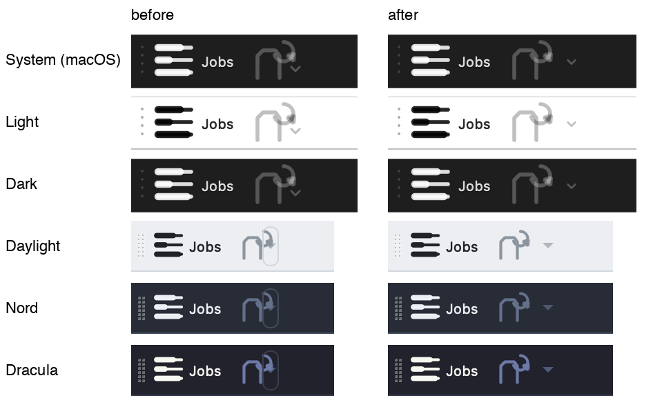
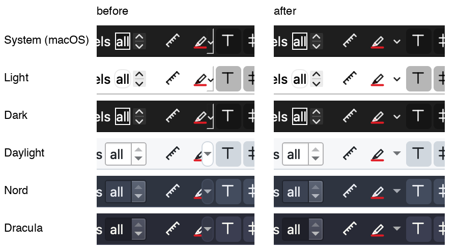
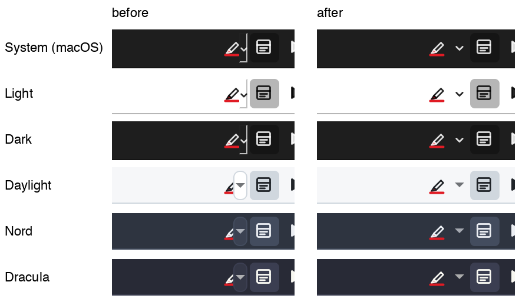

# Bug hunt: the drop-down arrows on the icons

*8 November 2026 - Qucs-S 27.0.8 (`1d154f2`), the Release build with Homebrew's Qt 6.12.0 on macOS
27.2 (Apple silicon). Fixed in the commit that adds this report; its test broken in turn.*

The user's request: "Looks like drop-down buttons cover part of the button image. I'm seeing this in
the buttons in the toolbar, as well as pen marker buttons in the layout viewer and pptx viewer. Can
you add some right padding to the images of the button or make the button wider so that the
drop-down arrow doesn't cover the image of the button?" Their screenshot: the Running Jobs toolbar,
Reopen Closed Tab's small triangle on the right edge of its icon.

## Summary

| | Finding | Where | Fixed |
|---|---|---|---|
| **F1** | A tool button with a menu beside it (`MenuButtonPopup`) styled by a style sheet that gives it a border or padding: Qt keeps no width for the arrow, lays the icon across the whole button and draws the arrow's part over its right edge - 7 of the pen's 16 pixels, at every icon size and ratio | the pens of the layout and PPTX viewers (their bars' sheets), in every theme | `apptheme::menuButtonRules()` in each viewer's sheet |
| **F2** | The same for Reopen Closed Tab: under the designed themes (the application's sheet), and on macOS under every theme - the main window's own sheet, macOS only, `QToolButton { padding: 0px; }`, outweighs the application's and puts every one of its tool buttons through the style-sheet style | Running Jobs toolbar | the rules in both sheets; under the platform themes on macOS a transparent frame of its own |
| **F3** | Reopen Closed Tab not auto-raised as the toolbar's own buttons are: its arrow's part drawn as a raised push button at rest (the box round the arrow in the user's screenshot) | Running Jobs toolbar | `setAutoRaise(true)`, the popup mode set before the action (a sheet's property selector reads it when the button is first styled) |

The other tool buttons with a menu - the viewers' ⋯ menus, the File Browser's, the PDF and picture
viewers', the Claude dock's header - are `InstantPopup` with their indicator hidden (`image: none`)
and were right; the Claude dock's git bar's Create PR keeps its own room (`padding-right: 24px`, a
`::menu-button` of 18). Nothing else in the toolbars has a menu.

## Pictures

Drawn by Qt on the real Cocoa platform with the real macOS style, at the Retina display's two device
pixels a pixel (`QUCS_TEST_GRAB=<dir> QUCS_TEST_GRAB_PLATFORM=cocoa ctest -R test_menu_buttons`;
the widgets are grabbed, not shown). Reopen Closed Tab is disabled in them (no tab closed yet): grey.

The Running Jobs toolbar's Reopen Closed Tab:

The layout viewer's pen:

The PPTX viewer's pen:

## Why

`QStyleSheetStyle` (Qt 6.12, `qstylesheetstyle.cpp`) on a tool button whose rule has a box
(padding) or a border of its own:

- `pixelMetric(PM_MenuButtonIndicator)` returns 0 for it, so `QToolButton::sizeHint()` adds no
  width for the arrow;
- `drawComplexControl(CC_ToolButton)` draws the label in the rule's whole contents rect, then the
  `::menu-button` at the right of the border (`positionRect`, origin border, the base style's
  indicator width) over it.

Qt's own documentation's answer is the one taken: `QToolButton[popupMode="1"] { padding-right: … }`
with the `::menu-button` as wide. Where the rule has no border of its own (the macOS window's
`padding: 0px` under a platform theme), the style-sheet style lets the platform's style draw the
button with the menu feature taken off - the label across the whole button again - so there the
button gets a transparent border, and the palette's Midlight and Mid when hovered and pressed.

## The fix

- `apptheme::menuButtonRules(selector)`: for the `MenuButtonPopup` buttons the selector picks,
  `padding-right: 16px`, a `::menu-button` 14 wide with no frame of its own (the button's hover and
  pressed colours are round all of it; Fusion's and macOS's frames of the part showed at rest), a
  `::menu-arrow` of 8 by 8 (Fusion's size; the macOS style fills the rect it is given). Buttons
  without such a menu match nothing.
- Used by the designed themes' sheet (`QToolBar QToolButton`), the layout and PPTX viewers' bars,
  and the main window's macOS sheet, now set again at each theme change (`QucsApp::applyLook()`).
- Reopen Closed Tab: auto-raised, its popup mode set first.

## The test

`tests/test_menu_buttons.cpp`. Every tool button with a menu of the main window, the layout, PPTX,
PDF, picture, spreadsheet and ZIP viewers, in every theme and, under System, every style the
platform has (macOS, Windows, Fusion): 15 rows. Each button is painted by its style as its paint
event would, at its size hint, at one and two device pixels a pixel, with the icon of its own size
and 16, 24 and 32, with and without the text beside it:

- what an opaque square icon changes against a transparent one must be all of it, a square, and
  under the designed themes as large as without the menu;
- what the menu adds, the icon and text away, must not lie on the icon or the text;
- the style's `SC_ToolButtonMenu` rect must not meet them either (Qt's macOS style draws no arrow
  offscreen: this is what checks it there);
- a `MenuButtonPopup` button must draw an arrow (but under the macOS style offscreen).

A button without a menu keeps its size (`aButtonWithoutAMenuKeepsItsSize`).

Broken in turn:

| break | rows failing |
|---|---|
| the code before the fix (`1d154f2`'s six files) | 15 of 15, offscreen and on Cocoa |
| `menuButtonRules()` returning nothing | 15 of 15 (14 before the `SC_ToolButtonMenu` check, the macOS row passing) |

## Checked

- `ctest -R test_menu_buttons` offscreen (as CI runs it), and the whole of it on the real Cocoa
  platform (`QUCS_TEST_GRAB_PLATFORM=cocoa`): passing.
- The Release suite, 180 tests (`test_library_export` left out: no `dos2unix` here):
  all 180 passing on the final code (`ctest -j6`). An earlier run at `-j8`, before the last change
  to the rules, had three timing checks fail under the load (`test_large_schematics`'s load,
  `test_claude_code`'s render times, `test_git_integration`'s reload), each passing run alone.
- `test_toolbar_lock`: passing (no toolbar added).
- The four lints of `scripts/ci/`: passing.

## Not verified

- On the screen itself: the pictures are Qt's grabs of the widgets on the Cocoa platform at the
  display's ratio, not screenshots; nothing was hovered or pressed (the hover and pressed colours of
  Reopen Closed Tab under the platform themes on macOS, `palette(midlight)` and `palette(mid)`, are
  unseen).
- Linux and Windows: not built. There the main window has no sheet of its own; the designed themes'
  rule and the viewers' are the same as on macOS, and under the platform themes Reopen Closed Tab is
  the platform style's alone (Fusion's, checked offscreen, has room for its arrow).
- A ratio of 1.5, and the toolbars' icon size: the application offers no setting for it; 16, 21,
  24 and 32 pixels are checked.
- Fusion under the System theme draws Reopen Closed Tab's 21-pixel icon at 19 in its size hint
  (as before): whole, not covered, but smaller; the test lets a platform style do so.
