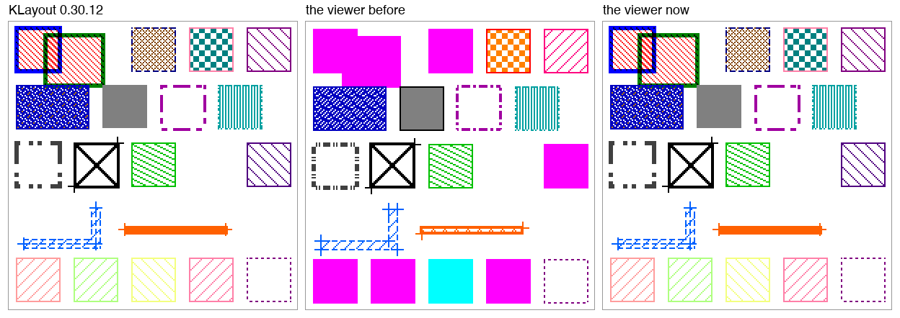
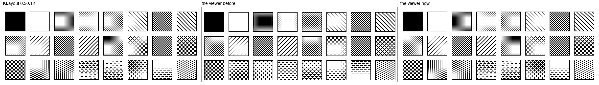

# Bug hunt: the layout viewer's KLayout look, against KLayout itself

*12 November 2026 - Qucs-S on `claude/keen-banach-952b9a` (on main's `f172b12c`), a Release build and
an ASan/UBSan build, macOS 27.2, Qt 6.12, KLayout 0.30.12. The user: "looks like there are some bugs in
the "honor klayout .lyp" feature we addd a while ago. Can you run bug hunts and checks?" Found, fixed
and tested here.*

The feature ([its write-up](../feature_gaps/2026-11-08-klayout-layer-styles.md)) was checked on 8
November against a handful of KLayout's pixels and a model of the rest. This hunt checked it against
KLayout's own pictures and its own layer list, whole:

| # | What | How |
|---|---|---|
| 1 | 34 .lyp files over one layout (boxes overlapping, a slanted polygon, a bent path, a second datatype, layers no file names) | each drawn by KLayout (`klayout -zz`, a `LayoutView` of 200 by 200 pixels, `get_pixels`) and by the viewer's renderer at the same micrometre a pixel, the two compared pixel by pixel. The cases: groups (colours, brightness, patterns, widths, transparency, hiding, sources, nesting), `*/*`, `*/0`, `1/*`, ranges, a layer named twice, tabs, the file's own patterns and line styles by `<order>`, width 0, dashed frames 1 to 3 wide, crosses and marks on boxes, polygons and paths, layers not valid, dark canvas, `#aarrggbb` and named colours |
| 2 | What KLayout makes of each file | its layer list after reading it, through its scripting API: each row's source, its own and its effective colours, brightness, pattern, width, visibility, transparency (`source(true)`, `fill_color(true)`, `eff_fill_color(true)` ...) |
| 3 | Probes | the 47 built-in patterns on 47 boxes at 1 and 2 pixels a micrometre; one 32 by 32 pattern of the file's own on 47 rows (the per-row shift); the 8 line styles and a one-pixel dash on frames 1 to 4 wide; default colours by layer and datatype; edges at whole and half pixels |
| 4 | The GPU | `theGpuDrawsKLayoutsLookAsTheCpu` on Metal, on the user's screen (a window for a second), now on two layouts |

Before this hunt the plainest case - eight layers each given a colour and a built-in pattern - differed
from KLayout in 13,686 of 40,000 pixels; every one of the 34 cases differed in 9,000 to 20,000. Now each
differs in 77 to 101, all of them on the slanted polygon's edges (N1), except the named colours (N2).

*The test's "rules" layout (`tests/data/klayout_look/rules.lyp`): groups, `*/*` and `*/0` entries, a
layer named twice, defaults, width 0, dashed and wide frames, a crossed and marked box, two paths, a
hidden layer, layers named by none. Before: the `*/0` entry painted every layer of datatype 0, the
`*/*` one 21/3; the group's settings lost to its members'; the paths without their spines.*

## Summary

| | Finding | Where | Fixed |
|---|---|---|---|
| **K1** | 36 of the 47 built-in patterns drawn wrong: 26 of them at the wrong phase (I5, I9, the hatches, the lines, grids), 10 a different shape (the bubbles, pyramids, plus, minus, sine, the two "unordered", 22.5° cross-hatched, the thick grids). The feature's write-up said the hatches came out pixel-identical; it had checked I2, I4, I9 and C0 | `layerstyles.cpp` `kStipples` | yes: each tile read from KLayout's picture of it |
| **K2** | KLayout draws each row of its list a pattern row lower than the row above (32 rows round), so two layers of one pattern overlapping do not hide each other; not done | renderer, GPU | yes: `stippleOffset` |
| **K3** | Everything a row lower than KLayout, and a column left at half pixels. KLayout puts a point on a pixel first - round(x), the row above round(y) - and draws from there. Listed on 8 November as a difference that remains | renderer, `layout_shape.vert` | yes: points snapped to KLayout's pixels |
| **K4** | A fill one column narrower: KLayout fills a row from its left edge's column to its right edge's, that one too (seen under a dashed frame or with none) | renderer, GPU | yes: drawn twice, a pixel apart |
| **K5** | A colour not given was KLayout's default for the layer's place in the list; KLayout's is by its layer number, (layer − 1) mod 36, whatever the datatype. The default pattern goes by the place among the list's layers, groups not counted (not by rows); layers no file names come after, in order of layer and datatype. (The 8 November measurement used layers 1 to 80 in order: place and number agreed) | `planLayers` | yes |
| **K6** | Groups backwards. KLayout: what a group sets wins over its members' own (the outermost group over all), brightness adds up, transparent, crossed and marked where either is, valid and visible where both are, the wider frame. The viewer let a member's own win | `resolve` | yes |
| **K7** | A member's source with a wildcard not filled from its group's: `*/5` in a group of `1/*` is 1/5 to KLayout | `withinGroup` | yes |
| **K8** | Wildcards. An entry of `*/*` (or with no source) painted every layer; KLayout drops it and lists every layer in its own default instead. `*/0` and `1/*` painted every layer they match; KLayout draws nothing for them (they are not any one layer). `2-4/0` read as a range; KLayout has no ranges (it binds 2/0) | `planLayers`, `parseLayerSource` | yes |
| **K9** | A layer named twice drawn by its last entry only; KLayout draws every entry naming it, each in its place | renderer, GPU | yes: `LayerStyle::passes`, `drawingPasses` |
| **K10** | A file of tabs: its first read; KLayout shows the last | `parse` | yes |
| **K11** | 6 of the 8 built-in line styles at the wrong phase (dashed is `**..**` from the screen's left, not `****..`) | `kLines` | yes: read from KLayout's pictures |
| **K12** | Wide and dashed frames. KLayout widens a pixel-wide line on a W by W square, an even width's extra pixel right or below; a line runs on past its ends by (W−1)/2 (a solid one by W/2 after: square corners); a dash's pixel is W long, counted floor((x + (W−1)/2) / W) from the left or floor((b + W/2) / W) from the bottom. The viewer drew a pen W wide, dashes a pixel long, a 3-wide frame's corners and a 2-wide cross's diagonals wrong | renderer (`klayoutEdge`), `layout_line.*` | yes |
| **K13** | Width 0 drew a frame a pixel wide; KLayout draws none | renderer, GPU | yes |
| **K14** | A path's spine not drawn: KLayout draws it as the path's frame (as wide, as dashed); marks on a path's outline corners, where KLayout marks its spine's points | renderer, GPU flattening | yes |
| **K15** | A transparent layer's frame not mixed with its own fill; KLayout mixes each with what is under it, the fill too (a blue frame over its red fill, ANDed: #00001a) | renderer | yes: fills, then lines, each mixed |
| **K16** | A crossed box's diagonals with square caps past its corners | renderer | yes |
| **K17** | GPU: dashes lost bits. The shader read a bit as `floor(byte / exp2(n))`; Metal's `exp2(1.0)` is a hair over 2, so 14 / 2 floored to 6, and every bit whose quotient came out whole was dropped (I3's and I7's last bits, any file's own style past 8 pixels). There since the feature; the GPU test's tolerance of 1% let it pass at 0.8% | `layout_line.frag` | yes: integer shifts; the tolerance now 0.1% |
| N1 | A slanted edge: KLayout's line and its Qt's differ by a pixel here and there - about 1 pixel in 40 along the test's triangle | renderer | no |
| N2 | Named colours (`red`): KLayout reads only hex digits (it made `red` #00eedd); the viewer reads the name | `colourOf` | no: a file KLayout writes has hex |
| N3 | A layer named twice has one row in the layer list (its last entry's); KLayout's list has two | `planLayers` rows | no |
| N4 | A wide dashed slanted edge: each of its W² copies counts its own dashes | renderer | no: an approximation |

## Each in turn

**K1, K2: the patterns.** The 47 tiles are now KLayout's own, read from its picture of 47 boxes, each
pattern on one (a script found each tile's period and phase from the screen's lower left, checked at
1 and 2 pixels a micrometre), with K2's shift undone (each was drawn at its own row of the list).
`theKLayoutLookIsKLayoutsOwnPicture` draws the same boxes from the same file and compares the picture
with KLayout's: equal, every pixel.

**K3, K4: where an edge is.** KLayout's picture of a box from (4, 52) to (44, 92) µm on a picture 200
pixels high, at 2 pixels a µm: its frame on columns 8 and 88, rows 15 and 95; its fill (no frame drawn,
width 0) columns 8 to 88, rows 15 to 94. A box at (60.25, 10.25)-(90.75, 40.75): columns 121 to 182.
So a point is on column round(x) and on the row above round(y) counted from the top; a fill takes its
left edge's column to its right edge's, its top edge's row to the one above its bottom's. The renderer
now snaps each point to that pixel and draws from its corner (fills: Qt fills the pixels whose top left
corners are in, twice a pixel apart) or its middle (lines, a 256th of a pixel right and up, off Qt's ties);
the GPU's shape shader does the same in device pixels.

**K5 to K10: what the file means.** Read from KLayout's layer list of each case, after loading the file
as its default does (other layers added). For the test's plan (`aLypPlansTheLayers`), KLayout's own
values: 1/0 named by a member of a group and again later is two rows - the member hidden and of the
group's fill (#007f00, the group's #00ff00 darkened by its −128, over the member's own blue), the later
one yellow and shown; M2's frame #c080ff, KLayout's default for layer 2; 3/0, 5/0, 10/0 #9580ff, #80a8ff,
#0000ff (layers 3, 5, 10) with patterns I9, I5, I9 (the 5th, 6th, 7th layers of the list), rows 5 to 7.
Every value in that test is now one KLayout showed.

**K11 to K16: frames.** A one-pixel dash (`*.......`, a file's own) on frames 1 to 4 wide showed the rule
in K12: at width 2 its dash pixels 32-33, 48-49 (a period of 16); at 3, 47-49 and 71-73; at 4, 31-34 and
63-66; up a frame at 2, b 15 and 16, at 3, b 23 to 25. Edges along x and y are drawn as those runs of
pixels (`klayoutEdge`, `fillRect` a run); slanted ones as a pixel-wide line at each place of the square.
The GPU's thick-line shader builds its quad on the same pixels' edges and counts the same dashes.

**K17: the GPU's dashes.** Found by the GPU test once it drew the rules layout too: 721 of 93,832 pixels
differed, the dashed frames' bits 9 and 10 wrong. The shader now takes the bit as `(byte >> n) & 1`; Metal
draws that layout within 1 pixel of the CPU's, the sample within 2.

## Tests

- `theKLayoutLookIsKLayoutsOwnPicture` (new): `tests/data/klayout_look/` - three layouts, their .lyp files
  and KLayout's pictures of them (`klayout_look.py` wrote them; KLayout 0.30.12 drew them): the sample of
  the other tests on white and on black, the 47 patterns, the rules layout on white and on black. Drawn by
  the renderer, each must equal KLayout's to the pixel (0 of 10,000, 160,000 and 40,000 differ).
- `aLypPlansTheLayers`, `aLypsSourcesNameTheLayers`, `aLypIsReadWhole`, `klayoutsPatternsLineStylesAndBrightness`:
  their expectations now KLayout's (K5 to K11), each value from its layer list or its pictures.
- `aLypIsDrawnAsKLayoutDrawsIt`: what the pictures cannot show - Retina's 2 by 2 pattern pixels with K2's
  shift, a transparent layer on a transparent export, blinking and scrolling.
- `theGpuDrawsKLayoutsLookAsTheCpu`: also the rules layout; 0.1% at most.

Deliberate breaks, each caught: the place shift left out (K2: the picture test, 1,214 pixels of the
sample, and the plan test), the member's colour over its group's (K6: 708 pixels of the rules, and the
plan test), the fill drawn once (K4: 3 pixels of the sample), the default colour by place (K5: 345
pixels, and the plan test), the spines left out (K14: 243 pixels), the shader's float bit (K17: the GPU
test, 529 of 93,569 pixels, over its 0.1%).

## What was not checked

- KLayout's own Retina drawing: the viewer draws a pattern's pixel 2 by 2 device pixels there and a frame
  2 device pixels a pixel of width; KLayout was only asked for pictures (which are not Retina).
- The GPU on Direct3D, Vulkan and OpenGL: Metal only. Transparency there is still the lesser or greater of
  each channel, not AND and OR (as on 8 November).
- KLayout's GUI choices beyond its defaults (other layers added when a .lyp is read, its pattern offset
  switched on), and animation's timing against KLayout's.
- A .lyp of a real process: the cases here are written from the format; no file of the user's was used.

## Licensing

KLayout's source and files are still not in the repository. The 47 pattern tiles and the 8 line styles
are now read from KLayout's pictures, as the 36 default colours and the brightness formula were on 8
November (which the user decided to keep). They are facts of what KLayout draws, written here as tables
of `*` and `.`; their names are the ones KLayout's editor shows.
