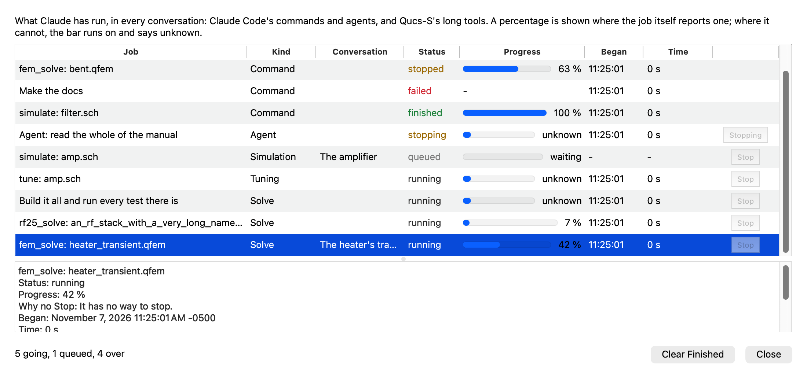

# The Background Jobs window: what Claude has run, how each stands, and Stop

The user (2026-11-07): *"Can you add a new menu item called "Show Background Jobs" to the three dot "..." menu in Claude
chat such that when I click on it, it opens up a new window and shows all the jobs that Claude has already run and with
their status (started, running, queued, stopped, etc.)? Also, add a progress bar with a percentage number to each job
that shows he how much progress each job has made. Also, add a button for me to be able to manually kill/stop a job and
add another button that let's me clear the finished jobs. Also, add MCP api for claude to able to open up this window and
tell me details about the jobs."*

*Apple M2 Ultra, macOS 27.2, Qt 6.12.0 from Homebrew, Claude Code 2.1.311. CI pins Qt 6.10.3 and none of this has run on
it (see "What could not be verified").*

**Now.** ⋯ > Show Background Jobs opens one window, not modal, over the main window, with every conversation's jobs in one
list. Each row has the job's name, kind, conversation, status, a bar with its percentage, when it began, how long it has
taken and a Stop button. Below the list are the whole of the chosen job, and Clear Finished. Claude has
`list_background_jobs`, `get_background_job` and `show_background_jobs`.

**What falls short of the request:**
- **Not every job has a percentage.** Claude Code's own commands and agents never do, nor scripts, nor tuning. The user
  asked for one on every job. The table below says which, and why. Those rows show a bar that runs on and "unknown", with
  the time taken beside them.
- **Not every job has a working Stop.** `tune` and the tools with no stopping point cannot be stopped part way. Their
  button is off, and its tool tip says why.

*(Made-up rows, from the test `pictures`, on this Mac's own display. The dark one is
[beside it](2026-11-07-background-jobs-window/jobs-dark.png).)*

## What can be tracked

**Claude Code says a good deal, and the dock ignored most of it.** Read from the program (`strings`, the schemas it carries)
and then seen over stream-json with Haiku ([task_probe.py](2026-11-07-background-jobs-window/task_probe.py)):

| Message | What it says |
|---|---|
| `task_started` | `task_id`, `tool_use_id`, `description`, `task_type` (`local_bash`, `local_agent`, `local_workflow`, `monitor`...), `is_backgrounded`, `parent_task_id`, `prompt`, `ambient` |
| `task_updated` | `patch.status`: `pending`, `running`, `completed`, `failed`, `killed`, `paused`; `patch.is_backgrounded` |
| `task_progress` | agents: `description`, `usage` (tokens, tool uses, ms), `last_tool_name`, `summary`. **No total, no fraction** |
| `task_notification` | the end: `status` `completed`, `failed` or `stopped`; `summary`, `output_file` |
| control request `stop_task {task_id}` | stops that task |

Seen, against the real program:
- **A foreground command becomes a task about 3 s after it starts.** One that ends sooner is never a job.
- **`stop_task` works on all three kinds tried:** a command in the background, a command Claude is waiting on (exit 137,
  and Claude is told), and an agent Claude is waiting on (the command it was running goes too). In each, `task_notification`
  came with `status: stopped`, and `pgrep` found no process left.
- **A success answer to `stop_task` means nothing by itself.** It answers the same for a task already over. So a job is not
  called stopped on that answer.
- **Claude Code ended with SIGTERM says `stopped` of each task** and leaves no process behind.

**Qucs-S's own tools** all pass through `QucsControl::callToolFor`, the dock's and `--mcp-server`'s alike, so a call has one
place to become a job (`qucscontrol_jobs.cpp`):
- `simulate`, `fem_solve`, `fem_build`, `fem_converge`, `rf25_solve` and `tune` are listed as they begin.
- Any other tool's call is listed once it has taken two seconds, or as soon as the user sends it to the background. A
  batch of edits or a script of a moment is no job. The 2 s is a choice: the 914 calls measured on 3 November had a median
  of 0.14 s.
- `wait_for` runs nothing, so it is listed only if sent to the background. The three new tools are never listed.
- A batch's or a script's inner calls are the one job of the batch or script, not jobs of their own.
- A simulation the user starts is not listed: the window is of what Claude ran.

**A job goes on past its call's answer** where the work does: `simulate` with `background`, or past its timeout, is followed
by its run (`endSimRun`); a solve or build past its timeout, by its document until the document is free.

**The statuses**, each from an event, with a job moving only forward:

| Status | Comes from |
|---|---|
| queued | `patch.status: pending`; a call waiting behind one that runs alone (`a_waiting`) |
| started | `task_started`; a call begun |
| running | `task_progress`, `patch.status: running`; or still not ended a second after it began. A task with no progress messages (a plain command) says nothing between its start and its end, and the program always says when a task ends |
| stopping | Stop pressed: nothing yet says it ended |
| finished | `completed`; a call answered with no error, and `succeeded` true for a simulation |
| failed | `failed`; a call answered with an error, or `succeeded` false |
| stopped | `stopped`, `killed`; a call that ended with an error after a stop was asked, or whose answer says `stopped` |
| lost | Claude Code ended without saying how the task ended, its document was closed, or Qucs-S closed while it ran |

An end, once seen, stays: a late `task_updated` does not change it. An agent resumed under its old id gets a new row.

**Across tabs and conversations.** One list and one window. The Conversation column names the tab and follows a rename. A
tab closed leaves its rows. Its tasks that the program did not report ending go to lost, and Qucs-S's own jobs go on, since
closing a conversation does not stop a solve. Tools mark a job `yours` when it is the calling conversation's.

**Across a restart.** The list is kept in `background-jobs.json` beside the kept conversations, at most 500 rows, written a
second after any status changes and at quit. A job running when Qucs-S closed comes back lost. Cleared rows stay cleared.
`--mcp-server` neither reads nor writes the file. Two windows of Qucs-S open at once share it, and the last to write wins.

## The percentage, kind by kind

Never worked out from the time taken. A value is taken only from what does the work, and it is what that work's own bar
shows. Nought counts as nothing said, since a bar at 0 for a whole run would claim the run has done nothing.

| Kind | Percentage | Where from, or why not |
|---|---|---|
| Claude Code's commands, agents, workflows, monitors | **none while running** | The protocol has no total. An agent's tokens and tool uses are shown beside it, as words. 100 % when it completes |
| `run_script` | **none** | A script may do anything: nothing knows how much is left |
| `tune` | **none** | It runs until the targets are met or its most runs are used, and how many is not known. "Runs of at most N" would not be a percentage of the work |
| Other tools past two seconds (`read_pdf`, `build_verilog_a`, `git_clone`...) | **none** | They do not say |
| `simulate`, ngspice | some runs | Its own `%42.00` lines. **Only where it prints them**, which is the transient; a DC or AC run says none and stays unknown |
| `simulate`, Xyce | some runs | Its "Percent complete" lines |
| `simulate`, Qucsator | yes | Its own progress marks (`SimProgress`) |
| `simulate`, an optimization | yes | The optimizer's generations of its total (`Optimizer::progress`) |
| `fem_solve`, `fem_build` (2D and 3D) | yes | The model's own fraction, as its tab's bar. A step that says nothing leaves it where it was |
| `fem_converge` | yes | Meshes done of the most it may use, plus the model's fraction of the one under way. It ends sooner if it converges early |
| `rf25_solve` | partly | Full-wave: frequencies solved of those to solve. Quasi-static: **of the step named, not of the whole**, and it starts again at the next step; unknown while a matrix is filled and factored. The row's text names the step |
| `batch` | yes | Calls done of all its calls. A call is one count however long it takes |

A job that ended without saying shows no bar and "-", not an empty bar. Stopped part way, it keeps how far it got.
`list_background_jobs` gives `percent: null` with `why_no_percent`.

## Stop

**The status changes only on evidence.** Pressed, the row says stopping and the button is off. Then:
- **The job ends:** stopped, or failed or finished if that is how it ended. A job that ended well before the stop reached it
  says finished, and says so in its text.
- **Nothing is heard for 20 s:** back to what it was, "Asked to stop; it has not stopped yet", and the button on again.
- **The program refuses:** back to what it was, with its words.

| Job | Stopped by | Tried |
|---|---|---|
| Claude Code's command, agent | `stop_task` by its own id, in the background or waited on | **The real program**, as above |
| Workflow, monitor, remote agent | `stop_task` too, which the program takes for any task | **Not tried** |
| `fem_solve`, `fem_build`, `fem_converge` | as `fem_stop` and the tab's Cancel; at its next check | Test, with no fake: a real long transient, in its call and past its timeout |
| `rf25_solve` | as `rf25_stop` | **Not run**: no long RF 2.5D solve is in these suites. The stop is the one its tool's cancellation uses |
| `simulate` | as `stop_simulation` | Test with a slow fake simulator: foreground, background, past its timeout |
| `batch`, `run_script` | the call under way, and none after | `batch` in the test; `run_script` by the cancellation test of 3 November, which uses the same stopper |
| A call still queued | taken out, answered "Stopped by the user before it began" | Test |
| `wait_for`, if sent to the background | the wait ended | Test |
| **`tune`** | **no Stop** | Its runs begin from the event loop with no stopper. Its tool tip says Simulation > Stop Simulation stops the run it is at, which ends it |
| **Any other tool** with no stopper | **no Stop** | The button is off, with why. They have nowhere to stop |

**Which call.** `QucsControl::cancelCall` finds a call by conversation and tool, so two `fem_solve` of one conversation would
stop together. A call's `Running` now carries its job's number, so Stop finds that call alone
(`stopStopsThatJobAlone`, and two real solves in `theLongToolsAreJobs`). A cancellation from the client is as before.

The user did not ask for a tool that stops jobs, so there is none. Claude tells the user, and the user presses Stop. It would
be one small tool on `Registry::stop` if wanted.

## The window

- **Not a dialog:** a plain `QWidget` with `Qt::Window`. `QucsControl::openDialog()` takes any open `QDialog` for one a tool
  must wait on, and would have blocked every tool while it was open.
- **One at a time:** asked for again, it comes forward. Its parent is the main window, not a floating dock.
- **Long names:** the name column stretches and the view cuts its text; the tool tip and the panel below have it whole. A
  row's text does not reach the window's least size (`aLongNameDoesNotWidenTheWindow`). Names are cut to 300 characters
  and details to 8,000 on the way in.
- **Themes:** the palette's colours, with the status words in the dock's own greens, reds and ambers for each paper; checked
  by eye in the pictures. It follows a change of theme live.
- **A row's widgets:** a table view shows a cell's widget again each time it lays itself out, which brought Stop back on
  rows over (seen in the first picture; no test had failed). The button now sits inside its cell.

## The tools

Named as their kin are (`get_*`, `show_*`), in every table a tool has: the schema, the action, the short description, search
words, `whileADialogWaits`. `list_background_jobs` and `get_background_job` only look and are used unasked.
`show_background_jobs` shows, and is allowed in auto mode as `show_layout` is.

- `list_background_jobs {status?, mine?, max?}`: the newest first, 50 unless told, each as above; `going` and `over` counts.
- `get_background_job {id}`: the same with `detail` (the whole command, prompt or arguments), `output_file`, `task_id`,
  `parent_task`.
- `show_background_jobs {}`: opens the window and answers with the list.

**Under `--mcp-server`:** no window can show, so `shown` is false and the list is still given. Its `note` says what the server
cannot know: only Qucs-S's tools called of it, in this run. The commands and agents of the Claude Code calling it never
pass through it.

## Tests

`test_claude_jobs` (new, 17 tests and 2 opt-in, a fake claude program):

| Test | What it holds |
|---|---|
| `aTasksStatusIsWhatTheProgramSays` | each status from its event; its command from the tool use; an end that stays; a resumed agent's new row; `ambient` left out; an end of a task never named |
| `aTaskBegunAndNotEndedRuns` | started moves on, on its own |
| `aRealPercentageAndAnUnknownOne` | a real value on the bar; a busy bar and "unknown" with why; live; held within 0 to 100; ended without saying; stopped part way |
| `stopAsksAndWaitsForTheEnd` | a click writes `stop_task` with the task's id, and only the program's end says stopped |
| `aStopWithNoEndIsNotAStop` | the program's success alone leaves it not stopped; past the patience, as it was, Stop on |
| `aStopRefusedIsSaid`, `aStopThatCannotBeAskedGoesNowhere` | its words said, nothing restarted; no program to ask; a job with no way to stop |
| `stopStopsThatJobAlone` | the other is not asked; asked twice, asked once |
| `theProgramEndingLosesItsTasks` | lost, not stopped; a session gone too |
| `clearFinishedLeavesWhatRuns` | going, queued and stopping stay; the button off with nothing over |
| `theMenuOpensOneWindow`, `aLongNameDoesNotWidenTheWindow` | as named |
| `theTabsShareOneList` | the same task id in two tabs makes two jobs; names; stopping one; a tab closed |
| `whatEndedIsKept`, `aDamagedFileIsNoList` | a restart; garbage; a pipe where the file is (it would hang, as 4a7186b's did) |
| `theListHasAnEnd`, `damagedEvents` | at most 500, those over first; 4,000 damaged messages with the window open |

`test_mcp_server`:
- **`theLongToolsAreJobs`** uses the real control and a real solve:
  - a model's transient reports its own percentage, the window lists it, and Stop stops it;
  - the same past its call's timeout;
  - a batch counted, and a call queued behind it stopped alone;
  - a simulation with a fake simulator that prints `%42.00`, in the foreground, in the background and past its timeout;
  - `wait_for` not listed, and listed once sent to the background;
  - two solves of one conversation, one stopped.
- **`theProgramServesOverStdio`** has both tools' answers under `--mcp-server`.

`test_claude_fuzz` now has `task_progress`, damaged `patch`, `usage`, `summary` and `output_file` in its stream, and the dock's
fuzz opens the window, stops a job and clears, and checks the window lists what the list holds.

No test asserts on a time taken. Waits are `QTRY` with long bounds, for the reason `3972088` and `c6c7eb2` give.

**Against Claude Code itself** (opt in: `QUCS_JOBS_REAL=1 test_claude_jobs againstClaudeCodeItself`; uses a few tokens). Haiku
ran `perl -e 'sleep 618'` in the background. The job came as a command with that command as its detail, Stop on, percentage
unknown. A click on Stop: stopped a second later, and `pgrep` found no process.

**Breaks.** [breaks.py](2026-11-07-background-jobs-window/breaks.py) undoes each piece, one at a time, and builds and runs the
tests. All 38 are caught (36 in one run; two added after it, and those and the survivor run again):
- **One survived at first:** a window made too wide from the start, because the test compared the window with itself before
  a long name came. The test now has an absolute bound, and a long text below the list is checked too.
- **That sharpening was wrong at first:** the new check was stricter than it should be (word wrap lets the least width
  shrink, and it demanded the same). The first retry said "caught" for every break, with that one test failing on clean
  code. It was seen because a server break should not have failed a window test. Fixed and run again.

**The results:**

As QtTest counts them, its `initTestCase` and `cleanupTestCase` among them:

| | Release | ASan + UBSan (Debug) |
|---|---|---|
| `test_claude_jobs` | 19 pass, 2 skip (opt in) | 19 pass, 2 skip |
| `test_mcp_server` | 21 pass | 21 pass |
| `test_claude_code` | 90 pass, 1 skip | 90 pass, 1 skip, 4 runs of 4 at a low load |
| `test_claude_fuzz` (short pass) | 4 pass | 4 pass |
| `test_qucs_control` | 218 pass, 1 skip | not run |
| the four lints in `scripts/ci/` | green (146 tools checked) | |

Also: `test_claude_jobs` whole on the Cocoa platform, 20 pass and the real-program test skipped; and that test by itself,
with the real program, passes.

**Two failures, seen only with the machine loaded** (load average 84, other sessions building). Neither came back once it
was quiet, and neither is a test of this feature:
- **`aLargeSchematicIsArrangedInTime`** (`test_qucs_control`, Release, once): a timing ratio, 43 ms against 564 ms. It passed
  in three runs alone, and in the full run after.
- **`aPinnedConversationsToolsAreGivenItsDocument`** (`test_claude_code`, ASan, twice at that load): its fake program did
  not ask within 10 s. Passing alone, and with every test before it. Its cause was not found. No test ran on a build
  without this feature to compare, so that it predates this work is inferred from what it exercises, not shown.

**The long fuzz** (ASan + UBSan, 240 s for each of the panel and the dock, seed 20261107, and 120 s of the dock, seed 7): no
report from a sanitizer, and the window always listed what the list held. One finding, in the first run only, at that same
load: the dock's written log held a line of a tool's long answer that was not whole JSON. The same seed ran clean when
quiet, though it does not replay the same way, since the fuzz's timing depends on the load. A session killed while its
pipe is full would leave such a line, and the fuzz kills sessions, but **that is a guess**: the fuzz's folder was gone
before it could be read. It was no line of this feature's (`stop_task` lines are short).

## What could not be verified

- **Qt 6.10.3.** Everything ran on Homebrew's 6.12.0. Nothing new is used in the feature itself; the opt-in `pictures` test
  uses `QStyleHints::setColorScheme`, there since 6.8.
- **The window on a real display: by the tests and pictures, not by hand.** `pictures` and the whole of `test_claude_jobs` ran
  on this Mac's own Cocoa display, the windows really shown and clicks sent to them. No person, and no driver, opened the
  built app and clicked through its real ⋯ menu: the test triggers the menu's action on a panel alone. It has not been seen
  on Windows or Linux.
- **Stop on workflows, monitors and remote agents.** Not tried against the real program. If it refuses, the row says so.
- **`rf25_solve`'s percentage and Stop on a real long solve.** Neither is in these suites; both read what its tab's own bar
  and Stop use.
- **The percentages of Xyce, Qucsator and an optimization in a real run.** They come from the bars those runs already drive.
  Only ngspice's form was tested, and with a fake simulator printing it.
- **Claude Code past 2.1.311.** The events are read defensively, and an older program with none of them lists nothing of its
  own. `stop_task` refused is said.
- **The cost.** Every tool call now does a little more (a map entry, a timer started). The MCP speed benchmark of 3 November
  was not run again. The window's own update was not measured with 500 rows going.

## Considered, not done

- **A percentage from elapsed time, or from a timeout.** It would be invented.
- **Parsing a command's output for percentages** (`make`, `pytest`). It would be right sometimes and wrong without saying.
- **`background_tasks_changed`,** the program's level signal. Its order against the other messages is unspecified, and the
  edges plus "the program ended" cover it.
- **A Stop for `tune`.** Its two modes each hold a long chain of callbacks, and it deserves a change of its own. It would also
  give `cancelCall` a way to reach it, which it has not today.
- **A tool that stops jobs.** Not asked for.
