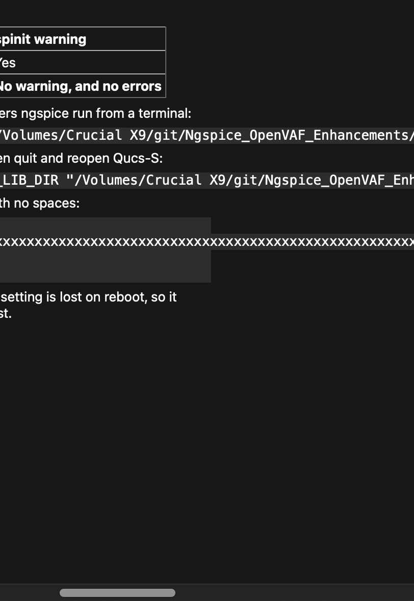
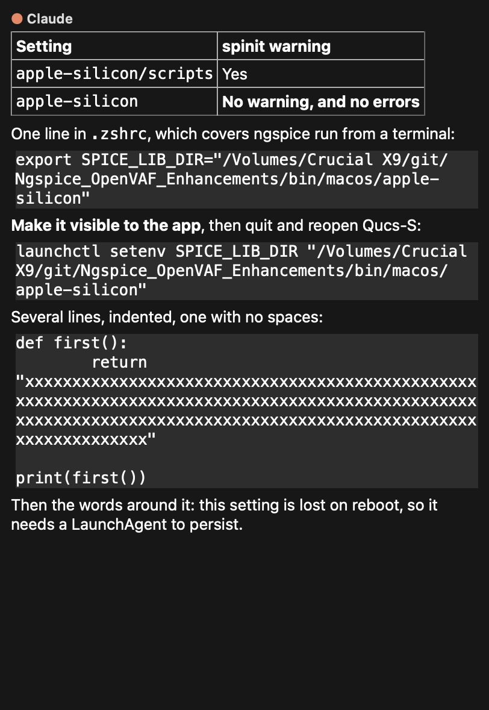
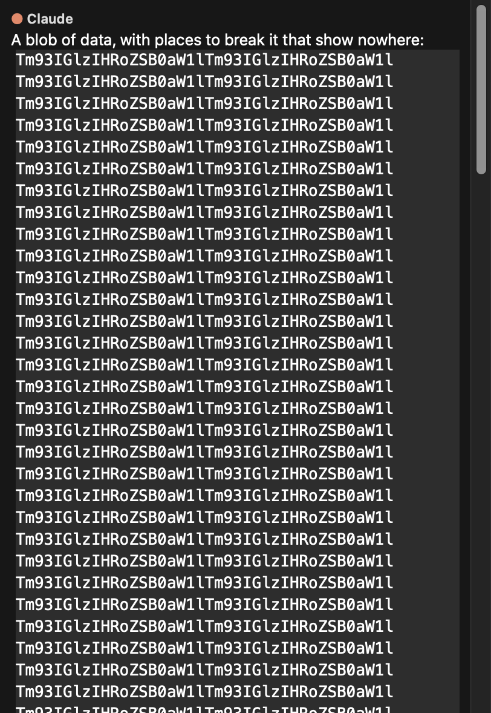
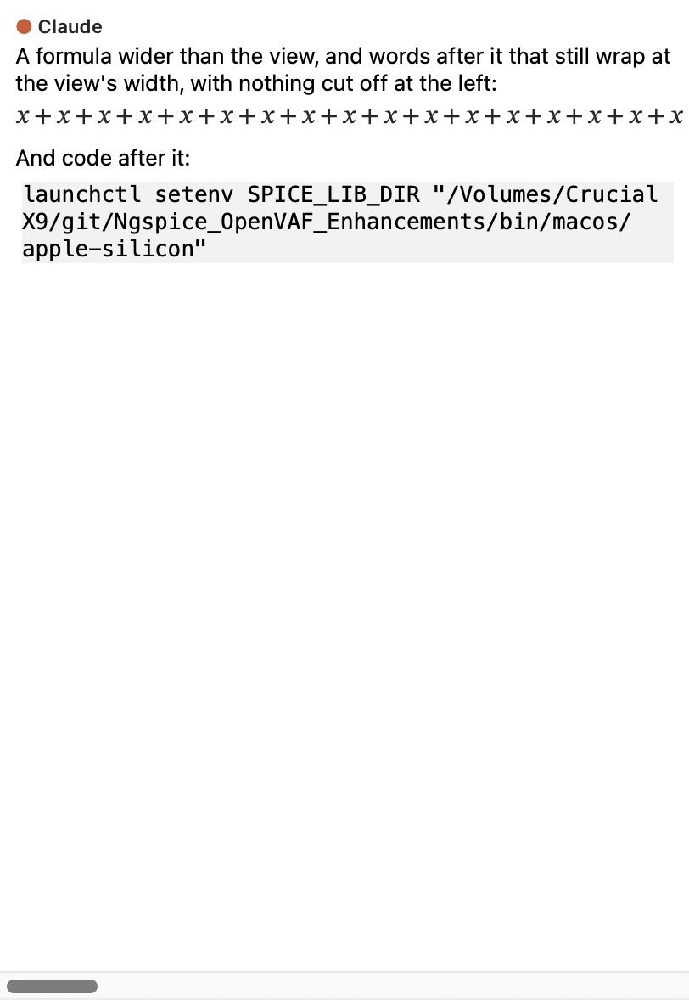

# Long lines of code and long words in the Claude dock

The user's report of 7 November, with a picture of the dock in `27.0.6 (bc0a4b9)`, Qt 6.12.0: "Looks like code blocks
don't correctly wrap in Claude Chat Gui." A reply's one-line block, `launchctl setenv SPICE_LIB_DIR "/Volumes/Archive
01/git/Ngspice_OpenVAF_Enhancements/bin/macos/apple-silicon"`, ran on past the view, and the whole conversation stood
scrolled sideways, the start of every line cut off at the left.

| Before, scrolled along to read the line | After |
|---|---|
|  |  |

## What it was

Qt's Markdown reader marks a fenced code block's lines as not to be broken (`QTextBlockFormat::NonBreakableLines`), and
Qt's text layout then lays each such line out at its whole length. The document is as wide as its longest line, and a
`QTextBrowser` gives the difference to its horizontal scroll bar. There is one scroll bar, for the whole document: to
read the end of one line, the reader moves everything else off to the left. A trackpad's sideways drift does the same.

The transcript's other text was never affected. The view wraps at its own width, breaking a long word where it must, so
only a line marked not to break could overflow.

Measured at a view of 420 px, before the fix:

| In a reply | Sideways range (px) |
|---|---|
| Fenced, the user's line | 296 |
| Fenced, 400 characters with no space | 2208 |
| Fenced, a long path | 1791 |
| Fenced, in a list / in a quote | 336 / 376 |
| Fenced, a short line and 500 spaces after it | 1436 |
| Indented code, the user's line | 0 |
| Inline code, plain text, a heading, with or without spaces | 0 |
| Table of two columns of 150 unbroken characters each | 0 |
| Table of 8 columns | 0 |
| **Table of 40 columns** | 288 |
| **A formula of some 240 characters, displayed or inline** | 2304 |

So inline code and ordinary tables did not behave as fenced code did; only the last two rows are also wide, and those
are wide things, not lines.

## What changed

`ClaudeCodePanel::renderMarkdown` takes the mark off as it shades a block of code, so its lines wrap at the view's width
as all other text does. A wrapped line is still one line of the document: copying, Reply and the conversation's export
all read that one line. What says a block is code stays on it (`BlockCodeFence`, `BlockCodeLanguage`), and
`readSelection` goes by those.

The export to PDF goes through the same code and gains from it: a long line of code used to be cut at the page's edge,
the rest of it not on the paper at all. It now wraps. That was seen on the PDFs, and no test holds it.

## Long words: the freeze wrapping would have spread

Qt looks for a place to break from each new row on to the word's end, so one word costs as the square of its length,
at each layout. Plain text and inline code always had this. Wrapping code would have brought it there too: measured
with code wrapping alone, offscreen, Release, 420 px.

| Characters with no space | Code or plain text, to draw | Inline code, to draw | Code, each step of a resize |
|---|---|---|---|
| 20 000 | 74 ms | 47 ms | 21 ms |
| 100 000 | 1.1 s | 0.6 s | 0.3 s |
| 200 000 | 4.1 s | 2.1 s | 1.0 s |
| 1 000 000, code | 110 s | | |

The composer had the same fault. At 300 000 characters: 5 s to go in, 2.5 s a key.

**In the transcript,** a word over 2000 characters now has a zero-width space every 8 letters
(`qucs_s::markdown::breakLongRuns`). The Markdown tab's preview had solved this on 22 October, with one every 64, and
the code is now shared; the preview's text and behaviour are unchanged apart from Markdown on the clipboard, below. Each
part of the conversation goes through it as it is drawn, whatever the part is: a reply, a prompt, a tool's input or
output, a failure, a note, and the PDF's document. So no later kind of text needs to remember it.

- *Why 2000:* a word up to that costs about a millisecond and fills its rows, breaking at the last letter that fits.
- *Why 8:* a row can only end at a break, so its right edge falls up to 7 letters short. At 64, as the preview has it, rows
  end far from the edge, which the test's check on rows catches (the breaks below).

| Characters with no space | Paragraph, code or quote, to draw | At each step of a resize | In a table |
|---|---|---|---|
| 2 000 | 5 ms | 2 ms | 8 ms |
| 20 000 | 35 ms | 10 ms | 63 ms |
| 100 000 | 0.16 s | 41 ms | 0.31 s |
| 1 000 000 | 1.7 s | 0.4 s | 3.0 s |

So it now goes as the length rather than its square. A million characters in paragraphs of 500 letters, none of them broken,
takes about the same (1.5 s), so that time is the Markdown reader and Qt's layout of that much text, not the word.

**In the composer,** the text is what gets sent, so it can hold no such characters. While it holds a word over 2000
characters its lines break anywhere (`QTextOption::WrapAnywhere`), and it goes back to whole words when that word has
gone. Qt lays text out as it goes in, so the mode is set first on each route that puts in text at once: paste, drop,
Reply, a prompt brought back. Pasted at 1 000 000 characters: 0.8 s to go in, 0.4 s a key, where 300 000 took 5 s and
2.5 s. Sending it is unchanged, and the text is exact.

**A tool's output** is cut at 6000 characters where it is read, as before; its input is not, and now has the breaks.

**The breaks are in nothing read from the view.** Copying and dragging take them out of the plain text, HTML and
Markdown, and drop the zipped OpenDocument form, which cannot be mended and which a program has the others to replace.
Reply and the conversation's exports to Markdown and text did not read them already. Only a selection that touches a
block over 2000 characters is cleaned, so a zero-width space that is the text's own is copied as written, unless the
same selection holds such a block. The preview's Copy took them out of plain text and HTML before, and now out of
Markdown too.

The PDF's text holds them, as the page does. They show nowhere; copying text out of the PDF was not tried.

## What stays as it was

- **Text copied.** A line's plain text on the clipboard is that one line, with no breaks put in it. Its Markdown is
  fenced and whole when the block is copied whole.
- **Indentation.** Leading spaces stay on the line's first row, with no empty shaded row for them (Qt does not break
  there). Rows after the first start at the block's edge: there is no hanging indent.
- **The look.** The fixed-pitch font and the shade, from the first row to the last.
- **Resizing.** The dock re-wraps as it is sized, and a line that fits goes back to one row.
- **The dock's width.** The transcript is a scroll area and asks for no width from its text, so
  `longTextsLeaveTheDockNarrow` and the rest of `test_long_lines` are untouched.

One thing did change on the clipboard. The rich form of a copied code block (`text/html`) is now a `
` with
`white-space: pre-wrap` rather than a `<pre>`; Qt's writer picks by that mark. Its font, shade and spaces are all there,
but a program pasting rich text will no longer see it as preformatted. A selection within one line was already a `
`.

## What can still scroll sideways

A formula wider than the view and a table of many columns (40 here: each column needs a character and its padding).
They cannot be wrapped, so the bar stays, for the whole document, as it is one document. What
changed is what that costs: the words and code around them wrap at the view's width whatever is beside them, and the
view stays at its start, new replies included. The text is only off to the left while the reader has scrolled it there.

Scrolling one wide thing alone would mean giving it a widget of its own or drawing it in a smaller size, and a formula
that wide would not be readable fitted to the view (0.15 of its size here). That is the user's choice to make, and it
was not made here.

## Tested

`aLongCodeLineWrapsAndStaysOneLine` (`test_claude_code`), at the view's real width:

| What | Holds it to |
|---|---|
| The user's line; with a language; among other lines; no spaces; a long path; in a list; in a quote; indented code | No sideways range, every row of the document within the view, more than one row, the block's text the one line, its font, shade and code properties, the copy equal to the line, a fence's Markdown holding it whole |
| Several long lines | Copied with one line break between each and no others |
| Reply | A line alone quoted whole; among others quoted as code |
| Written in pieces | Wrapped at each |
| Indented, trailing spaces | Spaces kept, no row of them alone, no sideways range |
| Resized | One row at 1600 px, the same rows as before back at 420 px, the shade drawn from the first row to the last and not beyond |
| Inline code, plain words, a heading, a table of long words | Still no sideways range |
| A wide formula, a table of 40 columns | Range there, the view at 0 through a new reply, words and code around them within the view |

`aLongWordHasPlacesToBreakWhereverItIs` holds the places, which is what the time comes from, and no elapsed time (commits
`3972088` and `c6c7eb2` show why). Without the fix a run of 30 000 is there, and it fails at once:

| What | Holds it to |
|---|---|
| A word of 30 000 in a paragraph, among words, inline code, fenced and indented code, a heading, a list, a quote, a table, a link | No stretch over 2000 letters without a place to break, no sideways range, the text whole with the breaks out |
| Across two formats | One run still, each part keeping its format |
| Being written | The mark of writing after it, a selection up to the mark kept as more comes |
| A prompt, a tool's input and output, a failure, a notice | As in a reply |
| 2000 and 2001 | The first has no breaks, the second has |
| Rows | Every row but the last within 8 letters of the edge; re-wrapped when sized and back to the same rows |
| Copied | The plain text exactly the word; none in the HTML or Markdown; the zipped form dropped, and kept where there are no breaks; a space of no width of the text's own kept |
| Reply | Quoted whole, none in it |
| The composer | Paste and Reply: the mode set before the text is laid out, seen from the document's own signal; back to whole words when cleared; many short words left alone; the 2001st letter typed changes it |
| A million characters in code | Drawn, wrapped, whole, the words after it still after it. This one would take the test 110 s without the fix |

Three other tests had used a long fenced line and changed with it. `aSelectionStaysAsTheConversationIsDrawn` and
`copyLinkLocationIsOfTheLinkUnderThePointer` wanted a view that scrolls sideways, and now get it from a wide formula.
`aReplyOpensAsItsMarkdownHasIt` looked for the mark and now looks for the fence. `test_claude_fuzz` has a new kind of
reply, a long line of code, and checks after each render that no line is marked not to break and none has a word over
2000 letters without a place to. `test_long_lines` has an opt-in `pictures` (`QUCS_CLAUDE_PICTURES`, `QUCS_CLAUDE_PICTURES_THEME`).

| Run | Result |
|---|---|
| `test_claude_code`, `test_claude_fuzz`, Release, offscreen, Qt 6.12.0, on the final sources | All pass |
| `test_claude_git`, `test_claude_jobs`, `test_long_file_names`, `test_gui_monkey`, `test_long_lines`, `test_qucs_control`, `test_markdown_doc`, Release | All pass |
| `test_claude_code`, `test_claude_fuzz`, `test_long_lines`, ASan and UBSan, on the final sources | All pass, no report, with one failure on the way, below |
| `test_claude_git`, `test_claude_jobs`, `test_markdown_doc`, ASan and UBSan | All pass, no report |
| Both of the new tests on Cocoa, this Mac's display | Pass |
| `test_claude_fuzz`, long | Seeds 1 and 2 at 600 steps and seed 51 for 60 s sanitized, no finding; seed 42 for 60 s in Release, no finding; seed 41 in Release, one finding, below |
| `scripts/ci/check-*.py` | All four pass |
| `2026-11-07-code-lines-wrap/breaks.py` | All 24 caught |

The suites in the second and fourth rows ran just before a last small change: `transcriptText()` had been made to take the
breaks out, `replyReadsParagraphsAndLines` showed that it must give the document's text as it is, and it was put back, the
new test taking them out itself. The breaks ran before it too, with one more for that change.

**The one failure.** `replyFromThePermissionCard` failed once under ASan, its 10 s wait for the fake program's permission
request running out, in a whole-suite run that took 107 s rather than the usual 65 to 73, with other sessions' builds on
the machine (load averages of 30 to 45). It touches nothing here. It then passed 8 times of 8 alone, and the whole suite
passed again under ASan, 92 of 92, no report. That it was the load is the likely reading, not a proven one.

**Broken on purpose.** *Code:* no wrapping at all (the old code, which fails the test's first check on the user's line);
the fence and language taken off too; no shade; a reply's first block missed; the document's wrapping off; wrapping only
between words. *Long words:* no places at all; none in code; from 2001 and from 1999; every 64; one place to a word; a
run counted from the block's start; a block's last run missed; the mark of writing not moved on. *Read from it:* copied
with them in; the text's own spaces taken out too; left in the HTML, the Markdown, the zipped form. *The composer:* as it
was; never back to whole words; told only after the text is in, pasting and quoting.

**Pictures.** The main window, built in `test_long_lines` with its Claude dock, shown on this Mac's own display under
Cocoa, Retina, in the light and dark themes as the app sets them at its start, the user's line in it. They are grabs
from inside the process.

## What the fuzz found, not from this

Seeds 21 and 41, timed, at about steps 7350 and 15000: "drawn whole, the selection went from ... to ...". Each pair differs
by one thing, the ` ▍` mark of a reply being written at the selection's very end (seen by printing them; seed 41's start
inside a broken word, and those letters are the same). `render()` keeps a selection without that mark on purpose ("more
of the reply comes in its place"), and the fuzz's check does not allow for it, so the fault reads as the check's own. It
takes a long seed to reach; the default pass does not. Not changed here. (A long run says nothing past Qt Test's 2000
messages: `-maxwarnings 0` shows them.)

## What could not be verified

- **The packaged app, seen by eye.** `screencapture` is refused in this session, so no picture of the screen itself was
  possible, and the app was built but not driven. The pictures are of the same main window and panel code, from a test
  binary. To see it: open the built app, or ask Claude for a long one-line code block.
- **Qt 6.10.3,** which CI and the releases use. Everything ran on 6.12.0. Nothing new is used: taking a property off a
  block format is as old as Qt 4. Commit `4a7186b` records a difference between the two in this same format (6.12 sets
  the mark to false on plain paragraphs), and the fix does not depend on it, as it only removes the mark.
- **Linux and Windows.** Not run on them.

## Not done

- **The Markdown tab's preview** leaves code unwrapped, as it says it does, so a long line of code there still scrolls
  it. A document may want other behaviour than a conversation.
- **Text set straight into the composer's own widget** by a route not listed above: the slash commands put in a short
  name, so none was found. One added later and given a long word would lay it out slowly once, and be right from then on.
- **A cost still as the length.** A million characters is 1.7 s to draw and 0.4 s at each step of a resize, and 0.4 s a
  key in the composer. Better than a freeze, not free.
- **A hanging indent** for a wrapped line's later rows.
- **Theme switched with the window up.** The first pictures changed the theme with the window already shown, this Mac
  in dark, and came out with black text on a dark dock. Set at the start, as above, both themes are right. A session of
  its own found that fault real on View > Theme and fixed it, in `19a312b` on `claude/youthful-sammet-2f5cc6`, not merged.
