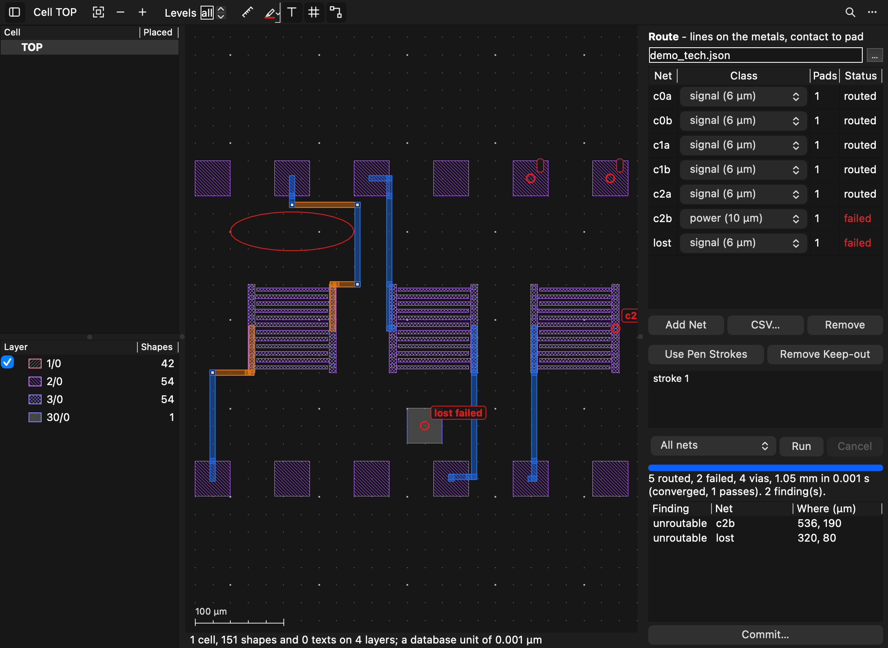

# The layout viewer's metal router: Manhattan lines from contacts to pads, routed, checked and committed

The user (2026-11-07): *"Implement this in a new session: 'qucs-reviews/LayoutViewer/Layout_Viewer_DC_Router_Proposal.md'"*
— an interactive two-metal router for DC and low-speed interconnect (bias, control, monitor, heater lines) from device
contacts to bond pads.

*Apple M2 Ultra (24 cores, 64 GB), macOS 27.2, Qt 6.12.0 from Homebrew. CI pins Qt 6.10.3 and none of this has run on it
(see "What could not be verified").*

**Settled with the user before it was built:**
- **The router the review notes describe** (`router_engine.cpp`, builds `336f432`, `41db994`, `2aeedd3`, driven through
  `route_*` tools) is not in this repository, its history or any other clone, Spotlight or session on this Mac. The user
  chose to write a new one, with `2026-11-05-metal-router-feedback.md` and `2026-11-06-metal-router-improvements.md` as
  the list of what worked and what went wrong.
- **Native C++ in the app** (the proposal's section 7 recommends an external scripted engine first): chosen for
  interactive speed, one engine for the panel, the tools and `--mcp-server`, and no Python packaging.
- **The technology file is JSON** (the proposal says YAML, which Qt cannot read; a YAML library would be a new third-party
  dependency).

**Now.** A layout tab's toolbar has **Route**, which opens a panel beside the layout. Claude has six tools:
`route_setup`, `route_run`, `route_report`, `route_commit`, `route_stop` and `route_assign_pads`. They work with a window
or without one (`--mcp-server`). The panel and the tools share one job for each layout file, kept beside it as
`<layout>.route.json`. Routes are written into the GDS (or OASIS) as a cell of their own, placed once in the cell
routed, so the next commit replaces them cleanly.

**What falls short of the proposal** (each in its own section below):
- No **foundry DRC**. The check covers opens, shorts and spacing on the drawn shapes, foreign pads, obstacles,
  keep-outs and cut spacing. It does not check widths, notches, density, antennas or enclosure rules.
- **Crowded chips do not always finish.** The 200-net chip at 20/10 µm with random pads ends with 179 of 200 routed on a
  2 µm grid (194 on a 4 µm one), where the reviewed router routed all 200 (with 14 sliver findings). The rest are
  reported, each with its reason and place, rather than routed through each other.
- Matched lengths, resistance targets and current density are not done. There is no global (coarse) routing stage
  either, and no `qucs-s --route-job` command line.
- The panel ran on this Mac's own display through a test (pictures below), not by a person's hand, and not on Windows
  or Linux.



*(The test `pictures` on this Mac's display: three two-metal capacitors, twelve pads, a pen ring made a keep-out, and a
net with nowhere to go, marked in red.)*

## How it routes

The engine is `qucs/layoutrouter/` (Qt Core and gdstk only, a library of its own so its tests build without the
application). It lays a lattice over the area, one plane a metal, a cell every `grid` µm. A line is a walk of its centre
over the cells, drawn as squares of its width at each one. A straight run is therefore a rectangle carried half a width
past its ends, and corners are full. The shapes drawn and the cells tested are the same thing.

- **What is there.** Every shape on the technology's metals, cut layers and obstacle layers is read from the cell routed,
  through its hierarchy, and cut into boxes (exact for Manhattan shapes; beside a slanted edge, slabs of half a pitch
  that cover it). Each box, grown by half a line and its clearance with rounded corners, is rasterised once into **one bit
  a cell for each size of square**: a class's line, or a via's landing on a metal. One bit then says whether a square of
  that size may sit there.
- **A net's own metal.** A net's own terminals, and the metal joined to them (through their own vias too), would block it
  like anything else. So near its own metal each blocked cell is tested again, exactly, for that net alone: **only the
  part of the square outside its own metal must keep clear**. This is a quadtree of the square down to 0.05 µm. It is
  what the first-use note's item 1 asked for: a 10 µm line from the middle of a 12 µm bus, with foreign finger tips 2 µm
  away, now routes (`aLineLeavesItsOwnBusPastForeignFingers`).
- **Search.** A* for each net. The costs are length, a bend, a via, and a step against a metal's preferred direction
  (`direction` h or v, `wrong_way` cost: the improvements note's "preferred directions"). The heuristic is the Manhattan
  distance to the target's point plus a hair (1/1024), so that of two equal cells the one nearer the target goes first.
  The search window is the net's terminals' box, grown; a net contested in a pass gets its window doubled in the next.
  The queue is a radix heap. The binary heap it replaced took two thirds of the time.
- **Negotiation (PathFinder).** Other nets' lines are stamped into counts a cell, one map for each size of square: the
  cells where a square of that size would come too near them. A net's cost grows with the present count (×1.6 a pass, at
  most 16 times) and with a history that stays where nets kept meeting. A pass where no net is too near another ends the
  run. Otherwise the run ends when the best pass has not improved in `stall_passes` (8), at `passes` (40), at
  `max_memory_mb`, or when stopped. The best pass is kept. Nets still too near another are then taken up and routed one
  by one around everything else; those that cannot be are reported as too crowded, with where they were.
- **Parallel and repeatable.** Nets along the order whose windows (and what their lines would stamp) do not meet are
  searched at once: 48 at most, picked from the next 192. The batches do not depend on the threads, so the routes are the
  same with one thread or many (`threadsDoNotChangeTheRoutes`). An earlier version searched fixed batches of 32 nets
  regardless of overlap. Nets in one batch then chased each other's last positions, and the 10/4 chip went from 0 to 60
  contested; it was taken out.
- **Ends.** Each line ends in the middle of its contact and of its pad, as an L-shaped tail from the lattice into the
  shape's middle (mode `centre`, the default). A terminal's cells are only those from which that tail can be drawn clear.
  A 20 µm line cannot reach the middle of a 12 µm bus past the other plate's fingers, so that terminal cannot be left in
  `centre`; mode `anywhere` ends the line wherever it meets its own metal. Mode `exact` ends it at the point itself. A
  terminal on no shape ends at its point.
- **Vias.** A via is a cut and a landing on each metal. A cell is a via site only if both landings fit. A new cut keeps
  its spacing from the cuts already there and from the net's own last via along its way (measured as distance, not as
  steps along the lattice).
- **Memory.** One bit a cell a size for what is fixed. Counts and history are kept only in pages of 64 × 64 cells that
  something touched. A net's exact cells near its own metal are in pages too, and a search's arrays are its window's.
  All of it is counted as it is made: `prepare()` refuses a job that would pass `max_memory_mb` (and says what grid would
  do), and lowers the threads first. A run stops with its best pass if it gets there. The improvements note's chip at
  20/10 µm held 34.9 GB in the router it reviewed; see the table below for this one.

`prepare()` also reads each terminal and says where nets look too many for the room. Each net's straight-line box
spreads its line's tracks over it (RUDY), against the free cells, over 3 × 3 tiles of 32 cells, so that a solid
capacitor does not count as a full channel. That is the improvements note's "estimate track use before a run".

### The technology file

JSON, every key checked, and an unknown one refused by name. A metal or class appearing twice, a via between metals that
are not neighbours, a missing via, a landing smaller than its cut, or a length that is not a positive number in range is
each refused with what is wrong.

```json
{"name": "demo", "grid": 2,
 "metals": [{"name": "M1", "layer": "1/0", "direction": "h"}, {"name": "M2", "layer": "2/0", "direction": "v"}],
 "vias": [{"name": "V1", "layer": "3/0", "between": ["M1", "M2"], "size": 4, "enclosure": 2, "spacing": 4}],
 "classes": [{"name": "signal", "width": 10}, {"name": "power", "width": 20, "spacing": 6}],
 "default_class": "signal",
 "spacing": {"same_layer": 4, "to_metal": 4, "to_terminal": 6},
 "obstacles": [{"name": "optical", "layer": "30/0", "clearance": 0, "metals": ["M1"], "landings": true}],
 "costs": {"bend": 2, "via": 10, "wrong_way": 2},
 "area": {"margin": 100}}
```

- **`to_terminal`** applies to the shape another net's terminal is on (its pad or contact). **`to_metal`** applies to all
  other metal, including a net's metal that is joined to its pad but is not the pad. The first-use note's item 5 found
  that the reviewed router applied the pad rule to a whole capacitor plate; here the rule names what it means.
- **More than two metals** come for free: an ordered list, a via between each pair (`threeMetalsStackTheirVias`).
- **An obstacle** keeps `clearance` from the metals it names. With `landings`, a via may sit on a net's own contact inside
  it: the proposal's "via landing" case, where a contact sits on the lower metal in an area where that metal may not run.

### What a run is given (the job)

`<layout>.route.json` holds the job: `technology` (a file beside the layout, or the technology itself), `cell`,
`route_cell` (`ROUTES`), `nets`, `keep_outs` and `options`.

- **A net** has a `start` and its `pads`. Each is a point in µm, or `{"text": "G1"}`, a label of the cell, which the
  first-use note asked for and which survives an edit of the layout. Each may also give a `metal` and a `mode`. A net
  also takes a `class`, a `guide` (a polyline: the line keeps within `band` of it as far as its last point, then is
  free), and `fixed` (already drawn: not routed, its terminals kept for it).
- **A keep-out** has an outline or a box, the metals it applies to, `except_nets`, and `let_through`. A net named in it,
  or with a terminal inside it, takes only its shortest way in (`way_in`, the default): a step inside costs eight. This
  answers the notes' complaint that a let-through net roamed the whole ring. `free` lets it roam; `none` lets nothing in.
- **A CSV of nets**: `net, start x, start y, pad x, pad y[, class]` a row, or `net, start label, pad label[, class]`. With
  a header naming its columns (`net, class, start_x, start_y, start_text, start_layer, pad_x, pad_y, pad_text, pad_layer,
  mode`), a net's further rows add pads.

### Incremental routing

Each net's route carries a key: a hash of its terminals, class, guide, the technology, and every fixed box in its
window. In mode `changed`, a net is kept when its key matches and every cell of its route (and each via's landings) is
still clear of what is fixed. Kept routes too near each other are routed again. Everything else is negotiated around
the kept ones. If that fails, everything is negotiated afresh, as the proposal asks (`onlyWhatChangedIsRoutedAgain`).

## The check on the shapes drawn

`router_verify.cpp` checks the result on polygons, not on the lattice. Booleans use the Clipper that gdstk carries.

- **Each net's new metal** is its runs and landings less its own metal. Only new metal is held to the spacing rules:
  a line lying over its own fingers adds nothing.
- **Opens:** the net's boxes, its own pieces of metal and its terminals, joined where they touch (a via joins its two
  landings). Every pad must be joined to its start.
- **Between nets:** new metal against other nets' new metal, at the larger of the two classes' spacing. Touching is a
  short.
- **Against metal already there** that is not the net's own: `to_terminal` from another net's pad, `to_metal` from the
  rest. Touching another net's metal is a short.
- **Obstacles** at their clearance (none: no overlap at all). A landing on the net's own contact is excused where the rule
  says `landings`.
- **Keep-outs:** no area inside, except for a net let in, which gets a note instead of a finding.
- **Cuts** at their spacing, the routes' against all.
- **A net not routed** is a finding of its own (`unroutable`, with its reason and place). So `clean` means every net asked
  for is routed and correct. That is the first-use note's item 6: the reviewed tool returned `findings: []` for a run with
  two unroutable nets.

Each finding has its kind, the nets, where, the distance measured and required, and a box to look at. The panel's list
goes there; `route_report what=findings` lists them for Claude.

**What it is not:** a foundry's DRC. It does not check widths (lines are drawn at their class's width), notches or slots
within a net's own metal, densities, antennas or enclosures beyond the landings. The improvements note's 14 slivers at
20/10 µm were slots in a net's own metal; this check would not see them. Whether this router makes them was not
measured by an outside DRC either.

## Claude's tools

Named and shaped after the notes' `route_*`, in every table a tool has: the schema, the read-only list (`route_report`),
the short description, search words, `whileADialogWaits` (`route_report`), and `waitsFor` (`route_run` 120 s,
`route_stop` 30 s). The arguments a handler reads match its schema (`scripts/ci/check-tool-arguments.py`, 154 tools, 0
disagreements).

| Tool | What it does |
|---|---|
| `route_setup` | Edits the job: technology, cell, route cell, nets (added or replaced by name, from a CSV, removed), keep-outs (outline, box, or a pen stroke of the open tab by number, its box if asked), guides (a stroke, or points), options. Returns how each terminal was read (where the line ends, its metals, its shape, a warning when no line of its class can leave it — first-use note item 4), crowding, the memory a run needs, and warnings (a label that names two places, the old route cell left out) |
| `route_run` | `all`, `changed` (the default after a run) or `selected`. Waits up to `timeout`, then answers how far it is and goes on |
| `route_report` | `summary`, `passes` (the passes alone, during a run too: the improvements note's `passes_only`), `nets`, `net` (one net's runs as metal, x0, y0, x1, y1, its vias and findings: the note's 200 bytes, not 2 kB), `findings`, `terminals`, `crowding` |
| `route_commit` | `save_as` (a copy; the job goes beside it) or `in_place`. Refused while there are findings, or the job changed since the run, unless `allow_findings`. `remove` takes the cell away. Reads the file back, and reloads its open tab |
| `route_stop` | Stops a run; the best pass is kept |
| `route_assign_pads` | Least total distance pairing (Hungarian), pairs kept by hand, as a proposal; `apply` sets it. The improvements note measured 18 times faster and a tenth of the vias for such a pairing |

`route_run` opens the Route panel in the layout's tab, when it has one, so the user sees what Claude routed.

## The Route panel

`qucs/layoutrouterpanel.{h,cpp}`, beside the layout when the toolbar's Route is down.

- **Technology:** a file (relative to the layout's folder), chosen or typed.
- **Nets:** Add Net puts the view in its picking mode. The first click is the contact, the next its pads, then Finish.
  CSV… reads a file as `nets_csv` does. Each row has a class (a list of the technology's) and its status from the last
  run, red with the reason as a tool tip when it failed.
- **Pen:** Use Pen Strokes takes the strokes drawn on the cell routed. A ring becomes a keep-out. A line, an arrow or a
  mark becomes the guide of the net whose start it begins near (within a tenth of its length, or 20 µm), else of the net
  selected.
- **Run:** all, selected or changed nets; a bar with each pass ("Pass 3: 198 routed, 0 failed, 5 contested"); Cancel,
  which keeps the best pass.
- **Preview:** the routes over the layout before anything is written, each metal in its own colour and translucent,
  cuts in white. A failed net's terminals are labelled "failed" in red, and where it was stopped too. Shown only while
  the cell routed is the cell shown.
- **Findings:** a list; a click shows the place and marks it.
- **Commit…:** asks where (`<layout>_routed.gds` by default; the layout itself writes it in place), and asks first when
  there are findings.

`LayoutDoc` gains only the button, the panel's place in its splitter, and `showRouting()`/`setRoutingShown()`.

## Measured

The improvements note's chip, rebuilt from its description, since its files are
not on this Mac: 8 × 5 mm, 100 two-metal MoM capacitors in a 10 × 10 array (200 × 150 µm, 12 µm buses on both metals
with a row of cuts, 4 µm fingers 4 µm apart, their tips 2 µm from the other bus), 200 pads of 80 µm round the edge, and
a net from each plate to its own pad. 2 µm grid. Made-up rules. The layout is not the note's, so the two columns are
alike, not the same job. `QUCS_ROUTER_BENCH="10/4 random" test_layout_router aLargeChip` runs it.

| Job | The note's router (41db994) | This router |
|---|---|---|
| Least-distance pads, 10/4 µm | 3.6 s; 200 of 200; 111 vias; 368.3 mm | **2.5 s** (4.7 s on one thread); 200 of 200; 352 vias; 423.3 mm against a 421.7 mm lower bound; **0 findings**; router 1.6 GB, process 2.0 GB (one thread: 270 MB and 588 MB) |
| Random pads, 10/4 µm | 66 s; 200 of 200; 1302 vias; 1015.3 mm; about 12 GB | **46 s**, 3 passes; 200 of 200; 524 vias; 992.8 mm against 992.0; **0 findings**; router 3.2 GB, process 4.1 GB |
| Random pads, 20/10 µm | 14.7 min; 200 of 200; 1492 vias; 14 slivers; 34.9 GB | 7.6 min, stalled at pass 16 (the best, pass 7, had 46 contested); **179 of 200**, the 21 others reported "too crowded" with where; 1042 vias; **0 wrong findings**; router 3.1 GB, process 4.0 GB. Plates in mode `anywhere` (see "Ends") |
| The same on a 4 µm grid | (6 µm grid at 20/20: 107 of 200, stopped) | 2.4 min; **194 of 200**; 0 wrong findings; 1.0 GB |
| Random pads, 20/20 µm | stopped at 38 min with 129 of 200 | **0 of 200**, said in 1 s: at 20 µm from metal, no plate can be left past the other plate's fingers 2 µm from its bus. The note's rules for this run are not known here; on this rebuilt layout the job is impossible as set |

- **Speed.** 10/4 is faster than the note's router, and random pads far better routed (524 vias against 1302, 0.1 % over the
  lower bound). Threads help where nets are local (least distance: 2.5 s against 4.7 s on one). On random pads most
  windows overlap, so it runs on one or two cores (50 s of CPU in 46 s).
- **Memory.** At most about 4 GB, against the note's 12 GB and 34.9 GB. Most of it is one search's arrays a thread over
  the whole chip; one thread holds 270 MB.
- **Crowded.** 20/10 does not converge on the 2 µm grid: 179 of 200 against the note's 200. It stalls, says so, keeps its
  best pass and reports the rest; nothing it reports as routed is wrong. Capping the sharing cost (16) took the 4 µm run
  from 185 to 194; the 2 µm run with it is the row above. One run each, so these are single samples.

"Process" is the test program's peak resident memory (`/usr/bin/time -l`); "router" is what the router counts of its own
maps and searches. Every routed net was checked as above. "Wrong" findings exclude nets reported as not routed.

## Tests

`test_layout_router` (new; the engine alone, Qt Core and gdstk; under a second):

| Test | What it holds |
|---|---|
| `aStraightNetEndsInTheMiddleOfItsPads` | ends exactly at both pads' middles, one off the grid; no via; clean |
| `aCrossingTakesTheSecondMetal` | two nets through each other on M1 pads: vias and M2; clean |
| `aKeepOutIsGoneRound`, `aKeepOutOnOneMetalIsCrossedOnTheOther` | round it; over it on M2, two vias |
| `aContactUnderALowerMetalKeepOutLeavesThroughAVia` | the via landing case: the first via on the contact, no M1 in the obstacle beyond it |
| `aLandingLargerThanItsContactNeedsTheRuleToAllowIt` | with `landings` it routes; without, refused, naming the obstacle |
| `anImpossibleNetSaysWhyAndWhere` | "no way", the keep-out named, the place by its side, and an `unroutable` finding |
| `aTerminalThatCannotBeLeftIsSaidAtOnce` | `prepare()` warns before any run; the run says "cannot be left" |
| `aLineLeavesItsOwnBusPastForeignFingers` | the first-use note's item 1 |
| `aWideLineDoesNotLeaveANarrowBusOverForeignFingers` | a 20 µm line from a 12 µm bus: unleavable or clean, never drawn into the fingers (found by the chip, below) |
| `anOrderedRunFailsWhereNegotiationSucceeds` | two rooms, a short corridor for one line and a long narrow one only the thin class fits: in order the wide net fails, negotiated both route and the thin net takes the long way |
| `aCrowdedRunSaysSoAndStops` | six nets, room for two: crowded before the run, stalled during it, two routed and four reported "too crowded", the clean-up's own row |
| `aGuideIsFollowed`, `aNetMayGoIntoAKeepOutItsTerminalIsIn` | up the guide; only the way in, with a note |
| `threeMetalsStackTheirVias`, `manyPadsAreJoinedAsOneTree` | M3 over keep-outs on M1 and M2; a net of three pads as a tree |
| `threadsDoNotChangeTheRoutes` | 12 crossing nets, 1 and 4 threads: the same runs |
| `onlyWhatChangedIsRoutedAgain` | keys; two kept, one routed; a kept net named is routed again |
| `verificationCatchesBrokenRoutes`, `anObstacleIsCheckedOnTheShapesDrawn` | an open, too near, a short over a pad, near metal of no net, into a keep-out, two cuts too near, a failed net; an obstacle's distance and rule |
| `theCellIsWrittenAndReadBack` | gdstk reads the cell back with every shape on its layer, placed once, the source's own shapes untouched; again over it, replaced and still placed once; removed; OASIS; a `.gds.gz` and a cell routed into itself refused |
| `theTechnologyIsReadKeyByKey`, `netsAreReadFromCsvAndJson` | round trips; unknown keys by name; each refusal |
| `damagedInputIsRefusedNotACrash` | 3,000 rounds of a technology, a job and a CSV damaged the same way each run (`QUCS_ROUTER_FUZZ=<seconds>` for more, at random); a technology that still reads is routed |
| `padsArePairedByLeastDistance`, `tooMuchMemoryIsRefusedBeforeARun`, `cancelledRunKeepsWhatItHas` | as named |
| `aLargeChip` | opt-in, the chip above |

`test_layout_routing` (new; the application):
- **`claudeRoutesALayoutWithTheTools`**, with no tab open: a technology key misspelt and an argument misspelt are
  refused; a terminal is read by its label; the old `ROUTES` is left out; routed clean; reports; a commit as a copy is
  read back with its job beside it; a pad moved and `changed` run (one kept); committed in place twice with one placement
  left; a boxed net is an `unroutable` finding and its commit is refused until allowed; pads paired.
- **`theRoutePanelRoutesAndCommits`** (offscreen): technology; two nets clicked; a pen ring becomes a keep-out and a pen
  line a guide; Run with Cancel on; routed and clean, statuses, the overlay drawn; a boxed net failed, marked and listed,
  its finding gone to; commit refused, then allowed and read back; hiding the panel takes the overlay away.
- **`theToolsServeOverStdio`**: `qucs-s --mcp-server` lists the six tools and runs setup, run and commit over stdio.
- **`pictures`** (opt-in): the pictures above.

No test asserts a time; commits `3972088` and `c6c7eb2` show why.

**Breaks.** [breaks.py](2026-11-07-layout-metal-router/breaks.py) breaks 35 pieces one at a time: the lattice, the own-metal
test, landings, keep-outs, tails, guides, the negotiation, stalls, the clean-up, kept routes and keys, the reasons,
the memory cap, each check, the commit, the readers, pairing, the tools and the panel. It builds and runs the tests for
each. The first run caught 30. Four survived because the tests were loose, and were sharpened:
- letting every net into a keep-out (a box was cheaper to go round anyway: `aKeepOutKeepsOutANetNotNamedInIt` has a thin
  wall now);
- a key blind to the terminals (the moved pad changed the key through its shape: a mode changed alone now);
- nets' lines not checked against each other (the "too near" case also touched a pad);
- the old route cell routed around (any warning passed for the one that names it).

Run again, those four are caught. **One survives:** keeping the best pass rather than the last. A stalled run reroutes
its contested nets one by one in either case, and no test can yet tell the two apart from outside.

**The results:**

| | Release | ASan + UBSan (Debug, CI's flags) |
|---|---|---|
| `test_layout_router` | pass (30, the chip opt-in) | pass; and 60 s of the fuzz at random, no report |
| `test_layout_routing` | pass (5, `pictures` opt-in); `pictures` on the Cocoa display too | pass, `--mcp-server` over stdio with the sanitized program |
| `test_layout_doc` | pass | pass |
| `test_qucs_control`, `test_mcp_server`, `test_claude_fuzz`, `test_claude_code` | pass | not run |
| the four lints in `scripts/ci/` | green (154 tools checked) | |

One failure was seen on the way and is not this work's: `aLongReplyIsReadInLinearTime` (`test_claude_code`, a timing
ratio in the chat reader, 20 ms then 177 ms) failed once while the sanitizer build loaded the machine. It passed alone,
and in the full run after.

## Found by the measurements, fixed

- **Tails drawn into foreign metal.** On the chip at 20/10 µm, a plate's line ended in its 12 µm bus's middle through the
  other plate's finger tips, 2 µm away. The check found 789 shorts. A terminal's cells are now only those whose tail can
  be drawn (`aWideLineDoesNotLeaveANarrowBusOverForeignFingers`).
- **`anywhere` began at the pad.** A terminal in mode `anywhere` took all of its net's own metal, its pad included, so a
  search began at its target. The check found 200 opens. Now a terminal takes only the piece of metal it is on.
- **A batched net never saw its batch.** See "Parallel and repeatable" above.
- **Vias two cells apart.** The check against the net's last via counted lattice steps, so two cuts could sit 2 µm apart
  with 4 µm needed. It now measures the distance.
- **The heuristic's weight.** A weight of 1.2 (VPR's default) made the random 10/4 chip three times faster, with 3,505
  vias against 524. The default is 1; `search_weight` (up to 3) trades vias for time.

## What could not be verified

- **Qt 6.10.3.** Everything ran on Homebrew's 6.12.0. The router uses `QCryptographicHash::addData(QByteArrayView)` (Qt
  6.3) and nothing newer that I know of; it has not been built against 6.10.3.
- **A foundry DRC.** Not run. The check here is the router's own, on the shapes drawn, and lists what it does not cover.
- **The note's own files and router.** The chip was rebuilt from the note's words, so the numbers compare like with like
  only roughly; the reviewed router was not run here.
- **An irregular real layout.** Only synthetic layouts were routed, as in the notes; nothing like 1,000 or 5,000 nets
  was tried.
- **The panel by hand.** It ran on this Mac's Cocoa display through `pictures`, and offscreen in the tests. No person has
  clicked through it, and it has not been seen on Windows or Linux.
