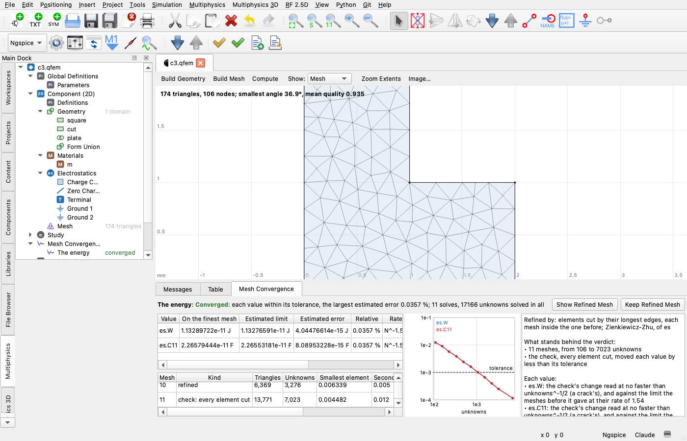

# Multiphysics mesh convergence: refined where the error is, until the values settle

*7 November 2026, on `claude/mesh-convergence-d40de6`, cut from `ab53a48`. Apple M2 Ultra, macOS 27.2, Qt 6.12.0 from Homebrew.
CI pins Qt 6.10.3 and none of this has run on it, nor on Linux or Windows (see "What could not be verified").*

The request: "Is there a way to have a powerful and fast way of checking mesh convergence for the multiphysics 2D? I think
this will be something like an adaptive FEM meshing refinement feature so that we ensure the convergence is good."

## What you can do now

Add a check under the **Mesh Convergence** node of a 2D model's tree (its menu, **Multiphysics > Check Mesh Convergence**,
or `fem_converge` with `"method": "adaptive"`). Give it the values to watch, as an optimization's objectives (`es.C11`,
`ec.R`, `ht.Tmax`, `emw.neff`, a Derived Values node's `lp1.Z0` or its tag), and a tolerance. **Run** it:

- It starts from the model's mesh as it is and refines it **locally, where the error is**, cutting triangles by their
  longest edges, so each mesh holds the one before. No mesh setting needs editing.
- It stops as soon as **every value has settled** within its tolerance, or at a cap (unknowns, meshes), or when the rate
  it has seen says the cap cannot be reached in time. It always says which.
- For each value: the value on the finest mesh, its **estimated limit and error**, the rate it was seen to converge at,
  and how far to trust them (`extrapolated`, `bounded`, `erratic`, `unmoved`).
- Before it says "converged" it cuts **every element once more** and reads the values again. Values that only agreed
  because the refinement was elsewhere are caught there; it then refines everywhere until they settle, and says so.
- It runs as a job with progress and Cancel. The model tab's **Mesh Convergence** page fills as it goes: each mesh, each
  value, a graph of each value's distance from its limit against the unknowns, the verdict and what stands behind it.
- **Show Refined Mesh** shows the finest mesh in the view. **Keep Refined Mesh** writes into the mesh node the sizes of the
  coarsest mesh whose values were within their tolerances (an Adapted Sizes feature, one step of Undo). The model's own mesh is never touched otherwise.
- The setup and the last result are saved in the `.qfem` and shown again on opening, with no solve. A result whose model
  has changed since is marked old.
- **Goal-oriented** refinement (`Refine by: The values watched`) solves an adjoint on each mesh and refines where the
  error reaches the value, for an integral, an average or a heat's `Tmax` of a linear heat, electrostatics or currents
  physics.

**What falls short:**
- **Not faster everywhere.** On the 16 measured models cutting every element needed 2.4 to more than 35 times the
  unknowns for the same accuracy, wherever a corner or small feature holds the mesh. Where the shipped mesh is already
  fine enough (3 of the 16), two uniform meshes cost 0.6 to 0.8 times its four solves.
- **No warm start for semiconductors.** Their meshes are made anew (they must stay Delaunay) and the solver starts them
  only from the same mesh, so each mesh solves from equilibrium.
- **Goal-oriented refinement covers three physics** (linear heat, electrostatics and currents, stationary), and on the
  one model measured it cost more than the fields' error, not less (below).
- **Not run to the end** on the frequency-domain waves example: its solves take 3 to 42 s each.
- **Not run on Qt 6.10.3, Linux or Windows, nor on a real display** (offscreen, through the tests).

## What was there, checked

Read in the code at `ab53a48` and then run on the shipped examples (a scratch probe, linked against the `fem` library):

- **The adaptive step** (`solveAdaptive` in `fem_solver.cpp`, a Stationary or Frequency step's `adaptive`): a fixed number of
  rounds (`adaptsteps`, 1 to 20), no target, Zienkiewicz-Zhu of one physics, the triangles holding half the squared
  error given half their size as size points, the whole mesh made again from those sizes, each mesh solved from nothing.
- **How it really behaves**, on seven rounds of each:
  - **Meshing costs more than solving.** On the linear examples building a mesh took 1 to 10 times as long as solving it
    (the coax: 984 ms to mesh, 280 ms to solve at 145,000 unknowns).
  - **It stalls.** The size points cannot go below the mesh's own minimum size: the microstrip's mesh stayed at about 4,300
    triangles from its second round to its seventh, its indicator flat at 0.05.
  - **Its values are noisy.** Each mesh is made anew, so the values move by the remeshing as well as by the refinement:
    the microstrip's C went 1.20783, 1.20778, 1.20785, 1.20783, 1.20779; the inductor's L 4.52591, 4.52611, 4.52595,
    4.52595, 4.52593 mH. No rate can be read from that.
  - **Edge elements get nothing.** Mode Analysis and the resonator: "error is not estimated (edge elements)".
- **`fem_converge`** (Claude's alone; nothing in the window): the mesh as it is and meshes of every size divided by the
  `refine` factors, a verdict from the change between the last two. Run on the same examples, its verdict was wrong more
  often than not at a tolerance of 0.1 %:

| Model, value | `fem_converge`'s verdict | Its value's real error |
|---|---|---|
| TSV (axisymmetric), C | converged at `[2]`, 54k unknowns | 0.11 % - **above** its 0.1 % |
| Resistor, R | converged at `[2, 4]`, 27k unknowns | 0.10 % - **above** it |
| Resistor, Tmax at 0.01 % | converged at `[2, 4]` | 0.013 % - **above** it |
| Microstrip, C | converged at `[2, 4]`, 35k unknowns | 0.090 % - within it, but its "finer" meshes hardly were: the mesh's minimum size held them |

Its two meshes agree because both are held by the same small features: dividing every size does not divide what the preset's
curvature and narrow-region rules set. A small change between two meshes is not a small error.

## What was built

### The engine: `multiphysics/fem_adapt.{h,cpp}`

**The mesh.** `bisectMesh` cuts each marked triangle by its longest edge, and cuts its neighbours' longest edges as far as
keeping the mesh conforming needs (Rivara's bisection: no hanging nodes, the smallest angle at least half the mesh's first).
The old nodes keep their numbers, so each mesh holds the one before and a Galerkin solution's energy moves one way. A new
node on an arc goes onto the arc (and back onto its chord where a triangle would turn over); a periodic condition's two
sides are made the same node for node again (`matchPeriodicSides`, now public in `fem_mesh.h`). No mesh is built anew, so the
mesh step costs 4 % to 10 % of a solve (measured below), where meshing anew cost 1.7 to 4.2 times one.

A domain that must stay Delaunay (a semiconductor's, for its box method) cannot be cut this way. A model with one is
meshed anew each time from size points, as the old step did - but with the mesh's minimum size lowered with them, which is
what stalled it.

**The indicator.** Every solved field's, each brought to the same total (they are of different units), unless the check
names the physics:

| Field | Indicator |
|---|---|
| Nodal fields (electrostatics, currents, heat, magnetic, frequency-domain waves, PDE) | Zienkiewicz-Zhu: each element's gradient against the one recovered from its neighbours in its domain |
| Solid mechanics | the same on both displacement components together |
| Semiconductor | the same on V, log n and log p, each weighing a third |
| Quantum wells (on the plane) | the same on each carrier's wavefunction |
| Mode Analysis, Eigenfrequency (edge elements) | **new:** the electric field itself recovered across each domain - its tangential part is continuous between elements and its normal part jumps, so within a domain it should be one smooth field - against each element's own |
| Rays; fields solved along a line (1D semiconductor, quantum wells, PDE) | none: every element is cut, and the result says why |

Nothing in an absorbing layer (PML) is refined: what is refined there does not reach the answer.

**Marking.** The triangles holding half the squared indicator, and at least 10 % of them. (It was 35 % at `063142f`, for
fewer, larger steps; the review found that it held the refinement back from a corner - see "The review of `063142f`,
answered".)

**The values.** Read on each mesh as an optimization reads them (`solutionValue`, now public in `fem_optimize.h`): at the
study's last time or frequency, of the mode its step chose.

**The estimate** (`estimateValue`). Each value as `Q = limit + C N^-q` on the last three meshes at least 1.4 times apart:

- **Extrapolated** where the changes shrink with one sign at a rate within reason: above 0.1 and no faster than the
  elements' order (with 5 % to spare). The error said is the finest value's distance from the limit, with room: 1.25 where
  the rate on the meshes before was the same (Roache's factor for three meshes), 2 on three meshes alone, 3 where it was
  not steady.
- **Bounded** where there is no rate to believe: two meshes; changes that alternate but shrink; changes falling faster than
  the elements' order (a corner's fall faster than its error does, so no rate is claimed and the result says the changes'
  rate in words, with the error bounded as if it fell at the order); faster than the order plus one ("two meshes may have
  agreed by chance"). Elsewhere the error is three times the last change, as if it fell as slowly as a crack's field would
  let it.
- **Erratic** where it jumps about and no less. Not settled, unless three times its jumps are within a third of the
  tolerance.
- **Unmoved** where it did not move at all (exact on any mesh, or not of the mesh) - said in those words.

**The verdict.** Each value settles when its error is within its tolerance (its own, or the check's), or within an absolute
floor for a value near nought. When all have settled, the **check** cuts every element once and solves again. That mesh was
not chosen by any indicator, so a value moved past its tolerance there was moved by what the rounds did not look at: a
**false agreement**, caught, said, and from there every element is cut until the values settle on meshes nothing chose. The
check's change is read at no faster than unknowns^-1/2 - a crack's field's rate, the slowest one of finite energy
converges at - with Roache's 1.25, and against the limit the rounds gave (2.4 times that where the rounds gave no limit).
Read at the rounds' own rate, the error said was up to 4.4 times the error made (see "Measured"). Where that leaves a value
just above its tolerance, every element is cut once more: the mesh before the check, the check's and this one are nested
meshes nothing chose, and their rate is read. The check is on by default; off, the result says that the agreement of
meshes refined by one indicator is all there is.

**It stops** and says why: converged; `meshes` (its limit, 25 by default); `unknowns` (no mesh past the limit, 2 million by
default, is solved - the next mesh's size is predicted before it is cut); `projected` (on a steady rate the tolerance
would need more than twice the limit); `stalled` (nothing left to cut, or a remeshed mesh that hardly grew); `failed` (a
solve, with what the coarser meshes gave kept and called unconfirmed); `cancelled`.

**Speed.** Measured below. What makes it fast:
- Local refinement: unknowns where the error is.
- No remeshing: bisection is linear in the mesh and 4 % to 10 % of a solve.
- It stops on evidence: a value already settled on the mesh as it is costs three solves (as it is, one round, the check).
- The geometry is built once, the sizes read once.
- Each solve is handed the previous one as its start, which the solver uses where it can: a mode analysis takes the last
  mesh's mode centres (`modeCentres`), where it searches when it follows a mode. A linear solve is direct and has no use
  for a start. A semiconductor's start must be on the same mesh, so it is not used here (see "Left open"). How much the
  mode centres saved was not measured.

### Goal-oriented refinement

For a value that is a linear functional of one field of a linear physics - an integral or an average of `T` or `V` over
domains or boundaries (a Derived Values node), or a heat's `Tmax` or `Tmin` - the check builds the adjoint's model once:
the same physics, its sources taken out, its fixed values and outside temperatures made nought, the other physics off;
a source of the value added on each mesh (over the node's selection; at the hottest node, a narrow Gaussian of the size of
its elements there, for `Tmax`). Each mesh solves it too, and each element is weighed by the product of the field's error
and the adjoint's (the dual-weighted residual's estimate, each factor recovered as Zienkiewicz and Zhu's). An energy
(`es.W`, `es.C11`, `ec.R`, `ec.P`, `mf.L`) needs no adjoint: its error is its field's, and the result says that. A value
with none - nonlinear coefficients, a step in time, a feature the adjoint is not set up for, any other expression - falls
back on the fields' error, said for that value.

**It did not pay off where it was measured.** Two plates apart, one with a singular corner, the other with the watched
sensor: to 1e-6 the goal-oriented check settled on 166,000 unknowns in all (72,000 at most, adjoints counted), the
fields' error on 11,860 (6,140 at most), both within the tolerance of a reference. The sensor's own region is smooth, so
the fields' error leaves it right early; and the goal-oriented value converges one way and then the other, which the
estimate settles later. Before the review's fixes the opposite seemed true (19,763 against more than 173,000 unsettled),
but only because the estimate then bounded the fields' route too loosely to stop. Nor does it help where the value is
the field's energy, or where the adjoint is singular where the field is (an L held hot along its corner's sides: 28,992
against 6,250 at 2e-5, on an earlier build). It is the user's choice, not the default, and on this evidence it should
stay so.

### The node, the file

A top-level `"convergences"` array, written only where there is one: a model without any writes what it wrote before,
byte for byte. In the tree, a **Mesh Convergence** node between the studies and the Optimization node (always there on a
2D model, as the Optimization node is), each check under it. A check holds its settings (study, tolerance, refine by,
physics, unknowns and meshes at most, the check, the sweep's points), its `values` table (expression, its own tolerance,
an absolute floor) and, once run, `result`: its rows one string a line, so a file diffs by the line. **Keep Refined Mesh**
adds a `mesh/adapted` feature to the mesh node: the sizes of the coarsest mesh whose values are each within their tolerance
of the finest's limit, its error counted (the finest where none is or the check did not converge; the result's `keptrow`
says which; where the model's own mesh is enough, Keep says so and keeps nothing), gathered to at most 4,000 where it was
finer than the mesh it started from, and its minimum size. `meshSizes` reads it, so a built mesh is about the kept one:
meshed anew, so about, and 1.2 to 1.6 times its triangles (the corner's 3,232 came back as 4,624, its W within 0.1 % of
the limit).

### The window

- **The node** by the generic form; Add fills a row with a global value the last solution has. **Run** and **Keep Refined
  Mesh** in its form and its menu; **Show Refined Mesh** in the menu while the mesh is in memory. Its status in the tree:
  checking, converged (green), not converged (red), old.
- **`multiphysicsconvergence.{h,cpp}`**, the tab's **Mesh Convergence** page: the verdict in a line, each value's
  estimate, each mesh as it is solved, the graph, what stands behind the verdict and the notes, the two buttons.
- **`MultiphysicsDoc::converge`**, a job like Compute and Optimize: progress, Cancel (the meshes so far kept), its result
  into the node as one step of Undo made by the simulation.
- **Multiphysics > Check Mesh Convergence**: runs the shown check; on a model with none, adds one (its value a global the
  last solution has) and runs it if it has a value.

*(The window driven offscreen by `test_multiphysics_converge`; the corner's check at 1e-3. The refined mesh, shown by Show
Refined Mesh, is [beside it](2026-11-07-multiphysics-mesh-convergence/refined.png), and the tree's node
[here](2026-11-07-multiphysics-mesh-convergence/tree.png).)*

### For Claude

`fem_converge` gains `"method": "adaptive"`, and `uniform` stays the default, so a call as before answers as before. The
adaptive method runs the model's check (or the named one) with what the call gives over its settings, and makes one of them
where there is none. What the call gives is written into the check with its result, as one step of Undo, and not at all if
the run is refused or fails; what it leaves out is the check's own, and the answer's `settings` say what it ran with. It runs
it as the window does, waits up to `timeout` for the whole of it (past it, it goes on;
`fem_stop` stops it; `fem_describe` says how far), and answers with the verdict, the evidence, each value's estimate and
each mesh. `"action": "result"` reads the last result; `"action": "keep"` (or `"keep_mesh": true`) keeps the refined mesh. `action` result or keep needs no `method`: they are the
adaptive check's (the uniform method refuses them).
`fem_describe` lists each check's verdict; `fem_describe what=format` has its paragraph and its kind; `fem_edit` and
`fem_model` take the node and the section as any others. The tool search finds it by "mesh", "convergence", "adaptive",
"refine", "error estimate".

## Coverage: what each physics and step gets

Each was run on a shipped example on the final build (the check at its defaults, tolerance 0.1 %; the pn diode 1 %);
"converged" is the check's verdict there.

| Physics, step | Refined by | Run on | Verdict |
|---|---|---|---|
| Electrostatics, stationary | Zienkiewicz-Zhu; goal-oriented for an integral or average of V | coax, microstrip, TSV (axisymmetric), the corner | converged |
| Electric currents + heat, stationary (two physics in one study) | both fields, each weighing the same | resistor heating | converged |
| Heat, transient | the field at the last output time; the value there | heater transient | converged |
| Solid mechanics | both displacements | bimetal strip | converged |
| Magnetic fields, frequency + heat, stationary | both fields | induction heating | converged |
| Electrostatics + magnetic, stationary + frequency | both fields | coax RLGC | converged |
| Magnetic fields, a Parametric Sweep (2 points) | the field, each end on its own meshes | gapped core inductor | converged at both |
| Electrostatics, a sweep of the strip's width (reshapes the geometry) | each end its own geometry and meshes | microstrip sweep | converged at both |
| Mode Analysis (edge elements) | **the electric field recovered** (new) | WR-90, SOI waveguide; heat + modes in a sweep (thermo-optic) | converged |
| Eigenfrequency (edge elements, axisymmetric) | the electric field recovered | VCSEL modes (1.1M unknowns at the check, 26 s) | converged |
| PDE, eigenvalue | Zienkiewicz-Zhu | drum modes | converged |
| Quantum wells on the plane, states | each wavefunction | quantum wire | converged |
| Semiconductor, stationary in a sweep | V, log n, log p; **meshed anew** (Delaunay kept) | pn diode at both ends of its sweep (8.6 s) | converged |
| Frequency-domain waves (PML) | Zienkiewicz-Zhu, nothing in the PML | iris filter | **not run to the end** (on an earlier build): its S21 moved -9.78, -9.51, -9.28, -9.13, -9.00, -8.91, -8.83 dB over seven meshes of up to 146,000 unknowns, each LU solve 3 to 42 s - two minutes in, still moving by a per cent a mesh |
| Rays; anything solved along a line | none: every element cut, said | - | - |
| 3D models | refused: their own estimate (`fem3_estimate`) | - | - |

**Multiple physics in one study.** Every solved field's indicator, each brought to the same total; "Refine by the physics"
names some. Where a watched value's physics is not among those refining, its agreement is the kind the check is for
(`falseAgreementIsCaught`).

**Time.** A transient's value is read at its last output time and refined by the field there. The time step is not
checked: this is a mesh check.

**Frequency sweeps.** The value at the last frequency, the field there. A value over a band is not checked frequency by
frequency.

**Mode Analysis.** The mode its step chose (the first by default). Where refinement changes which mode that is, the value
jumps: erratic, not settled, and said.

**A Parametric Sweep.** By default its first and last points are checked, each on its own meshes from its own geometry,
the verdict the worse; `first`, `last`, `all`, or `own` (the model's own values, the sweep not run, said).

**The old adaptive step** is untouched and solves as it did (`adaptiveStepsStillWork`: the shipped corner still ends on its
1,168 triangles). The check turns a study's own adaptive rounds off for its solves, since it refines itself.

## Measured: against `fem_converge`'s uniform route

`compare.sh` and `probe3.cpp` (beside this file) run each shipped model's value three ways; unknowns are counted as
`fem_solve` counts them, by both routes. The reference is the adaptive check run
to a tolerance thirty times tighter (its extrapolated limit), or the closed form where there is one. The adaptive check is
run at the tolerance asked. The uniform route is `fem_converge`'s own `refineMesh`, factors 1, 2, 4, 8, 16, 32 of every size,
each mesh solved once. Each line says where `fem_converge` would first call it converged and what its value's error really
was there, and where the uniform meshes first reach the adaptive check's own accuracy and at what cost.

| Model, value, tolerance | Adaptive: solves, unknowns in all (largest) | its error made / said | `fem_converge` first says converged | its error there | Uniform to the adaptive accuracy |
|---|---|---|---|---|---|
| adaptive_corner, `es.W`, 1e-3 | converged: 12, 4,897 (1,685) | 4.0e-04 / 8.2e-04 | 5 meshes, 28,937 | 3.0e-04 | 5 meshes, 28,937: **5.9x** the unknowns, 22.5x the time |
| adaptive_corner, `es.W`, 1e-4 | converged: 21, 75,213 (27,301) | 2.2e-05 / 4.3e-05 | never | - | not reached in 6 meshes, 114,885 unknowns |
| coax, `es.C11`, 1e-4 | converged: 4, 15,283 (7,303) | 8.8e-07 / 1.7e-05 | 2 meshes, 11,481 | 6.2e-07 | 2 meshes, 11,481: **0.8x** the unknowns, 0.1x the time |
| microstrip, `es.C11`, 1e-3 | converged: 6, 89,298 (35,394) | 6.2e-05 / 1.5e-04 | 3 meshes, 35,273 | 9.0e-04 | not reached in 6 meshes, 1,015,850 unknowns |
| tsv_axisymmetric, `es.C11`, 1e-3 | converged: 6, 169,816 (64,324) | 1.0e-04 / 3.0e-04 | 2 meshes, 53,938 | 1.1e-03 **above tolerance** | 6 meshes, 5,963,146: **35.1x** the unknowns, 253.6x the time |
| resistor_heating, `ec.R`, 1e-3 | converged: 6, 69,150 (26,162) | 1.5e-04 / 4.3e-04 | 3 meshes, 26,642 | 1.0e-03 **above tolerance** | not reached in 6 meshes, 858,686 unknowns |
| resistor_heating, `ht.Tmax`, 1e-4 | converged: 6, 69,150 (26,162) | 1.9e-05 / 5.5e-05 | 3 meshes, 26,642 | 1.3e-04 **above tolerance** | not reached in 6 meshes, 858,686 unknowns |
| bimetal_strip, `solid.dmax`, 1e-4 | converged: 6, 74,472 (27,376) | 3.5e-06 / 1.5e-05 | 2 meshes, 34,186 | 8.5e-05 | 5 meshes, 2,336,774: **31.4x** the unknowns, 47.8x the time |
| heater_transient, `ht.Tmax`, 1e-4 | converged: 8, 55,005 (18,197) | 1.7e-05 / 4.7e-05 | 3 meshes, 32,903 | 6.3e-05 | 5 meshes, 345,945: **6.3x** the unknowns, 7.1x the time |
| drum_modes, `c.lambda`, 1e-5 | converged: 4, 49,948 (25,324) | 4.0e-08 / 2.9e-07 | 2 meshes, 30,831 | 2.4e-08 | 2 meshes, 30,831: **0.6x** the unknowns, 0.8x the time |
| gapped_core_inductor, `mf.L_go`, 1e-3 | converged: 6, 441,008 (169,874) | 4.5e-05 / 1.7e-04 | 2 meshes, 162,046 | 2.7e-04 | 4 meshes, 2,075,652: **4.7x** the unknowns, 10.7x the time |
| induction_heating, `mf.P`, 1e-3 | converged: 4, 267,816 (129,591) | 3.2e-07 / 1.3e-05 | 2 meshes, 175,293 | 1.9e-06 | 3 meshes, 688,908: **2.6x** the unknowns, 2.4x the time |
| wr90_modes, `emw.neff`, 1e-4 | converged: 4, 18,704 (9,106) | 1.7e-09 / 1.9e-08 | 2 meshes, 12,594 | 2.7e-10 | 2 meshes, 12,594: **0.7x** the unknowns, 0.5x the time |
| quantum_wire, `qw.Ee1`, 1e-4 | converged: 4, 134,335 (65,290) | 2.2e-07 / 5.1e-06 | 2 meshes, 89,055 | 6.5e-07 | 3 meshes, 350,520: **2.6x** the unknowns, 3.7x the time |
| heatsink_import, `ht.Tmax`, 1e-3 | converged: 4, 16,432 (7,745) | 2.1e-06 / 1.5e-05 | 3 meshes, 12,672 | 4.3e-06 | 4 meshes, 39,182: **2.4x** the unknowns, 2.8x the time |
| soi_waveguide_modes, `emw.neff`, 1e-3 | converged: 4, 122,890 (58,942) | 3.1e-06 / 1.5e-05 | 2 meshes, 84,306 | 8.6e-06 | 3 meshes, 329,202: **2.7x** the unknowns, 2.7x the time |

"Uniform to the adaptive accuracy" uses the reference, which neither route has: it is what cutting every element costs to
be as accurate, not what `fem_converge` would know. `compare.txt` beside this file has every mesh of every route.

**What it says** (after the review's fixes, below; `compare-063142f.txt` has the run before them):

- **Where a corner or a small feature holds the mesh, the adaptive check wins clearly:** to be as accurate as it was,
  cutting every element took 5.9 times the unknowns on the L-shaped gap, 31 times on the strip, 35 times on the TSV, and
  had not got there at a million unknowns on the microstrip and the resistor, nor at 115,000 on the corner at 1e-4. In time
  that is 7 to 250 times. In the test `reentrantCornerRates`, the check's own uniform route (`refine: uniform`) took 866,000
  unknowns in all for 1e-4 against the adaptive route's 75,000 (2.6 million before its rounds cut every element twice, below).
- **On quadratic elements at a corner** - the review's L - the check now grades into the corner: its error falls as
  unknowns^-3.4 here against ^-1.2 before, 1e-5 on 43,000 unknowns in all (`aCornerIsGradedAsItShouldBe`; for 1e-6, 44,000
  against a million with the old marking, in `probe5.cpp`).
- **Where the shipped mesh is already fine enough, it costs a little more:** the coax, the drum, WR-90. Two uniform meshes
  cost 0.6 to 0.8 times the check's four solves, and `fem_converge` was right there.
- **In between, 2.4 to 6 times:** the heater, the inductor, induction heating, the quantum wire, the heatsink, the SOI
  waveguide.
- **`fem_converge`'s verdict was wrong on 3 of the 16**, each value's error above the tolerance it said it was within (TSV,
  resistor R, resistor Tmax), and right but for the wrong reason on the microstrip (its "finer" meshes hardly were).
- **The adaptive check's verdict was right on all 16, and the error it said was at or above the error made on all 16**:
  from 2.0 times (the corner) to about 40 times where a value converges fast and the estimate falls back on a bound
  (induction heating). The same was true of `063142f` only after its last changes (the TSV's error was once said 4.4 times
  too small), and the review found that true of its own five models.
- **Against `063142f` at the same tolerances,** most models cost within 15 % of what they did; the corner at 1e-3 is 3.5
  times cheaper, the microstrip 1.4 times, the heater 1.7 times dearer. The unknowns of WR-90 and the SOI waveguide are now
  counted as `fem_solve` counts them (K2 below), so their numbers are not comparable with that run's.
- **The mesh step's cost** (`probe4.cpp`, one round on a mesh of 60,000 to 130,000 triangles; measured while the
  sanitizer tests ran on other cores): the indicator and marking took 1 % to 4 % of the solve, the bisection 4 % to 10 %.
  Meshing anew from the same marks, as the old adaptive step does, took 1.7 to 4.2 times the solve, and gave meshes 1.4
  to 1.7 times larger than the bisection did.

| Model | Triangles | Solve | Indicator + marking | Bisection | A remesh of the same marks |
|---|---|---|---|---|---|
| Corner | 76,844 | 363 ms | 8 ms | 24 ms | 908 ms |
| Coax | 61,128 | 472 ms | 9 ms | 20 ms | 993 ms |
| Microstrip | 107,363 | 614 ms | 18 ms | 50 ms | 1,587 ms |
| TSV | 101,275 | 405 ms | 5 ms | 39 ms | 1,684 ms |
| Resistor | 84,876 | 597 ms | 17 ms | 28 ms | 1,296 ms |
| Inductor | 130,019 | 1,205 ms | 30 ms | 55 ms | 2,058 ms |

## How it was tested

### New tests

| Suite | What | Release | ASan, UBSan |
|---|---|---|---|
| `test_fem_adapt` (29 cases) | Below | 40 s | see "What else ran" |
| `test_multiphysics_converge` (14 cases) | The tree and its form, a run and its page as it goes, the model's mesh untouched, Show and Keep Refined Mesh (and Undo), saved and opened, old after a change, Cancel, a bad check, the menu's action, the tool (made from the call, result, keep, settings, goal, bad input), `fem_stop` past the tool's timeout, the uniform method as before | 3.4 s | 59 s |

In `test_fem_adapt`:

- **The mesh:** three rounds of bisection at the corner: conforming (every edge in one or two triangles, one only on the
  boundary), nested (each old node where it was), the area kept, the smallest angle at least half the first, left and right
  of each boundary edge right; on the coax every new node on its circle; nothing marked, the mesh as it was.
- **The estimate** on series of known rates (0.5, 1, 2: the limit and rate found, the error said not below the error
  made and within 1.3 times it); meshes hardly apart; two meshes; a rate faster than the elements can give ("by chance");
  a change that does not slow; alternating, settling, unmoved, NaN.
- **Closed forms:** the coax's C against 2πε0/ln 3, first and second order, at 1e-3 and 1e-5 (second order): within the
  tolerance, the error said not below the error made.
- **The re-entrant corner:** the rate against a fine reference, refined where the error is (asserted above 0.85; 1.10 here)
  and cutting every element (between 0.55 and 0.8; 0.64 here, the corner's 2/3), the uniform route at least ten times the
  unknowns for 1e-4 (36 times here), the smallest elements at the corner.
- **The error said is not below the error made** on the TSV, the resistor and the microstrip, against references thirty
  times tighter (within the reference's own error).
- **False agreement:** two parts, refined by the electrostatics alone, the heated bar's Tmax agreeing from mesh to mesh. The
  check moves it 0.69 %: caught, said, and on from there every element cut, converged to within 1 % of the rise of a fine
  reference. The same without the check: converged, and saying so.
- **Goal-oriented:** two plates apart, the sensor in one: to 1e-6 of a reference, an adjoint on each mesh it refined; the
  fields' route logged beside it (it is cheaper here). An energy needs no adjoint, an expression of none falls back, both
  said.
- **The review of `063142f`:** the review's L graded into its corner (rate above 1.6, 1e-5 under 15,000 unknowns at most),
  a rate faster than the order not claimed, the coarsest mesh within the tolerance kept (and Keep saying so where the
  model's own is enough), and in `test_multiphysics_converge` its three tool bugs and the count of unknowns. Each was
  checked to fail with the old code put back: the marking floor, the rate rule, the kept mesh's choice, the failed run's
  answer, the dispatch of `action`.
- **Edge elements:** WR-90's modes refined by the recovered field, to 1e-4.
- **The caps:** 3 meshes, 300 unknowns: stopped, said, no mesh past the cap solved.
- **Cancel:** at the third mesh, two kept; before anything, nothing, no crash.
- **A solve failing partway:** a permittivity that is not a number below an element size: two meshes solved, the third
  fails, what came before kept and called unconfirmed. The first mesh failing.
- **What the results lack** (the globals listed), a field that is not one number; **bad settings**, 11 of them and the rows',
  each refused before any solve with the same words by the plan and the run; a 3D model.
- **A sweep's ends**, each its own; `own` said. **The model not touched**, byte for byte. **Keep Refined Mesh** through the
  file and back, built, its value within 0.2 % of the limit (0.007 % here). **The result in the file**, every field back;
  old after a change; **damaged** in many ways, read as far as it goes. **Every shipped model** read with no
  `"convergences"` added and its tree node there; a 3D model without one. **The old adaptive step** as it was.

Each case asserts on unknowns, solves, errors and verdicts. None reads a clock: the stop test waits on rows, not on time.
A slow (sanitized or Debug) build runs the heavy cases smaller: the corner at 1e-3 against a reference to 3e-5, the
honesty test on the resistor alone, the goal case at 1e-5, the false agreement's reference at 1e-4.

### What else ran

- **Release, all of CTest:** 172 of 172 passed, run with `test_library_export` left out: it needs `qucsconv_rf`, whose
  build needs `dos2unix`, which is not installed here. It tests nothing changed here.
- **ASan and UBSan:** `test_fem_adapt` (182 s), `test_multiphysics_converge` (59 s), `test_fem_optimize`,
  `test_multiphysics_optimize` (23 s), `test_fem_waves` (1,234 s), `test_fem_engine`, `test_multiphysics_doc` (1,099 s),
  `test_qucs_control` (317 s): 8 of 8, with no sanitizer report.
- **Lints:** `check-json-nesting`, `check-shaders` (14 shaders), `check-third-party`, `check-tool-arguments` (148 tools,
  0 disagreements). The JSON lint found three braced copies in the test on its first run; a fourth, in
  `checkMeshConvergence`, it could not see (the inner array a function's result) and was found by reading: a model's first
  check would have had a broken row.

### The fuzz

`docs/bug_hunts/2026-10-16-fuzz/fuzz_qfem.py` now makes one mutant in five of those not an optimization's a mesh convergence
check's (`QFEM_CONV_SHARE`): the section added to a small corner or capacitor, or to a shipped model, damaged alone (its
settings, its rows, a kept result's rows and sizes), a damaged Adapted Sizes feature in the mesh node one time in five, then
`fem_converge` run, stopped, read, kept, the mesh built, run again with other settings, stopped, saved.

Under ASan and UBSan with `QFEM_OPT_SHARE=0 QFEM_CONV_SHARE=0.9`, seeds 31 and 32, 100 mutants each: **200 mutants, 0
findings**. `fem_converge` was called 724 times; 55 runs ran, the rest refused with a reason (a result asked of a check
not run, a tolerance of 0, a value the results lack, nothing to keep). Three calls were slow (30 to 39 s): each a stop of a
VCSEL model's solve under the sanitizers, and the same model's plain `fem_solve` closed as slowly - the solver's own
stopping points, not the check's.

## Decisions worth a look

- **Uniform stays `fem_converge`'s default.** A call as before answers as before; the description calls the adaptive
  method the one to use. Making it the default would change what existing callers get, which the brief said to ask about.
- **The check is on by default.** It costs about twice the last mesh: on the coax at 0.01 % it was 8,303 of the 14,111
  unknowns solved. Off, the result says the agreement of one indicator's meshes is all there is.
- **A sweep's ends by default**, each on its own meshes. Checking only the model's own values would be cheaper and could
  check a point the sweep never solves (a diode at 0 V); every point is `all`.
- **The error said is conservative.** After the check it is the largest of: the check's change read at a crack's rate, twice
  the extrapolated distance, the distance from the rounds' limit. On the 16 measured it was 1.13 to 30 times the error
  made (table above), never below it. A tolerance may therefore take a mesh or two more than it strictly needs.
- **Kept, the refined mesh is remeshed from sizes.** A bisected mesh cannot be written as a mesh node; its sizes can. The
  mesh built from them is about as fine and gives about the same value (the corner: within 0.007 %), not the same mesh.
- **The result is kept in the model, as a step of Undo** (as an optimization's): a run makes the document unsaved. The
  refined mesh itself is not saved (it is large): after reopening, Show Refined Mesh says to run it again; Keep still works,
  from the sizes in the result.
- **A new tree node on every 2D model** (Mesh Convergence, empty unless used), as Optimization is. It writes nothing to the
  file while empty.

## The review of `063142f`, answered

The user's review (`qucs-reviews/Multiphysics/2026-11-07-claude-qfem-mesh-convergence-check.md`) ran the merged app against
exact answers: the numerics sound, every verdict right, every error said at or above the error made; three tool bugs, a
misleading rate, a kept mesh too fine, two counts of unknowns. Each finding was checked here first; each was real.

| Finding | What it was | Now |
|---|---|---|
| **B1** (high) | A run that failed - a value the results lack - answered with the last good result, `converged: true` | The document keeps why its last run gave no result (`convergenceError`); the tool answers that error. The good result stays as it was. |
| **B2** (medium) | A call's settings were written into the node before the run: a refused `study: "nosuch"` broke every call after it, a `check: false` stayed | The settings go into the run's own copy of the model and into the node with the result, as one step of Undo - not at all if the run is refused or fails; a new check is made the same way. What a call leaves out is the check's own setting, and the answer's `settings` say what it ran with. |
| **B3** (medium) | `action` was read only with `"method": "adaptive"`: `action: result` asked for values, `action: keep` ran a whole uniform study | `action` result or keep means the adaptive check; with `"method": "uniform"` it is refused. |
| Nit | Right after Keep, the result read "changed since" | The Adapted Sizes a result was kept as are not part of what it depends on. |
| **N1** | On the L corner the rate read 2.2 (`extrapolated`) where the error fell as 1.2 | Two causes. **The marking:** at least 35 % of the triangles a round held the refinement back from the corner; at 10 % the error falls as unknowns^-3.4 there (the optimal ^-2 of quadratic elements, and faster pre-asymptotically), 1e-6 on 44,000 unknowns in all against a million, in as many solves (`probe5.cpp`). **The label:** a rate faster than the elements' order is no longer claimed: `bounded`, the changes' rate in words. |
| Side note (grading) | The smallest element was 0.0039 at 35k unknowns | The same cause as N1's marking: now 1.2e-4 at 8,300 unknowns and 4.3e-5 at 12,700 (`probe5.cpp`). |
| **K1** (medium) | Keep wrote the check mesh's sizes: 45,430 triangles where 4,140 were enough | Keep writes the coarsest mesh whose values are each within their tolerance of the finest's limit, the finest's error counted. Where the model's own mesh is enough, it says so. The remeshing from sizes still makes 1.2 to 1.6 times the triangles of the mesh kept; a size floor to undo that was not tried. |
| **K2** (low) | The two routes counted unknowns differently on one mesh (6,793 against 3,950) | The check counts as `fem_solve` does. For edge elements that is the nodal space times the components, not the true count of edge and node unknowns - but the same on both routes. |

**What the fixes cost and changed.** With a tenth of the triangles marked, a round grows a mesh by 1.1 to 1.3 rather than
1.5, so a check takes more solves (the corner at 1e-3: 12, was 11; at 1e-4: 21, was 15); the meshes at most went from 12 to
25. Meshes are compared when 1.25 times apart (was 1.4). Bounding a rate faster than the order with the crack's slowest rate,
as first tried, refined the TSV ten meshes deep and the review's corner to 1.5e-7 where 1e-5 was asked; it is bounded as if
it fell at the order instead, and the check's own bound decides the end. After a check that leaves a value just above its
tolerance, every element is cut once more, so that three meshes nothing chose give a rate - the goal case had gone on to a
second check, 186,000 unknowns, for a value within its tolerance at 20,000.

**Measured again** on the 16 models (the table above): every verdict right, every error said at or above the error made.
At the same tolerances most cost within 15 % of `063142f`, the corner at 1e-3 3.5 times less, the heater 1.7 times more.

**Checked after the fixes:** `test_fem_adapt` (29 cases) and `test_multiphysics_converge` (14) in Release and under ASan and
UBSan (190 s and 80 s there), with `test_multiphysics_optimize` and `test_qucs_control`, no sanitizer report; in Release
also `test_fem_optimize`, `test_multiphysics_doc`, `test_fem_engine`, `test_fem_waves`, `test_mcp_server`, 9 of 9; the four
lints green. The whole Release suite was not run again after the fixes (it was, 172 of 172, at `063142f`).

**Not done:** the remeshing from kept sizes still inflates the mesh by 1.2 to 1.6; the review's SOI strip and its `parallel`
were not rerun here (the shipped SOI example was).

## The Linux CI finding of `f3c591c`, answered (8 November)

The session fixing CI's Linux sanitizer job found it (`docs/bug_hunts/2026-11-08-linux-debug-ci.md`, N3); the user gave it to
this session ("Mesh session"). In `reentrantCornerRates`' slow-build branch, the uniform route at 1e-3 said "converged ...
largest estimated error 0.0931 %" where it had made 1.23e-3. Its changes on CI's meshes fell by 0.39, 0.98 and 0.35 a step.
The last pair read as unknowns^-1.4, faster than the order, so it was bounded at the order from the last change alone: 1.84
times that change, where 2.4 were left (the true rate about 0.62).

**The cause is the cut, not only the bound.** Longest-edge bisection of every element cuts each triangle one way and then the
other, so meshes cut once a round alternate in kind and so do their changes. On macOS's meshes the corner's ratios run 1.04,
0.51, 0.79, 0.48, 0.81, 0.49 against a true 0.63 a step. Any one pair reads half of it. Measured at `a26ec63a`, the uniform
route said less than it made on two of seven models here, both from three meshes (TSV: 3.50e-4 said, 3.65e-4 made; resistor
R: 3.37e-4 said, 4.61e-4 made), where no reading of three meshes can see the alternation.

**What changed:**

- **The uniform rounds cut every element twice:** the `refine: uniform` route, and the rounds after a check caught a false
  agreement (whose meshes start at the check's). Each mesh is then of the kind of the one before, about 4.3 times its
  unknowns. The check itself is still one cut, and so is the one cut after a check that left a value just above its
  tolerance (measured fine on all 16 models, and its three meshes are read as before).
- **The rate read over every other mesh as well** (meshes n-1, n-3, n-5, where there are five), which cancels the alternation:
  6.10e-15 left where 6.2e-15 was on the corner's macOS meshes, 2.3 changes on CI's ratios where 2.4 were. The error said is
  at least what that reading leaves, with room 1.25 where it agrees with a steady pairwise rate or with the reading before
  it, else 2. It counts only where it reads a rate of its own, one way and no faster than the order. Bounded at the order
  over two steps as well, it held the shipped corner's check back three meshes (15,256 unknowns where 4,897 had been right).
  Counting its erratic cases too, it held the goal case's reference to 4.7e-7 said where 7.7e-9 was made.
- **A rate faster than the order among slower ones gets room 3, not 2**, where four meshes show the earlier pair read another
  rate: one fast pair among slow ones is the alternation, and that is where four meshes cannot read every other one.

**Measured again**, `compare.sh` at `a26ec63a` (`compare-a26ec63a.txt`) and after (`compare.txt`), with seven runs of the
uniform route added against the same references:

| Model, value, tolerance, uniform route | Before: solves, unknowns in all | made / said | After: solves, unknowns in all | made / said |
|---|---|---|---|---|
| adaptive_corner, `es.W`, 1e-3 | 8, 36,860 | 5.5e-04 / 7.9e-04 | 5, 50,791 | 3.3e-04 / 5.0e-04 |
| adaptive_corner, `es.W`, 1e-4 | 14, 2,620,022 | 3.4e-05 / 5.2e-05 | 7, 865,671 | 5.2e-05 / 6.8e-05 |
| coax, `es.C11`, 1e-4 | 3, 20,234 | 5.8e-07 / 3.8e-06 | 3, 72,970 | 2.9e-08 / 1.0e-07 |
| microstrip, `es.C11`, 1e-3 | 4, 173,209 | 1.5e-04 / 2.5e-04 | 3, 268,474 | 8.3e-05 / 1.7e-04 |
| tsv_axisymmetric, `es.C11`, 1e-3 | 3, 146,411 | 3.7e-04 / **3.5e-04, below** | 3, 547,028 | 1.5e-04 / 2.6e-04 |
| resistor_heating, `ec.R`, 1e-3 | 3, 58,016 | 4.6e-04 / **3.4e-04, below** | 3, 204,760 | 2.3e-04 / 4.5e-04 |
| wr90_modes, `emw.neff`, 1e-4 | 3, 22,136 | 2.3e-10 / 6.4e-10 | 3, 79,472 | 1.1e-11 / 3.3e-11 |

- **The 16 adaptive runs are unchanged**, to the unknown and the error said: none passes through what changed in a way that
  moves its verdict.
- **The uniform route says at least what it makes on all seven**, where it did not on two. Where it settles on three meshes it
  now costs 1.5 to 3.7 times what it did, since those meshes are four times apart rather than two, and its errors are 2 to 20
  times smaller for it. On the corner at 1e-4 it is three times cheaper: no mesh between is solved.
- **In the test**, the slow-build branch at 1e-3: the uniform route converged at 38,743 unknowns with 3.25e-4 made (5 solves,
  50,791 in all; was 1.23e-3 made on CI's Linux meshes). Release at 1e-4: 5.18e-5 made, 6.8e-5 said (was 7.4e-5 made, 5.5e-5
  said, on CI's).

**The goal case's reference.** `goalOrientedRefinesForTheValue`'s reference (refined by the adjoint, 1e-7) moves one way and
then the other. At `a26ec63a` its error said was below the error made in 3 of 4 runs here: 2.0e-8, 5.8e-8 and 3.5e-8 said,
7.7e-8 made. Now it says more, and in some runs it reaches 1e-7 only near 957,000 unknowns, where its check's mesh would pass
the 2e6 limit, so it stops at "unknowns". It failed 5 runs of 5 on its own in Release here and passed in the whole suite's
run. The CI session's change to that test runs the reference without its own check (macOS's run-to-run rounding, its N1); with
that change it passed 4 of 4 here. That change is in its branch, not this one.

**Tests:** `estimateOfAlternatingChanges` checks three cases. On the corner's macOS uniform meshes, the error said is at least
the error left on every three or more. On CI's ratios it is at least the 2.4 changes left (1.82 with the code before). A
smooth sequence is said as before. `reentrantCornerRates` carries the CI session's lines unchanged: the first mesh within the
tolerance compared, and a converged uniform run within its tolerance.

**Checked:** `test_fem_adapt`, `test_multiphysics_converge`, `test_multiphysics_optimize` and `test_qucs_control` through
ctest in Release (4 of 4) and in the Debug ASan + UBSan tree (4 of 4, no sanitizer report; `test_fem_adapt` 178 s); the four
lints green. Not run: CI's Linux itself, and GCC's libstdc++ stand-in tree.

## What could not be verified

- **Qt 6.10.3**, the version CI pins, and **Linux and Windows**: all of this ran on macOS with Qt 6.12.0 alone. Nothing here
  uses a Qt API newer than the code around it, which is not the same as having run.
- **A person's eye on a real display.** The window was driven offscreen by the tests, and looked at in their screenshots
  (above). No mouse, no real display.
- **The frequency-domain waves example to the end** (iris filter): each LU solve of 3 to 42 s, still moving a per cent a mesh
  after two minutes and seven meshes. Its estimator and stops are the same code as the others'; the run itself was cut short.
- **Long runs on large models.** The largest here was the VCSEL's resonator check, 1.1 million unknowns at its check, 39 s.
  Hours of a semiconductor's solves have not been run through it.
- **Goal-oriented refinement beyond heat, electrostatics and currents.** It is set up for those three, linear, stationary,
  one physics' value. Others fall back, and say so; that fallback is tested, nothing more.
- **Process flows as the geometry of a check.** A flow's geometry is built first, as Compute does; none was run through a
  check.

## Left open

- **A semiconductor's warm start.** `solveStudy` starts a semiconductor from a solution on the same mesh only. Its meshes
  here are made anew (Delaunay), so each solves from equilibrium and walks its contacts again. Interpolating the last
  mesh's V, n and p onto the new one could save much of a semiconductor's check; it needs `solveStudy` to take a start on
  another mesh. The pn diode's check took 8.6 s; how much of it the walks were was not measured.
- **A semiconductor's mesh kept Delaunay under bisection** (edge flips after each cut) would let it be nested like the
  others, and its values smoother.
- **The time step.** A transient's mesh is checked at its last output time; its time stepping is not. A check of the step
  (BDF's own error) would be a separate one.
- **A band.** A frequency sweep's value is checked at its last frequency. A value over a band, frequency by frequency, would
  be the worst of them.
- **Goal-oriented refinement of a mode's effective index** (an eigenvalue's adjoint is its own mode) and of
  frequency-domain S-parameters (the adjoint of a port's power) would fit the same machinery.
- **Multiphysics 3D** has its own estimate (`fem3_estimate`); this check refuses a 3D model.
