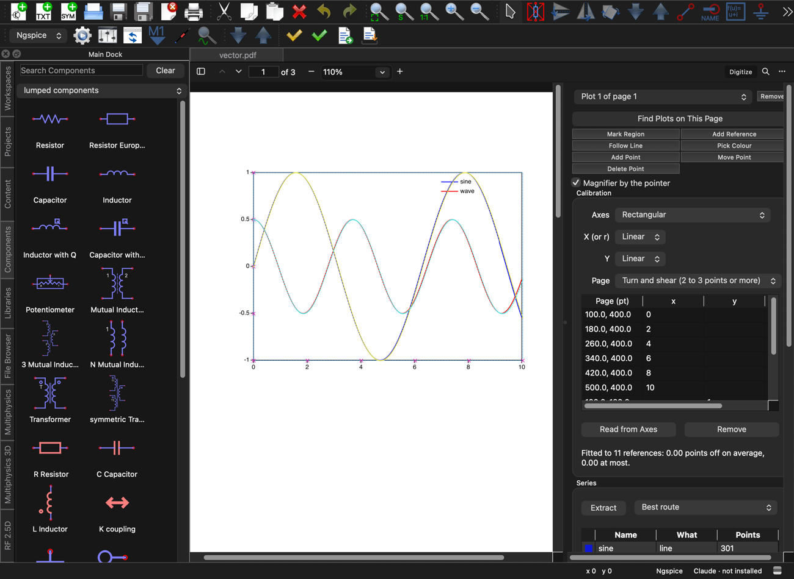

# A plot digitizer in the PDF viewer, and tools for Claude to use it

The user (2026-11-07): *"Many times I need to ask Claude to digitize some plot in a pdf file. Can you add a feature to the
pdf viewer so that it has a powerful plot digitizer and Claude can quickly use it to digitize a plot? Do this in a new
session."*

*Apple M2 Ultra, macOS 27.2, Qt 6.12.0 from Homebrew. CI and the published releases use Qt 6.10.3 with qtcharts and qtpdf.
Nothing here was built or run against 6.10.3; see "What could not be verified".*

**Now.**
- **In the viewer:** a **Digitize** button beside Find opens a panel at the side of the pages. **Find Plots on This Page**
  frames each plot, calibrates it from its tick marks and labels, and extracts its curves and markers, named from the
  legend. The panel also has Mark Region, Add Reference, Follow Line, Pick Colour, Add Point, Move Point and Delete Point,
  a magnifier by the pointer, Undo (Ctrl+Z), and Copy, CSV… and Dataset…. Everything extracted is drawn over the page.
- **Kept with the PDF:** each change is written beside the PDF as `<name>.pdf.digitized.json`. Reopening the PDF opens the
  panel on what was kept.
- **For Claude:** three tools that work with no window (`--mcp-server`):
  - `find_plots` lists a document's plots.
  - `digitize_plot` returns, in **one call**, every series in the axes' units, how far to trust them, the time taken, and a
    picture of the plot with the extraction drawn over it.
  - `get_digitized` reads what the user digitized by hand, or what Claude kept.

**What falls short of the request:**
- **No automatic calibration of a polar plot.** A polar plot (and a Smith chart, which is not supported at all) is
  calibrated from three or more references: points with known r and angle, clicked in the panel or given to
  `digitize_plot`. Its grid circles and spokes are then recognised and left out.
- **No OCR.** A scan whose labels are only pixels gets its frame and tick marks found, but not their values. Claude
  supplies the values (`x_values`, `y_values`, one per mark the first answer lists) from the picture it receives; a user
  types them into the reference table. Reading the labels would need an OCR engine (Tesseract, or Apple's Vision on macOS
  only). That would be a new dependency, so I did not add one; whether to is the user's call.
- **No encrypted files on the vector route.** Their paths are not read: a PDF with any `/Encrypt` goes to the raster route,
  and the answer says why. The standard security handler would need RC4/AES and key derivation, which I did not write.
- **Scanned papers (the review of 7 November) are better, not solved.** See "The first test on a scanned paper":
  touching ring markers, lines under them, insets and legends are handled now; black lines traced through the densest
  marker rows still come back with the data.
- **Axes without a box are not found automatically.** Detection needs a frame, or at least two edges meeting at a corner
  (an L of spines). Spines detached from each other, and axes through the middle of the plot, are digitized by region plus
  references.
- **A second y axis is noticed, not used.** Labels on both sides that disagree produce a note saying which side the
  numbers use. A curve read against the other axis needs references from that axis.
- **Some extraction gaps:**
  - Error bars are not extracted.
  - Hollow markers sitting on a line are not separated from the line on the raster route. Hollow markers alone are found.
  - Overlapping curves of one colour are followed by direction, which works at crossings but not where two curves run
    together.

## Where the numbers come from

**Vector art.** `QPdfDocument` draws pages and gives their text, but does not expose the paths: QtPdf exports none of
pdfium's `FPDF_*` symbols (checked with `nm` on Homebrew's QtPdf). So `pdfvector.{h,cpp}` is a small reader, about 1,000
lines:
- **Finding objects:** cross-reference tables and streams, `/Prev` chains, hybrid files and object streams. Where the
  cross-reference is wrong or missing, it falls back to scanning the file for `N G obj`, with the later object of a number
  winning.
- **Decoding streams:** Flate (through the inflater `zipfile.cpp` already has), LZW, ASCII85, ASCIIHex, RunLength, and the
  PNG and TIFF predictors.
- **The page:** its crop box and rotation, and its content stream. It follows paths, `cm`, `q`/`Q`, colours in every colour
  space (approximately for Lab, Indexed and Separation), line width and dash (from `gs` too), clipping (as a bounding box),
  and form XObjects (with the origin recorded: matplotlib's markers are forms, and the origin is the data point). It records
  where images are placed.
- **Limits:** every length, count, depth and nesting has one, and a page stops after 30 s.

Where the page is vector art, the series are **the file's own vertices**. A cheap check runs on every vector series: the
share of its points that have ink under them in pdfium's own picture of the page (`ink_under_points`). That catches any
case where this reader and pdfium disagree about the page. The reader's page size is also compared with pdfium's and
rescaled to it (which covers `/UserUnit`).

**Pictures.** Embedded images and scans go to the raster route (`plotdigitizer_trace.cpp`):
- **Rendering:** the page is drawn at the scan's own resolution (4 to 10 pixels per point, at most 16 MP).
- **Straightening:** a turned page is set straight, by the angle where its dark pixels pile up in rows.
- **Clearing the clutter:** grid rows and columns at tick marks, inner ticks, and words that pdfium knows are on the plot
  are removed.
- **Sorting by colour:** pixels go into colour families by the direction of their difference from the background. An
  anti-aliased edge has the same direction as the line's core, so it joins the right family.
- **Markers:** small compact blobs of one size, with a moment test that keeps slanted dashes out. Markers sitting on a line
  are found as patches thick in both directions.
- **Lines:** each line is followed with momentum. At every step it takes the ink-weighted middle across the line (to a
  fraction of a pixel). It goes straight through crossings and marks, and jumps dash gaps and occlusions within a narrow
  fan. It makes no points inside gaps, at a cut-short dash end, or where it lands after a jump.

**Calibration** (`Calibration` in `plotdigitizer.h`):
- **The fit:** least squares from references, linear in x and y or in their logarithms. Each reference carries x, y or
  both.
- **Ticks along one edge** only fix the direction along that edge, and are fitted that way. Three or more references off a
  line fix a full affine map, which handles turned and sheared pages. Two opposite corners alone are taken as axis-aligned.
- **Other models:** projective (four or more references) for a page photographed at an angle, and polar with r's value at
  the centre (a pattern in dB).
- **Residuals:** reported per reference, with their rms.
- **Automatic calibration:**
  - Labels are read as numbers: `−1.5`, `1e-3`, `10^3`, a raised `10` plus exponent, `2×10⁵`, `100k`, `10µ`, `1,000`,
    `0,5`, `2.4GHz`, `50%`, `-3dB`.
  - Each label is snapped to the tick mark or grid line under it.
  - Linear and log are both fitted robustly, so a page number or a stray label among the ticks is dropped and reported.
  - A `×10⁻³` or `1e6` at the end of an axis is applied, with a note.
  - Two labels alone cannot tell linear from log. The spacing of the unlabelled marks between them decides, and the answer
    says it is a guess.

**How far to trust it** (`assess()`): returned with every answer and shown in the panel.
- **A level:** high, medium, low or none, with the reasons.
- **What a point of the page is worth** on each axis (decades per point on a log axis).
- **What each value is good to:** the calibration rms combined with the route's own error. The file's vertices count as
  0.02 pt. The raster route counts as 1.5 px at its scale, which is about what the tests below measure.

## Accuracy measured

`qucs/tests/test_plot_digitizer.cpp` writes PDFs with QPdfWriter from known functions and compares each extracted value
with the function at that x. Errors are in percent of the axis span; the frames are 400 × 280 pt, so 0.06 % of the y span
is 0.17 pt.

| Case | rms | worst |
|---|---|---|
| Vector, linear (two curves, legend, grid) | < 0.00001 % | < 0.00001 % |
| Vector, log-log; reversed x with "1k" labels; dashed; 19 markers | < 0.00001 % | < 0.00001 % |
| Vector polar pattern (by references) | 0.0000 dB | 0.0000 dB |
| Picture, 300 dpi, two curves crossing, grid | 0.061 %, 0.065 % | 0.19 %, 0.22 % |
| Picture, 17 markers | 0.063 % | 0.11 % |
| Picture, dashed line (gaps followed) | 0.072 % | 0.51 % |
| Scan turned 2.4°, no text (tick values given) | 0.066 % | 0.13 % |
| Two black lines crossing, same colour | 0.070 %, 0.063 % | 0.50 %, 0.26 % |
| A hysteresis loop (x goes both ways) | | 0.09 % of the span |
| Polar pattern in a picture, 40 dB span | 0.040 dB | 0.14 dB |
| Scan sheared 6 % and turned 3°, by four references | 0.37 % | 0.70 % |

- **The sheared scan's error is pdfium's, not the trace's.** Its frame's corners in pdfium's picture are 0.7 to 2.1 points
  from where the file's image matrix puts them (measured by rendering the corners). The test's references use the file's
  matrix. References clicked on the picture would agree with it. A rotation alone is drawn correctly, as the turned case
  shows.
- **Worst errors on the raster route come from crossings and dash ends,** where the line under the trace is partly covered.
- **Other measurements:**
  - Calibration residuals are below 0.05 pt on vector pages and below 0.3 pt on pictures.
  - Tick positions in pictures are found to a fraction of a pixel. Before that was done, they were whole pixels and the rms
    was 0.10 %.
- **Real PDFs:**
  - **From the repository:** `qucs/python/qucs-py/test1dat.pdf`, a log-log plot of six swept curves exported by Qucs (each
    curve written as ten separate two-point paths). It is found, calibrated to 0.27 pt rms from its labels, and gives six
    curves of ten points each, all with ink under every point. The 0.27 pt is Qucs's own rounding: its bottom label "0.003"
    sits 0.7 pt from where 0.003 falls. `test1.pdf` next to it is a schematic with no plot.
  - **matplotlib** (3.11, out of tree, PDF font types 3 and 42; not checked in, since they are not ours to vendor): linear
    and log-log plots with a legend, a dashed curve and square markers come back named and exact to a millionth.

## Time per call

`2026-11-07-pdf-plot-digitizer/mcp_times.py` runs the program as `--mcp-server` with no window and times each call as the
client sees it, over stdio, picture included:

| PDF | find_plots | digitize_plot (first, again) | in `ms` |
|---|---|---|---|
| matplotlib, linear, 3 series | 65 ms | 34, 30 ms | 11 ms of work |
| matplotlib, log-log | 15 ms | 25, 25 ms | 6 ms |
| A 300 dpi picture of a plot | 152 ms | 255, 248 ms | 146 ms find, 53 ms trace |
| A scan turned 2.4° | 225 ms | 348, 346 ms | 227 ms find (incl. straightening), 64 ms trace |

So a plot is digitized in one call, in under half a second. On a vector page most of that time is the overlay PNG (85 to
140 kB). Each answer gives its own breakdown (`ms`: find, calibrate, extract, all). The tests assert nothing about time,
because timing bounds have gone red on slow runners before (3972088, c6c7eb2). These figures come from one run on the
machine above.

## Claude's tools

- **`find_plots {path, pages}`:** for each plot, its page, box, route, and axes (scale, from, to, title, the ticks used,
  labels left out). It also says whether the plot is calibrated, or lists the tick marks a scan needs values for. It looks
  at pages for up to 20 s and lists the pages it did not reach.
- **`digitize_plot`:**
  - **Choosing the plot:** `page` and `plot`, or `region`. Without `page`, the first plot from the page in view. On a page
    with several plots and no `plot` given, it lists them and stops.
  - **Correcting or supplying the calibration:** `x_scale` and `y_scale`; `x_values` and `y_values`; `references`, with
    `polar` and `r_at_centre`, and `model: "projective"`.
  - **Choosing what is taken:** `colours`, `seeds` (one series per point on a curve), `route`, `trace_scale`, and `names`
    to rename the series.
  - **Output size:** `max_points` per series, 200 by default, thinned with Douglas–Peucker so the shape is kept; 0 returns
    every point. At most 24 series come back, the longest; `series_left_out` counts the rest, and trust says so.
    `picture` (on by default) and the usual picture arguments control the overlay.
  - **Writing out:** `csv` (`series,x,y`) and `dataset`. The dataset is a Qucs `.dat` in which each series depends on its
    own `<name>_x`, which `add_diagram`/`add_trace` can plot beside a simulation. A test reads it back with the program's
    own dataset reader.
  - **Keeping:** `keep` (with `replace`) stores the plot with the PDF, with what the call asked for (`asked`: the scales,
    colours, references and the like), and an open tab shows it at once. `show` also opens the panel on it.
  - **Errors:** bad input is refused with the reason. Wrong value counts say where the marks are. A kept file that cannot be
    read is left untouched.
- **`get_digitized {path, plot, max_points, picture}`:** what is kept, in the axes' units. If the PDF has changed since,
  it says so.
- **Wiring:** all three are in the schema, the summaries, the search keywords, the auto-mode list, the tools allowed while a
  dialog waits, and the dispatch. `find_plots` and `get_digitized` are read-only and `digitize_plot` is additive.
  `digitize_plot` joins `read_pdf` and `show_pdf` in the tools sent every turn while a PDF is open, and the instructions
  tell Claude to use it rather than reading values off a picture by eye.

## The panel

`plotdigitizerpanel.{h,cpp}`. The viewer gains `PageTool`, an interface for something that lies over the pages and takes
the mouse (`pdfdoc.h`):
- The panel draws into a transparent picture of the part of the page in sight. Either of the view's surfaces, CPU or GPU,
  can show that picture.
- With a mode on, the left button is the tool's. The middle button still pans.
- Escape and Ctrl+Z are taken on `ShortcutOverride` while the tool wants them, as the pens' keys are.

Panel details:
- **Overlay:** each series is drawn in the colour complementary to its own, with its points marked. A trace that has
  wandered off its curve stands out.
- **Magnifier:** a 5× lens by the pointer, with the marks drawn in it and the value under the pointer.
- **Undo:** keeps up to 64 states.
- **Saving:** at every change, with `QSaveFile`. If the folder is not writable, the file goes under the application's data
  folder, named from the PDF's path.
- **When the PDF changes:** reading the file again keeps the plots. A kept file whose PDF has changed is still shown, with
  a warning.

**On the brief's "saved with the PDF as the pen strokes are":** the pens' strokes are not saved at all. They belong to the
tab (see 2026-11-02-pen-markers.md). The digitizer keeps its own file beside the PDF, which is what the brief asked for.

## Tests

- **`test_plot_digitizer`:** the engine alone, about 2,740 lines, 88 cases (QTest's count). It links only the engine and
  Qt Core, Gui, Pdf and Test, so it builds in seconds, under the sanitizers too. It covers:
  - Calibration: two axes, log and reversed, turned and sheared, projective, polar, and each way a calibration can fail.
  - Twenty-seven forms of tick label, both ones that should read as numbers and ones that should not.
  - Every row of the accuracy table above.
  - Bars, a second axis, a stray label among the ticks, and colour selection.
  - The reader against pdfium on seven page boxes: plain, turned 90, 180 and 270, cropped, cropped and turned, and
    `/UserUnit`.
  - Hand-written PDFs: crop boxes, rotations, an encrypted trailer, a page tree and a form that refer to themselves, a form
    used as a marker, ASCIIHex.
  - Damaged files: an empty file, a non-PDF, a file with no cross-reference, one with wrong offsets, and a file cut short at
    six places.
  - Fuzzing:
    - The reader: 1,500 damaged files; 273 of them still open.
    - Content streams: 400 random ones.
    - The kept file: 4,000 damaged ones; 281 still read. Everything read is then used.
  - CSV quoting (including a name that would be a spreadsheet formula), dataset names, a series' pieces in both, thinning,
    and saving and restoring, including a stale or damaged kept file.
- **`test_plot_digitizer_app`:** in the program, 27 cases (one skipped offscreen):
  - Every tool, with its refusals.
  - A scan given its tick values.
  - References and seeds.
  - CSV and a dataset, read back by `qucs_s::dataset::Dataset`.
  - Keeping, replacing, and a damaged kept file left alone.
  - `show`.
  - Over stdio against the program with no window.
  - The panel driven by the mouse on the pages: its buttons, every mode, Escape and Ctrl+Z through the window's shortcuts,
    the overlay and the magnifier changing the view's pixels, and restoring on reopening.
  - `QUCS_DIGITIZER_SHOTS=<folder>` writes the pictures in this folder.

**Results:**
- **Release:** all pass:
  - the two new tests;
  - the affected suites: `test_pdf_viewer`, `test_qucs_control`, `test_mcp_server`, `test_mcp_wishlist`,
    `test_claude_fuzz`.
- **Earlier failures, and why:**
  - `test_qucs_control` first failed because the new tools' action phrases lacked "in Qucs-S". That is now fixed.
  - Its `aLargeSchematicIsArrangedInTime` failed once while the sanitizer tree was building beside it, and passes on an idle
    machine.
  - `test_mcp_wishlist` needs `qucs-strans` and `rxcalc` built. A build of selected targets lacks them, and that test then
    fails for that reason alone.
- **ASan/UBSan** (Debug, `-fsanitize=address,undefined`): all pass with no report from either sanitizer: the two new tests
  (rerun on the final code), `test_pdf_viewer`, `test_qucs_control`, `test_mcp_server`, `test_mcp_wishlist` (with
  `qucs-strans` and `rxcalc` built) and `test_claude_fuzz`.
- **The four lints:** `check-tool-arguments.py` (0 disagreements), `check-third-party.py`, `check-json-nesting.py` and
  `check-shaders.py` are clean. `check-tool-arguments.py` gained one line, telling it which function reads
  `digitize_plot`'s `references` items.

## Files

- **New:**
  - `pdfvector.{h,cpp}`, `plotdigitizer.{h,cpp}`, `plotdigitizer_p.h`, `plotdigitizer_trace.cpp`,
    `plotdigitizerpanel.{h,cpp}`, `qucscontrol_digitizer.cpp`
  - the two tests
  - this note and its folder
- **Shared, with small additive changes:**
  - `pdfdoc.{h,cpp}`: the `PageTool` hook, the Digitize button, the panel's lifetime.
  - `qucscontrol.{cpp,h}`: the three tools in each list, three declarations, one sentence of the instructions.
  - The two `CMakeLists.txt`.
  - `check-tool-arguments.py`.
- **Not touched:** `qucscontrol_fem.cpp` and the multiphysics files.

## The first test on a scanned paper, and what came of it (8 November)

**The review:** `qucs-reviews/PdfViewer/2026-11-07-claude-pdf-digitizer-check.md` tried the digitizer on a real paper. The
paper's figures are pictures, MATLAB-style:
- boxed frames with ticks inside;
- black ring markers over the model lines, touching along the flanks and piled up in the tail;
- a legend in a box;
- in Fig. 5, a grey inset with red annotations and circled labels.

It found that nothing calibrated itself, the model lines were lost under the markers, most markers were missed, and
insets, legends and labels came back as data. Ten findings, D1 to D10.

**The rework:** the raster route was rebuilt in its own file, `plotdigitizer_raster.cpp`. `retest_scanned_paper.py` in
this note's folder reruns the review's three figures through the tools over stdio, with the review's own references. The
paper is not in the repository.

**The same figures, before and after** (marker counts by eye from the overlays; about 100–150 per figure):

| | Review (cdef951) | Now |
|---|---|---|
| Fig. 5 markers | 25 | 82 |
| Fig. 5 red model line | 3 pieces, runs into the circled 2 (up to 0.89; true peak about 0.81) | one piece to 0.815, stops at the peak |
| Fig. 5 inset | 12 or more junk series from it | left out, hatched in the picture |
| Fig. 4(a) markers | about 15 | 61 |
| Fig. 4(a) series | legend line and dots as data, a few pieces | 61 markers and the two blue peaks; the legend left out; 2 short black scraps |
| Fig. 4(b) markers | about 7, nearly all the legend's | 68 |

**A synthetic version of the same kind of figure** (`aPapersFigure` in `test_plot_digitizer`: a 300 dpi scan with no
text, drawn from known functions, its truth known):
- 137 of 141 markers found, and 138 of the 139 found within a point of a true one;
- the blue line under them followed to 0.365 against a true 0.363, every point within 0.012 of the curve;
- the red peak 0.302, as drawn;
- legend and inset left out, nothing from them.

**Finding by finding:**
- **D3, colour by darkness:** done. A family is a direction of colour and a band of darkness, measured from the darkest
  pixel near each one, so a line's soft edge counts as the line. A colour asked for is a band too. Black and #7f7f7f are
  two families (`blackIsNotGrey`), and a series of a colour not asked for is dropped after the trace as well.
- **D8, legends in boxes:** done for boxed legends, by the box's outline. The box is drawn on three or four sides (a thin
  line can fall between two rows of pixels) and has something inside it, which a square pulse of a curve has not.
  Everything inside it is left out. **Not done:** a legend with no box, unless the PDF has text for it; then the samples
  beside its words are used as before.
- **D4, regions left out:**
  - `exclude` on `digitize_plot` (page points or fractions; given, it replaces what is found; `[]` leaves nothing out).
  - A **Leave Out Region** tool in the panel, and a **Leave out insets and legends** checkbox with **Clear**.
  - Kept in the JSON (`exclude`, `left_out`), drawn hatched in both overlays.
  - Insets found: a large region of one colour, mostly filled, wider and taller than an eighth of the frame, not
    standing on the axis (bars and filled areas do).
  - Short lines in an inset's own colour are dropped with it.
- **D9, touching markers:**
  - Ring markers are found by their holes. The frame's line is a wall, so a ring sitting on the axis keeps its hole.
  - Rings packed so tightly their holes are gone, and filled discs, are found by the peaks of a distance transform, a
    marker's radius apart.
  - Markers are found for every colour in two passes. In the second, a candidate touching another colour's markers is a
    bit of line seen between them, not a marker.
  - Markers are then lifted out and left as "covered".
- **D5, lines under markers:**
  - The line is followed through what covers it, curving as it was curving, to where its own ink comes out, within a
    narrow lateral and directional band. That keeps it from crossing to the other side of a narrow peak.
  - Pieces still parted are joined when one's end points at the other's start, or when one goes up and the other comes
    down near an apex.
  - What is left of a colour's own row of markers, once lifted out, is no line and is dropped.
- **D10, glyphs:**
  - Circled labels and letters with holes are found as compact pieces with a hole, together with what sits inside them.
  - Words are found as small pieces of one height on one baseline, three or more side by side.
  - Both are left covered.
  - Hues that lie between two stronger hues are not families: a red line under black rings is dark red there, and before
    this it became a family of its own, traced into junk.
  - **Not done:** cutting a series where it jumps.
- **D6, seeds and peaks:**
  - A seed honours `colours` and the markers lifted out.
  - The rest of its colour is followed too, and whatever meets the seeded line is joined to it. A seed on one side of a
    narrow peak gets both sides (`aSeedRoundANarrowPeak`).
  - A function of x comes back in order of x, with a note.
  - "Seen" now means walked by another walk, or longer ago than the last few steps.
  - A walk that cannot go on also tries turning back at a narrow peak's top.
- **D7, names:** with `colours`, `names[i]` goes to the series of `colours[i]`, and repeats are numbered. Otherwise names
  go in the order the series come. A note says which name went where.
- **D1, scanned labels:**
  - `x_range` and `y_range`: the values at the frame's edges, four numbers, the quickest calibration of a scan.
  - The panel prefills four references at the frame's corners of a plot with no calibration, for the user to type the ends
    of its axes into.
  - Tick marks in a picture are now looked for both outside and inside the frame (MATLAB draws them inside), must be
    attached to the frame's line, and are kept to the evenly spaced ones when most are.
  - A figure placed in a typeset page is no longer "straightened": the two-column text around it made a skew test read
    0.4°.
  - **Not done:** OCR, which is still the user's decision. On this paper the tick marks inside the frame are partly hidden
    by markers, so the references from the review (or `x_range`/`y_range`) are what calibrates it.
- **D2, label and title reach:**
  - A label must stand by a tick mark (within half the marks' spacing), or, with no marks, be one of an evenly spaced row
    of one size.
  - Labels on the top or right side are not taken when that side has no marks and the other does. The paper's running
    header is no longer taken for labels.
  - "8," and "25," are no numbers.
  - Two labels with no marks give no axis.
  - A title is the first line of words beyond the labels, never one starting "Fig." or "(a)".
- **Smaller points:**
  - `show` without `keep` no longer writes the file: the plot is shown as not kept, and written once the user changes it
    in the panel.
  - Trust drops to low when most curves are scraps beside the longest, and to medium when more than ten series come back.
  - Fig. 1 on page 2 is no longer listed.

**Bugs found on the way:**
- **Panel undo:** several panel actions took a pointer to the plot before saving the undo state, so after the copy their
  edits went into the undo copy.
- **False grid lines:** a band of markers along the axis inks whole rows, and was cleared as a grid line. A grid line is
  now thin and stands alone, and is at most of the marks, not at one.
- **Ticks at the frame:** clearing ticks inside the frame cut off a peak that touched it.
- **Reading words:** text is now read a word at a time, not a character at a time. Finding the plots on the paper's page
  went from 5.5 s to about 0.7–2 s in the engine alone. Through the tools on a loaded machine one run took 4.8 s, the
  first call on the page; later calls reuse what was read.

**What still falls short on this paper:**
- Black lines are traced through the densest marker rows in Fig. 5 and 4(b), and Fig. 5 returns 13 series. Trust says
  "medium" and points at the picture.
- The blue model line in Fig. 4 is wholly covered in the tail, so only its peaks come back, in a few pieces each.
- Nothing calibrates itself without a text layer.

## The recheck, and what came of it (8 November, later)

**The recheck:** `qucs-reviews/PdfViewer/2026-11-08-claude-pdf-digitizer-recheck.md` reran the review on the installed
app (5e024155). It found the markers, insets, legends and glyphs fixed. What was left:
- **R4:** line series were not functions of x. A line came back in several pieces, or in one whose points jumped between
  the two sides of a peak, despite a note saying they were in order of x.
- **R2:** in Fig. 4 the frame's bottom was 3.8 pt below the x axis, so the axis line was traced as a black curve.
- **R3:** with `colours` blue alone, black rings came back as blue markers, and the blue line stopped at its first ring.
- **R1:** `names` by colour gave the black rings the blue name, because their average is grey.

`retest_scanned_paper.py` now also runs the recheck's cases: colours and names, one colour with `x_range` and
`y_range`, two seeds on one curve. It flags any line not in order of x.

**What was done:**
- **R4, lines as functions of x:** on rectangular axes, each colour's line pieces are cut into runs that go one way in x.
  A run is also cut where a step is much longer than the line's usual step, since a jump across a peak or under a
  marker is not part of the line. Pieces whose runs agree where they share an x are put together into one curve,
  ordered by x. Where nothing could be seen, a gap of more than 8 pt is left as a break. Points of two runs within a
  line's width are one line followed twice, and the second copy is dropped. If more than 40% of a piece disagrees with
  the rest at the same x, it is a loop or two curves of one colour, and is kept in the order it was followed, with a
  note. Seeds get the same treatment, and a seed on a curve an earlier seed already gave returns it once.
  `aPapersFigure` now checks every line is in order of x, and that the blue line under the rings is one curve.
- **R2, the frame's far side:** a frame's far side is now the nearest line within 6 pt that runs along at least half
  of that side. Before, the last such line anywhere on the page won: a line in Fig. 5's inset at y = 136 became both
  Fig. 4 frames' bottom. `aFrameIsNotTakenFromAPlotBesideIt` fails with the old rule and passes with the new one.
  - Fig. 4's tick marks are tiny and mostly under markers. With the right frame, too few were found, and the old wrong
    frame had been passing that test by accident. A picture's frame is now also a plot when all four sides are drawn
    and it has at least two marks. Page 2's drawing is still not listed.
  - Rings sitting on the axis hang below the area that is traced. The picture is now rendered 1.5 pt past the frame,
    and a band out to 1 pt past it is labelled for finding markers only, then cleared before lines are followed.
    Holes are background regions that don't connect to the open plot: those that touch the edge of the area searched
    but are small count too. Markers found outside the frame are dropped.
  - A black or grey line lying within a few points of the frame's edges is taken as an axis and dropped.
- **R3, colours not asked for:** with `colours`, the colours found in the picture are kept too, as hidden families.
  Where one has an asked colour's hue, it keeps only the darkness outside the asked one's band. Hidden colours' markers
  are found and lifted out, so black rings are rings and the blue line is followed under them. Nothing hidden is
  traced or returned, and a seed snaps only to an asked colour.
- **R1, names by colour:** each series knows which asked colour it was traced as (`Series::asked`, not saved), and
  `names` go by that. A set of markers' colour is now the median of each marker's darkest pixel, its stroke, rather
  than an average watered down by the white inside a ring.
- **Short bits at a line's ends:** a bit standing alone past a gap at either end of a line, shorter than a scrap, is
  dropped, such as a legend's sample met at the end of a walk. A bit between two gaps inside a line is a piece of it
  seen between markers, and stays.
- **Trust:** a raster line of a set of markers' colour, half of whose points lie within 5 pt of those markers, may be
  what is left of them. Trust says so and drops to medium, or to low when such lines are half of all lines.

**The same runs, recheck → now** (with the recheck's references or ranges):

| | Recheck | Now |
|---|---|---|
| Fig. 5, red, blue and black asked | red in 2 pieces and a tail, blue to 0.783 with the key's jump, 5 black junk lines, 82 markers | red one curve to 0.816, blue one curve 0.61–1.27 to 0.781, 1 black junk line (trust says so), 108 markers |
| Fig. 4(a), blue and black asked, names | "Model" in 6 pieces back and forth, the rings named "Model 7", the axis line as "COMSOL 2", 63 markers | "Model" one curve over both peaks to 0.346, "COMSOL" the rings, 70 markers |
| Fig. 4(b), the same | one "Model" zigzagging across the peak, axis lines as two "COMSOL"s, 77 markers | "Model" one curve to 0.840, "COMSOL" the rings, 77 markers |
| Fig. 5, blue alone, ranges | blue stops at 0.748, 112 "blue" markers, black among them | blue one curve to 0.781 with both sides, no markers |
| Fig. 4(a), two seeds | each seed out of order | one curve over both peaks, in order of x; the second seed noted as on it |
| Lines not in order of x | every figure | none |

Without `colours`: Fig. 5 now comes back in 5 series where the recheck's build gave 13. Fig. 4(a) and 4(b) come back as
one blue curve and one marker set each.

The synthetic figure is unchanged or slightly better: 138 of 141 markers (137 before), the blue line's worst error
0.0116 (0.012), the red peak 0.302.

**Still short:**
- **The black line in Fig. 5:** dense rows of rings whose holes are gone still leave a "line" that runs where no marker
  was found. Only 36% of its points lie within a marker's width of a found marker, so no test based on markers can
  remove it without risking a real line drawn through its own markers. Trust names it.
- **The "Metal / Air" key** below Fig. 5's inset is a legend with no box and no text layer, and is still not found.
  Bits of it at the end of a line are dropped; bits inside a line are not.
- **No OCR**, as before.
- **Without `colours`**, Fig. 5's blue line covers 0.87–1.19: its low left part, running beside the red line and under
  rings, is not put with it.

## The second recheck, and what came of it (8 November, evening)

**The second recheck:** `qucs-reviews/PdfViewer/2026-11-08-claude-pdf-digitizer-recheck2.md` reran the recheck on
the app holding edf69a28. It found R2–R4 fixed and R1 fixed in Fig. 4. Four things were left:
- **S1:** Fig. 5's one black line, 272 points with 64 breaks, holding three things:
  - the rings' row along the tail;
  - points up the blue peak's sides;
  - the "Metal / Air" key.

  It took the name "COMSOL", pushing the rings to "COMSOL 2".
- **S2:** on steep sides, y jumped between points a sliver apart in x: 9 jumps in Fig. 4(a)'s line, 13 in 4(b)'s.
- **S3:** fewer of Fig. 4's tick marks found.
- **S4:** the dataset and the CSV dropped a series' breaks, so a diagram drew straight lines across the stretches hidden
  under markers.

`retest_scanned_paper.py` now also counts each line's gaps and flags a line that turns back in y. The model lines were
compared with the project's hand-digitized curves from 7 November as well, as the second recheck did.

**What was done:**
- **S1, the black line:**
  - **The rings on the blue peak's sides were never found.** The blue line runs through each ring's middle, so a ring
    is two half-rings of black with no hole, and the peak of their distance map lies in the stroke, too low to count.
    For the distance map, ink of any colour now counts, as do small pockets of background walled in by ink. A peak is
    kept only where this colour goes most of the way round it; directions where another colour covers it are not
    counted. Fig. 5's markers went from 108 to 160, along both sides of both peaks and the whole tail to 2.0. The
    stretches of black between them went with them.
  - **The key:** a word's letters with holes ("e", "a") and the key's empty square were taken for markers, which broke
    the word apart. Markers may now be letters of a word, as long as the word has at least two pieces that are not
    markers, and markers found inside a word are dropped. A row of markers alone is still no word. The "Metal / Air"
    key is now left out as words.
  - **Joining pieces that share no x:** a piece is put with a curve only if it carries on from it. Its end must be
    where the curve's end is, or where either end heads, within a few line widths over a short way, and more over a
    longer gap. Curves seen far apart, two peaks of one curve with the stretch between them under markers, are put
    together in a second pass over whole curves. That pass also joins two curves that pass through much the same
    heights.
  - **After the merge**, each stretch of a line between its gaps is tested again against the markers of its colour.
    In a colour with markers of its own:
    - a line with a gap every ten points or fewer is dropped as scraps put in a row;
    - a short line, most of it within two markers' widths of them, is dropped as what is left of them.

    A line drawn through its own markers is long, so it stays.
  - **Names:** with `colours` and `names`, a colour's markers take the name itself, and its lines take the numbered
    ones.
- **S2, steep sides:**
  - Lines are kept in the order they were walked, not sorted by x first.
  - Inside a run, a step back of less than a line's turn is jitter, and x is held there instead of shuffled.
  - Runs are cut where the walk reverses, such as up a near-vertical side and back down.
  - Points within four line widths of a curve where it already is count as doubled and are dropped; so are stragglers
    of one or two points left between them.
  - A curve's runs are put in order by their first x, each keeping its own order.
  - Where two runs share more x than a line's jitter: on a steep side both going the same way, they are merged by y;
    elsewhere, by x.
  - A run narrower than the line is laid the way that carries on from the last point.
  - Points of a steep side at much the same x are ordered by y, from the height before them to the height after.
- **S4, gaps in what is written:**
  - **The dataset:** a series with breaks is written as one variable per piece (`NAME_1`, `NAME_2`, ...) instead of one
    across its gaps. `digitize_plot` lists them all in `dataset_variables`.
  - **The CSV:** a fourth column, `piece`, numbers each series' stretches between its gaps.
  - `resultsCsvAndDataset` checks both, including a name that would clash with a piece's.
- **S3, Fig. 4's tick marks:**
  - Fig. 4's ticks point inward and are about 0.75 pt long. The inner strip searched starts 0.9 pt inside the frame, so
    it missed them; most of the x ticks are also under rings.
  - The marks the first recheck reported most likely came from the old frame 3.8 pt below the axis. The strip outside
    that frame ran through the tick labels' strokes. The frame did not move to a near-duplicate box.
  - When neither strip finds marks, a shallow strip from 0.3 pt inside is tried. Fig. 4(a) now gives its five y marks
    (0 to 0.4 in steps of 0.1) and Fig. 4(b) four, where before they gave none and two. Fig. 4's x marks are still
    only the frame's ends.

**The same runs, second recheck → now:**

| | Second recheck | Now |
|---|---|---|
| Fig. 5, three colours | red, blue, 1 black line (272 pts, 64 breaks, the key in it, named "COMSOL"), 108 markers, 4 of them on the key | red, blue, 160 markers, no black line, nothing on the key |
| Fig. 5, no colours (not rerun by the second recheck; edf69a28 as this note gave it) | 5 series, the blue line 0.87–1.19 | red, blue 0.61–1.27, 159 markers |
| Fig. 4(a), names | "Model" one curve, 9 jumps | "Model" one curve over both peaks, no turn back; "COMSOL" the rings |
| Fig. 4(b), names | "Model" one curve, 13 jumps | "Model" one curve, no turn back |
| Fig. 4(a), two seeds | one curve | one curve, no turn back |
| Lines turning back in y between points a sliver apart | every Fig. 4 line | none |

Jumps of more than 4 pt within 0.3 pt of x, the second recheck's measure, are now 6 in Fig. 4(a) and 5 in Fig. 4(b).
Each goes one way: the line is steep there and the next point lies past a ring it was followed under.

**Against the hand-digitized curves** (gaps over 0.02 µm not bridged):

| Curve | Second recheck | Now |
|---|---|---|
| Fig. 4(a) | rms 0.012, worst +0.038 | rms 0.014, worst −0.055 at 0.802 µm |
| Fig. 4(b) | rms 0.040, worst +0.102 at 0.786 µm | rms 0.044, worst +0.099 at 0.781 µm |
| Fig. 5 ch1 | rms 0.006, worst −0.021 | rms 0.006, worst +0.026 at 1.004 µm |
| Fig. 5 ch2 | rms 0.010, worst +0.039 | rms 0.013, worst +0.069 at 0.809 µm |

The worst differences sit on the steepest sides, as before. There the stroke spans 5–7 pt of height at one x. The
hand-digitized top of Fig. 4(b) is also flat at 0.837 across 0.788–0.798 µm. So on those sides the hand-digitized
curves cannot rank the two builds; the lines no longer zigzag there.

**The synthetic figures:**
- `aPapersFigure`: 138 of 141 markers, as before. The blue line's worst error is now 0.0092 (it was 0.0116).
- New, `ringsPackedOnASteepPeakAndAKey`: a narrow peak with thick rings packed along its sides, the line through
  their middles, and a key of a filled and an empty square with words, unboxed. It checks:
  - no black line comes back;
  - the blue line is one curve, in order of x, turning back in y at most once;
  - 192 of 200 rings are found, 192 of 199 found ones are on a ring, and none is in the key.

**Tests:**
- **Release, through ctest:** all pass: `test_plot_digitizer` (84), `test_plot_digitizer_app`, `test_pdf_viewer`,
  `test_mcp_server`, `test_mcp_wishlist`, `test_claude_fuzz` and `test_qucs_control`.
- `test_qucs_control` first failed on the tool description's 2,048-character cap: `digitize_plot`'s grew to 2,135 with
  the sentence about pieces. That sentence is shorter now (2,030).
- **ASan/UBSan** (Debug): `test_plot_digitizer` and `test_plot_digitizer_app` pass with no report.
- The four lints are clean.

**Still short:**
- **Fig. 4's x tick marks** are under the rings, so `x_values` cannot be used there; `x_range` or references calibrate
  it.
- **A same-colour line drawn through its markers** ("-o-") is protected by its length. A short one, or one with a gap
  every few markers, would be dropped as what is left of the markers. Nothing on this paper is drawn that way, and no
  test has one.
- **No OCR**, as before.
- The hand-digitized comparison was not added to the workspace's `digitizer_comparison.dpl`. Its datasets are the
  review's, written before S4.

## The third recheck, and what came of it (9 November)

**The third recheck:** `qucs-reviews/PdfViewer/2026-11-09-claude-pdf-digitizer-recheck3.md` reran the paper on the
installed app holding 09124417. It found S1–S4 fixed, and three new things:
- **T1 (medium):** narrow peaks lost real line points. Fig. 4(b)'s model line kept about half the x it had traced densely
  at the second recheck, Fig. 4(a) two-thirds, Fig. 5 ch2 81%. The review put it down to `fitsWith`: a point inside a
  run counted as a double within four line widths in any direction, which reaches across a narrow peak.
- **T2 (low):** solid lines covered by rings in places came back `dashed`: any three gaps crossed made a line dashed.
- **T3 (low):** a piece of one point in the dataset (`model_ch1_2`).

**What was done:**
- **T1, the doubles test** (`fitsWith`):
  - Beyond a line width, a point counts as a double only where its run and the group run within 30° of each other there.
    The other side of a peak goes the other way in y.
  - A point whose nearest place on the group's run lies past that run's end carries the line on; it is no double. Up a
    steep side, every ring parts the walk, and each run's x span is tiny, so nearly every point was "at the ends" of
    the run before it.
- **T1, the follower:** this was most of the loss on the paper, not `fitsWith`. On Fig. 4(b) the walk hopped between the
  two sides of the peak, 2–3 pt apart: it took a new centre up to 3.6 steps away in any direction, and a step there is
  about a line width. The second recheck had hidden that by sorting each walk by x. 09124417 kept the walked order, so
  the hops became runs that went up both sides at once, and `fitsWith` dropped half of them. A straight step may now
  move no more than 1.5 line widths to the side of its heading. Bends, turns at a peak's top and gaps are as before. The
  same check on bends lost the line in `ringsPackedOnASteepPeakAndAKey`, where the line shows only through rings' holes.
- **T1, gaps and order:**
  - A step that moves less than a line width in x is no gap in what is written: up a steep side, or a peak too narrow
    for its sides to part, a line drawn straight is the curve to within its width.
  - Points at much the same x are ordered by y past such gaps too. A stretch holding a peak's top is put up to the top
    and down from it, not left as it was. A point after the top goes down from it only if it is no lower than the line
    just after the stretch.
- **T1, junk that came back:** the stronger walks kept the strokes of two rings on Fig. 5 ch1's left side that are not
  found as markers (at 0.64 and 0.71, against the blue line). They had been dropped as scraps by luck before. A stretch
  of a line in a colour with markers is now dropped as well when it is all bits no longer than a marker, two or more,
  parted by steps longer than one, and either those steps go up and down by more than a marker or the bits lie within two
  markers' widths of the found markers. A curve does not zigzag between bits. A line left with no stretch is dropped
  (a crash on the way: the short-line rule read an empty list).
- **T2:** a line is dashed when three or more of the gaps it crossed had nothing in them: no ink of any colour, and no
  marker or glyph lifted out, along the middle of the jump.
- **T3:** a piece of one point is joined to the piece beside it whose end is nearer, within 16 pt. Otherwise it is left
  out, with a note.
- `retest_scanned_paper.py` counts a turn in y only between points under 0.5 pt apart in x, as its docstring says. A
  peak's top moves on in x. With no gap at Fig. 4(a)'s two tops any more, the old count flagged them.

**The paper, third recheck → now** (with colours and names; "dense": the x covered by steps under 0.4 pt in x within a
piece, the review's measure, which gives the review's numbers for 09124417):

| Curve | Points | Pieces | Dense x | rms against the hand data | Worst |
|---|---|---|---|---|---|
| Fig. 4(a) | 78 → 97 | 6 → 2 | 0.078 → 0.098 µm (second recheck 0.119) | 0.014 → 0.013 | −0.055 → +0.045 |
| Fig. 4(b) | 31 → 43 | 5 → 1 | 0.027 → 0.044 µm (0.056) | 0.044 → 0.036 | +0.099 → +0.063 |
| Fig. 5 ch2 (red) | 99 → 104 | 4 → 3 | 0.049 → 0.052 µm (0.061) | 0.013 → 0.010 | +0.069 → −0.032 |
| Fig. 5 ch1 (blue) | 265 → 265 | 3 → 2 | 0.185 → 0.185 µm (0.191) | 0.006 → 0.006 | +0.026 → +0.026 |

- No line is `dashed`, and no piece has a single point.
- No junk line in any of the eight runs. Each model line is one curve, with and without colours.
- No line turns back in y between points a sliver apart.
- The markers are unchanged: 160, 72 and 79 with colours.

**The synthetic figures:**
- New, `aNarrowPeakKeepsBothSides`: a scanned Lorentzian whose half-height half-width is 1.2, 2 and 3.5 line widths.
  At least 90% of the x between its half-height points must be traced in steps under a line width in x, and the top
  reached. 09124417 traced 46% of the narrowest; now all three are 100%. In the narrowest, the two sides are one stroke
  of ink for the top 33 pt, and the walk goes up it and comes back down the far side lower down.
- New, `lonePointsBetweenGapsAreFolded`: `foldLonePoints` joins a lone point to the nearer piece within reach and drops
  one with none near.
- `ringsPackedOnASteepPeakAndAKey` also checks the blue line is not dashed. It fails with T2's old rule. Its line has
  164 points (157 before).
- `aPapersFigure`: 138 of 141 markers; the blue line's worst error is 0.0092, as before.

**Tests:**
- **Release, through ctest:** all pass: `test_plot_digitizer` (86), `test_plot_digitizer_app`, `test_pdf_viewer`,
  `test_mcp_server`, `test_mcp_wishlist`, `test_claude_fuzz` and `test_qucs_control`.
- **ASan/UBSan** (Debug): `test_plot_digitizer` and `test_plot_digitizer_app` pass with no report.
- The four lints are clean.
- `aNarrowPeakKeepsBothSides` fails with 09124417's code (46%), and `ringsPackedOnASteepPeakAndAKey` with T2's old rule.

**Still short:**
- **The two rings on Fig. 5 ch1's left side** (and others the hand data has on its steep sides) are not found as markers.
  Their strokes are now dropped as such, but the markers are missing.
- **Fig. 4(b)'s densely traced x** is 0.044 µm against the second recheck's 0.056. Part of that is the second recheck's
  doubles, which counted as dense; the line now matches the hand data better than either.
- **A same-colour line through closely spaced markers** ("-o-"), with each bit shorter than a marker and a half, would be
  taken for markers not found, as before.
- Fig. 4's x tick marks, OCR: as before.

## The open items: Chen et al.'s vector plots (9 November)

**The review:** `qucs-reviews/PdfViewer/2026-11-09-claude-pdf-viewer-open-items.md` gathers what is left. Its part A is
the scanned paper (above); part B is the eight depth-profile plots of Chen et al. (1996), digitized for the heavy-ion
implant benchmark on the build of 8 November, all vector art; part C two viewer items from October. Rerun on 22aa8c86,
part B came out as the review says: 24, 24, 24, 24, 20, 24, 17 and 9 series for 5+5, 2+2, 4+4, 5+5, 3+3, 2+2, 2+2 and
2+2 curves, and page 14's x axis log. Fixed here: B1, B2 with B7, B3, B6 and B8. Left: B4 (names from the arrows), B5
(arrows and ellipses as curves), A1–A4, and part C (C1's PDF is not where the review says).

**What was found and done:**
- **B2 and B7, a line in many series:** the file draws each SIMS line as one long path and then a short path for each run
  of counts, one after another along x. Each stops where a count is zero, which a log axis cannot show. The vector route
  joined only paths that touch (0.6 pt), so page 14 had 84 series and page 17 103.
  - Now a line's path is joined to the next path of its style in the file when both run the same way along x and the
    next starts after the first ends, by no more than a tenth of the frame's width, with a gap between them. B7's
    curve split where it reaches the frame's bottom is the same case.
  - A path under 3 pt long is still dropped as a scrap, but only after the joining: two counts alike side by side make a
    path that short, and it belongs to the line.
  - Found on the way: a group of six or more short paths was taken for a dashed line written stroke by stroke, and joined
    up to three dash lengths apart with no gap, which bridged the noisy pieces and called them dashed. It now needs its
    gaps as even as a pattern's: the middle half within 0.6 of the median (the paper's blue dashes 0.27, its noisy red
    pieces 1.11), and it bridges no more than twice the usual gap.
- **B1, a linear axis read as log:** the labels at the frame's corners ("0.0", "0.3", 10¹⁶) were dropped, because a label
  is kept only beside a tick mark and the frame's own edges are not marks. With 0.1 and 0.2 left, linear and log fit
  alike, and the minor ticks, one missing, looked uneven. A label centred on an end of the frame (3 pt), outside it on
  its axis's side, is now kept and put on that end; the other axis's label at the corner is on the wrong side and is not.
  Two labels alone go to log by their marks only when the gaps between them shrink (or grow) step by step, as a decade's
  do, not for one gap twice the others.
- **B6, points held along the frame:** on a log axis, a line drawn along the frame's edge (two points or more), or a
  line's point where it leaves the frame, stands for a value beyond the axis. They are left out, with a gap and a note. A
  point that touches the edge between two inside it may be a value at the axis's end and is kept.
- **B3, the cap:** it was 24 and kept the longest, and said so in `notes`. The answer now has `series_left_out`, and trust
  says it (medium at best).
- **B8:** a line starting a hair before the axis is put on it (x −0.002 µm before); `asked` keeps the call's scales,
  colours, references and the like with the plot; and `ink_under_points` / the record's `agreement` are left out for the
  file's own paths unless under 98% (a path is always under its own ink; under that, part of it is hidden).

**Chen et al., 22aa8c86 → now:**

| Page, plot | Curves | Series | Not curves now | x axis |
|---|---|---|---|---|
| 14, 2 | 5 + 5 | 24 (84 found) → 20 | 5 arrows, as 10 | log 0.05–0.4, guessed → linear 0–0.3, ticks 0, 0.1, 0.2, 0.3 |
| 15, 1 | 2 + 2 | 24 (44) → 9 | 1 scrap of 4 points, 2 arrows | linear |
| 16, 1 | 4 + 4 | 24 (56) → 17 | 1 scrap, 4 arrows | linear, 0.1 left out → all of 0–0.3 |
| 17, 1 | 5 + 5 | 24 (103) → 23 | 3 scraps of 4–26 points, 5 arrows | 0.1–0.3 → 0–0.4 |
| 18, 1 | 3 + 3 | 20 → 14 | 3 arrows, 2 ellipses | 0.1–0.5 → 0–0.6 |
| 19, 1 | 2 + 2 | 24 (33) → 10 | 2 scraps, 2 arrows | 0.1–0.5 → 0–0.6 |
| 19, 2 | 2 + 2 | 17 → 10 | 2 scraps, 2 arrows | 0.1–1 → 0–1 |
| 20, 1 | 2 + 2 | 9 → 9 | 2 arrows | 0.1–0.4 → 0–0.5 |

- Each curve is one series. Against the curves the benchmark picked out by hand (`HeavyIonImplant/chen_fig*.dat`, rms
  in decades, each point against the nearest within 0.0025 µm in x):
  - pages 15, 17, 18, 19 and 20: 0.000–0.001, the same points;
  - page 14, picked from a run forced to linear on two labels: 0.007–0.013 for all ten curves, now on four;
  - page 16: 0.025–0.148. Its x calibration changed: the frame's left edge read −0.0026 µm and the 0.1 label was left
    out as not fitting; now 0 is on the corner and all four labels fit within 0.1 pt. The difference is on the steep
    sides.
- No series is left out on any plot. The dashed model lines are still dashed; no SIMS line is.
- The scanned paper's eight runs are the same, point for point.

**The synthetic figures:**
- New, `aProfileDrawnInPiecesIsOneCurve`: a log plot drawn as Chen's are. Two noisy profiles, each a path per run of
  counts and broken at every zero (39 paths, 9 of them under 3 pt); a histogram held along the frame's bottom between
  two bumps; x labels at the corners with no tick of their own and a minor tick missing between 0.1 and 0.2. It asserts
  linear x on four labels, not a guess; two red series with 37 gaps holding every point drawn, not dashed; the
  histogram one series with no point on the bottom and a gap between its bumps.
- New, `seriesLeftOutAndWhatWasAskedAreKept`: three curves with two asked for, `seriesLeftOut` 1 and trust saying so; a
  line starting 0.9 pt before the axis starts on it; `asked` kept and read back; the paths' own ink not said, a trace's
  and a partly hidden path's said.

**Tests:**
- **Release, through ctest:** all pass: `test_plot_digitizer` (88), `test_plot_digitizer_app`, `test_pdf_viewer`,
  `test_mcp_server`, `test_mcp_wishlist`, `test_claude_fuzz` and `test_qucs_control`.
- **ASan/UBSan** (Debug): `test_plot_digitizer` and `test_plot_digitizer_app` pass with no report.
- The four lints are clean.

**Still short:**
- **B5 and B4:** the arrows (a 2-point shaft and a 3-point head) and the closed ellipses still come back as curves, and
  curves are numbered in the order found, not named from the arrows' text.
- **Scraps:** a few short series of 4–26 points by a curve's end, drawn apart from it out of order (page 17's model
  pieces at 0.37 µm), are not joined.
- **A1:** a line's dataset names still depend on whether it has gaps. Writing one variable with a gap marker between
  pieces needs the dataset writer and the diagrams (`rectdiagram.cpp` draws a missing value at 0) to change.
- **On a linear axis,** a line held along the frame is kept as data: a curve at the axis's 0 is often real.

## What could not be verified

- **Qt 6.10.3.** Built and run against Homebrew's Qt 6.12.0 only. The code uses `QPdfDocument`, `QPdfSelection` and
  `QPdfDocumentRenderOptions` (scaled size and clip rectangle), all of which 6.10 has, and no API newer than that as far as
  I know. CI has not built it.
- **The real display, by hand.** The app-level test ran on the real display (`-platform cocoa`, Retina, dark theme), driven
  by QTest's synthesized events: 23 of 24 pass, and the picture at the top comes from that run. The overlay lines up at a
  pixel ratio of 2. The one failure is the magnifier test: on macOS QTest's synthesized pointer move does not reach the
  window, so no lens was drawn. The same test passes offscreen. Nobody used the panel with a real mouse.
- **The GPU view.** The overlay goes through the `Surface` interface both views share, but it was not tested with
  Viewers/pdfGpu on.
- **Papers and datasheets from the wild.** Apart from the repository's Qucs plot and the matplotlib files, no third-party
  PDF was tried: there are none in the repository, and none were downloaded. Lumerical's digitized figures in
  2026-10-20-claude-coupled-exciton-strength.md were done outside the program. Redoing them this way would be the first real
  check.
- **Encrypted and Type 3 heavy PDFs.** Encrypted files go to the raster route, and that is tested only by an unencrypted
  file with an `/Encrypt` entry added. Plots drawn with Type 3 glyphs as markers are read like any other form.

## Considered, not done

- **Linking pdfium directly** for its paths. It is inside QtPdf, but its symbols are hidden. Building it separately would be
  a large third-party dependency, so I chose the small reader instead.
- **An OCR engine** for scanned labels. See above: the user's decision.
- **Calibrating polar plots and detecting frameless axes automatically.** Both are possible from the vector art, but each is
  another detector to get wrong. References cover both today.
