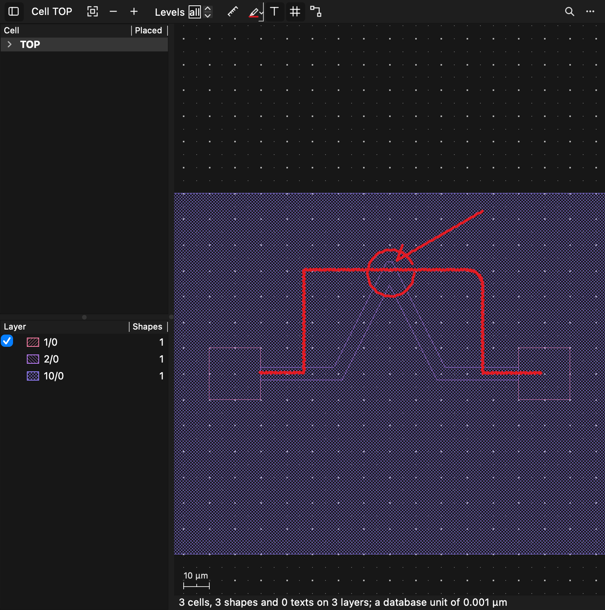
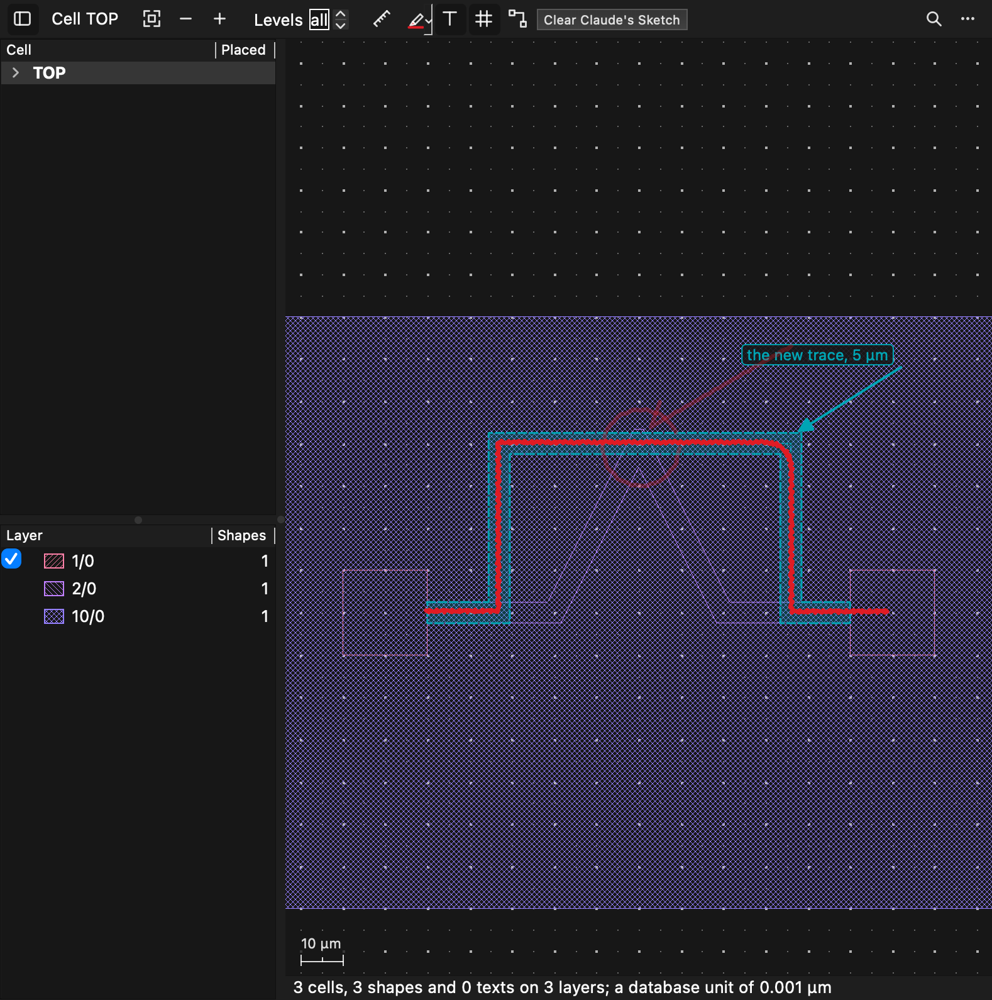

# Pen markers on a layout, followed up: what a stroke is about, a sketch as a polyline, Claude's overlay and edit_layout

The user (2026-11-07): *"Let's have a look at this in a new session: 'qucs-reviews/LayoutViewer/2026-11-07-pen-markers-feedback.md'"*

The review came from Claude using the layout viewer's pen markers ([2026-11-02-pen-markers.md](2026-11-02-pen-markers.md))
on a small demo: two pads joined by a bent 5 µm trace on 2/0, under a 300 × 140 µm frame on 10/0. It found that the
markers work, but that a stroke was described only by the layers it touches, so the frame crowded out what each stroke
was about.

*Apple M2 Ultra, macOS 27.2, Qt 6.12.0 from Homebrew. CI and the published releases use Qt 6.10.3. Nothing here was built
or run against 6.10.3, and no Qt API newer than the code already used was added; see "What could not be verified".*

Settled with the user before building: `edit_layout` may change **any shape** (add, delete, replace, move polygons,
paths, texts and placements); it saves **in place, with undo**; **no colour meanings** for now.

## The review's three cases, before and after

The demo is rebuilt in `test_pen_reading.cpp` (cells PAD, TRACE and TOP; the trace's spine (-50, 0), (-20, 0), (0, 40),
(20, 0), (50, 0)). The strokes are drawn as a hand would: points every 0.5 to 1 µm with a fixed wobble of a few tenths
of a µm, and a 6 µm rounding on the step's top right corner.

**Before**, as the review describes it (reproduced on this demo before anything was changed):

```
cell TOP, stroke 1: a red pen ring (its box -9.198, 29.441 to 10.197, 48.591 µm)
cell TOP, stroke 2: a red pen arrow from 1 shape(s) on 10/0 pointing at 1 shape(s) on 10/0 (its box 2.412, 43.357 to 36.544, 63.568 µm)
cell TOP, stroke 3: a red pen mark on 2 shape(s) on 1/0, 1 shape(s) on 10/0, 1 shape(s) on 2/0, 2 placement(s) of PAD, 1 placement(s) of TRACE (its box -50.811, -0.5 to 59.271, 41.1 µm)
```

Each finding held against the code: a ring counted only what lay at least half inside it, which a long trace never does;
an arrow's tip took whatever lay under it first, which was the frame; a mark listed every layer within half its breadth.

**After**, as the prompt now has it (one line a stroke; wrapped here):

```
cell TOP, stroke 1: a red pen ring around the vertex at (0, 40) of the 2/0 path in TRACE, a 53° corner, all of it over
  1 shape(s) on 10/0 that covers it (its box -9.198, 29.441 to 10.197, 48.591 µm)
cell TOP, stroke 2: a red pen arrow pointing at 1 shape(s) on 2/0, 1 placement(s) of TRACE, nearest its tip the vertex at
  (0, 40) of the 2/0 path in TRACE, a 53° corner, coming from the upper right, its tip at (2.9, 43.9), its tail at
  (36, 63.1), all of it over 1 shape(s) on 10/0 that covers it (its box 2.412, 43.357 to 36.544, 63.568 µm); its points
  (36.044, 63.068) (2.912, 43.857) (5, 49.8)
cell TOP, stroke 3: a red pen mark on 2 shape(s) on 1/0, 1 shape(s) on 2/0, 2 placement(s) of PAD, 1 placement(s) of
  TRACE, following the 2/0 path in TRACE from (-49.6, 0) to (50, 0), leaving it between (-33.8, 0) and (36.7, 0) to go
  40.6 µm above it, all of it over 1 shape(s) on 10/0 that covers it, read as a polyline of 5 run(s): horizontal at
  y ≈ 0.4 (±0.3, snaps to 0: the 2/0 path's centre line) from x = -50.3 to -33.2; vertical at x ≈ -33.2 (±0.3, snaps to
  -33: a 1 µm grid) up to y = 40.3; horizontal at y ≈ 40.3 (±0.3, snaps to 40: the 2/0 path's vertex at (0, 40)) to
  x = 36.1, the corner there rounded (radius ≈ 5.7); vertical at x ≈ 36.1 (±0.3, snaps to 36: a 1 µm grid) down to
  y = 0.3; horizontal at y ≈ 0.3 (±0.3, snaps to 0: the 2/0 path's centre line) to x = 58.8; its corners symmetric
  about x ≈ 1.4 within 0.1 µm, its ends not; snapped, its points (-50, 0) (-33, 0) (-33, 40) (36, 40) (36, 0) (59, 0)
  (its start to the 2/0 path's end at (-50, 0)) (its box -50.811, -0.5 to 59.271, 41.1 µm)
```

The third case is the review's "make it look like this": its snapped points, with the last one moved onto the pad's
edge, go straight into `edit_layout` as the trace's new spine (`editLayoutChangesTheFileAndUndoes`).





## The review, item by item

| # | Review's suggestion | Now |
|---|---|---|
| 1 | Say what a stroke is about | **Done** |
| 2 | Read a freehand line as a polyline | **Done** (layouts; not slides) |
| 3 | Points in the prompt when few | **Done** |
| 4 | A preview overlay Claude can draw; mark a stroke addressed | **Done** |
| 5 | A way for Claude to write a layout | **Done** as `edit_layout`; gdstk in `run_script` **not done** |
| 6 | Path naming, stable ids, what a reload changed, pen state | **Done** |
| 6 | Colour meanings | **Not done**: the user chose not now |

### 1. What a stroke is about

- **Shapes much larger than the stroke are set apart.** A shape counts as "much larger" when its box holds the whole
  stroke, its box is at least 8 times the stroke's, and its outline holds every point of the stroke (so a hollow seal
  ring is not one). Such shapes are left out of what the stroke marks and named once at the end: *"all of it over 1
  shape(s) on 10/0 that covers it"*. They are set apart largest first, and only while the stroke still marks something
  else. A dot on a pad under a die is on the pad, with the die set apart; a dot on the die alone is on the die, with
  nothing set apart (`aLargeShapeIsSetApartOnlyWhenSomethingElseIsMarked`).
- **A ring names the part of a large shape it holds:** the vertices of the shape inside the ring, with their angles. For
  a path these are the vertices of its spine. When no vertex is inside, the reading names the segments or edges that run
  through the ring.
- **An arrow** gives its tip and tail, the way it comes from (one of eight compass directions), and the feature nearest
  its tip. That feature is one of:
  - a vertex, end or corner, with its angle;
  - a segment or edge, with the side the tip is on (*"the edge from (70, 10) to (50, 10) of the 1/0 polygon in PAD, from
    above"*);
  - a text.

  A vertex is preferred to an edge that is up to half the path's width plus the stroke's reach nearer, because people
  point at a corner from outside it.
- **A line or a mark along a shape** says where it follows the shape (a path's spine, or a polygon's edges) and where it
  leaves:
  - **What counts as following:** the stroke must stay within the path's half width plus its own breadth, and run within
    30° of the segment's direction. A stroke that only crosses the trace, as the step's top run does at the trace's peak,
    does not count.
  - **When it is said:** when it follows for a quarter of its length, or for a tenth if it leaves and comes back.
  - **Brief touches and strays** shorter than a twentieth of the stroke are ignored.

### 2. A freehand stroke as a polyline

`strokeshape.{h,cpp}` reads a line, a corner, a mark or a ring as two to a dozen straight runs (a ring up to six):

- **Runs:** found with Douglas–Peucker at the larger of 1.5 pen widths and 3 % of the stroke's size. Short hooks where
  the pen landed or lifted are dropped. A short run between two long ones that turn becomes the corner's rounding.
- **Fit:** each run is fitted away from its corners. A run within 7° of level, upright or 45° is said as such, with its
  place as drawn and how far its points stray (*"vertical at x ≈ -33.2 (±0.3)"*).
- **Snapping, to what is near first** (shapes set apart are skipped):
  1. a path's centre line;
  2. a path's vertices and ends;
  3. a polygon's corners and the texts;
  4. edges.

  Failing those, it snaps to the coarsest round grid (100, 50, 10, 5, 1, 0.5 µm and so on, no finer than the database
  unit) within the run's spread. The ends snap along their runs in the same way.
- **Corners:** the corners as drawn are where the fitted lines meet, and the snapped ones where the snapped lines meet. A
  corner is rounded when the stroke passes further from that meeting point than the pen's breadth (or 2.5 times the
  wobble). Its radius is estimated from the angle and that distance: d = r (1/sin(θ/2) − 1).
- **Symmetry:** near mirror symmetry of the corners about an upright or level line, with the ends held to a stricter
  standard.
- **Not a polyline:** a circle or an arc that a circle fits as well, a run that bows (a parabola across it against the
  wobble), and a scribble.
- **Only when it says something:** the reading is given when it has a corner, or for a hand-drawn level or upright line.
  A two-point line's points already say as much.

### 3. Points in the prompt

A stroke whose simplified points number ten or fewer has them in its sentence (*"; its points (100, 30) (130, 50)"*). A
stroke read as a polyline gives its snapped points instead. `QucsApp::drawingsOf()` now reads with points, and the
prompt's lead-in says that few points are given there.

### 4. Claude's overlay, and strokes marked addressed

- **The overlay:** `show_layout`'s `overlay` draws over the cell shown:
  - polygons;
  - paths as wide as they would be (flush ends, mitred, outline dashed, spine dotted);
  - texts;
  - arrows with words at their tail.

  Coordinates are in µm and the colour is Claude's own teal (`colour` overrides it). It is kept per cell as
  `LayoutView::Sketch`, apart from the pen's strokes and their revision, from the prompt, and from the overlays the RF
  2.5D tab and the router draw. It is part of what a screenshot takes. The next `overlay` replaces it; `"clear"` takes
  every cell's away, and so does the tab's **Clear Claude's Sketch** button, which shows only while there is one.
  (`preview` was the review's word, but every tool already reserves that argument name.)
- **Addressed strokes:** `show_layout`'s `addressed: [n, ...]` marks strokes as dealt with, and `"none"` unmarks them. A
  marked stroke is drawn at 30 % of its colour and left out of the prompt, which counts it (*"(2 stroke(s) marked
  addressed, left out: cell TOP 1, cell TOP 3)"*). `read_drawings` still reads it, with `"addressed": true`. The pen's
  Undo takes the mark away. With every stroke marked, the prompt says so rather than "taken away".

### 5. `edit_layout`

`layoutedit.{h,cpp}` holds the editor; `qucscontrol_layoutedit.cpp` holds the tool.

- **Reading and writing** use gdstk through `router::readLibrary()` and `router::writeLibrary()`. These were factored out
  of the router's commit, which now uses them too: read whole, then a temporary file beside the target, renamed over it.
- **The edits:**
  - `add`: a polygon, a path (`width`, `ends` flush, round or extended), a text, or a placement (`of`, `at`, `rotation`,
    `mirrored`, `magnification`).
  - `delete`, `replace` and `move`: a polygon, path, shape (either), text or placement, picked among the cell's own
    elements by `layer` and `at` (the smallest there; a path within half its width of its spine) or by `box` (those
    wholly inside); a text by its words too, a placement by `of`.
  - `replace` changes the one element picked: its `points`, `width`, `ends`, `layer_to`, `text_to`, `at_to`, `rotation`,
    `mirrored` or `magnification`. Everything not given is kept, so a trace keeps its width and layer.
- **All or none:** the edits are applied in turn, and one that cannot be applied leaves the file as it was (*"Edit 2: TOP
  has no polygon on 9/0 at (0, 0) … Nothing was changed."*).
- **What it refuses:** an element of an array (it changes single elements only), a cell placed in itself, an OASIS path
  whose width varies (delete it and add one), unknown keys, and keys that are not of the edit's kind.
- **Undo:** the version before each edit is kept (20 at most) under the temporary-files folder, in
  `layout-edits/<the path's hash>/`. `undo: true` puts back the latest. It is refused when the file has changed since the
  edit (its SHA-256 differs from what the edit wrote), so a router commit or a change by hand is never lost; the answer
  says where the earlier version is kept.
- **The answer** gives what each edit did and what changed, read back from the file: by cell and layer, the shapes added
  and taken away with their boxes, and the texts and placements. It also reads the open tab again; the user's strokes and
  Claude's overlay stay.

**gdstk in `run_script`** was not done. The Python there has no gdstk, and installing a package needs the user's approval.
`edit_layout` covers what the review asked of it.

### 6. Smaller items

- **Path naming:** `show_layout` (and every layout tool that goes through `withLayout()`) now finds an open layout by its
  file name or tab title when the name is not a file in the project. Its `reload` does too; the test found that `reload`
  with `"demo.gds"` had silently read nothing again.
- **Stable stroke ids:** a stroke keeps its number on its cell or slide. `Drawing::add()` gives the next number after the
  last one given, and no number is given twice. Prompts, `read_drawings`, an arrowhead's `of stroke`, the router's
  `from_stroke` and `send_input`'s list of strokes it drew all use those numbers. The router's error lists the numbers
  there are.
- **What a reload changed:** `show_layout`'s `reload` and `edit_layout` both report `changed`, by cell and layer, using
  `layout::differences()`. Each shape is compared on its layer, kind, width, outline on the database grid and copies;
  texts and placements are compared by what and where.
- **The pen's state:** a prompt that tells the drawing adds *"(The pen is still taken up in its tab: a drag there draws
  rather than pans; show_layout's pen: false puts it down.)"* while the pen is taken up.

## Files

| File | What |
|---|---|
| `qucs/strokeshape.{h,cpp}` | New: a stroke as a polyline, its snapping, rounding and symmetry, in JSON and in words |
| `qucs/layoutstrokes.{h,cpp}` | New: a layout's strokes read against what is there. The reading moved out of `layoutdoc.cpp`, which now calls it, plus large shapes set apart, parts within a ring, features at a tip, follows, snaps |
| `qucs/layoutedit.{h,cpp}` | New: the editor and `differences()` |
| `qucs/qucscontrol_layoutedit.cpp` | New: `edit_layout` and its undo |
| `qucs/markup.{h,cpp}` | Stroke ids and `addressed`; the sentence's new parts, points when few, addressed strokes left out |
| `qucs/layoutdoc.{h,cpp}` | `Sketch` and its painting, `setAddressed()`, the Clear Claude's Sketch button |
| `qucs/qucscontrol_layout.cpp` | `overlay`, `addressed`, path naming, reload's `changed` |
| `qucs/qucs.cpp` | `drawingsOf()` reads with points, and says the pen's state |
| `qucs/layoutrouter/router_gds.{h,cpp}` | `readLibrary()` and `writeLibrary()` shared; `commitRoutes()` uses them |
| `qucs/qucscontrol_router.cpp`, `layoutrouterpanel.cpp`, `qucscontrol_input.cpp` | Strokes by their numbers |
| `qucs/qucscontrol.{cpp,h}` | `edit_layout`'s schema, description, keywords, dispatch; `show_layout`'s two arguments; `read_drawings`' description |
| `qucs/claudecodepanel.cpp` | The prompt's lead-in (one line) |
| `scripts/ci/check-tool-arguments.py` | `show_layout`'s overlay items checked against `sketchItemOf()` |

## Tests

`test_pen_reading` (new, 15 test functions):

| Test | What it holds to |
|---|---|
| `theReviewsCasesAreToldWhatTheyAreAbout` | The three prompt lines above, word for word up to the box; the arrow's three points; the step's points not said; `read_drawings`' fields (`over`, `holds part of`, `tip`, `comes from`, `nearest its tip`, snapped corners, angles, rounding, symmetry, `follows` above) |
| `aLargeShapeIsSetApartOnlyWhenSomethingElseIsMarked` | A dot on a pad: on the pad, the frame `over`; on the frame alone: on it, nothing apart; a ring round a pad holds it, and a circle is no polyline |
| `anArrowsTipIsNearestAnEdgeOrAText` | A tip above a pad's edge: that edge, from above, in PAD, coming from above, in the prompt; a tip on the trace's flank under its peak: the vertex, though the flank is nearer |
| `aStrokeKeepsItsNumber` | 1, 2, 3; cleared and undone; 4 and 5; 2 erased, the next 6; readings 1, 3, 4, 5, 6; an arrowhead's `of stroke` 4; the router's `from_stroke` 2 refused with the numbers there are |
| `aFewPointsAndThePenAreSaid` | Two points said; a scribble's not; the pen's line when taken up |
| `aFreehandStrokeIsReadAsAPolyline` | Synthetic strokes: a level line snapped to a 10 µm grid, then to an edge 0.1 away, its end to a named x; a U symmetric about 25, ends too, sharp corners at 90°; a lopsided one not symmetric, a slanted run; an L rounded r = 8 read within 1.2; a flick where the pen came down, and one where it lifted, dropped; a diagonal run; a rectangle ring closed, four runs, corners snapped to whole µm; a circle, an arc, a scribble, a stroke too small, none; the words; the round grid |
| `claudesOverlayIsKeptApartFromTheStrokes` | Four items drawn and counted; the button shows; strokes, revision, prompt and the router's overlays unchanged; teal in the picture along the new step and not on the old trace's flank; replaced; none on another cell; the button and `clear` take it away; 15 wrong overlays refused, nothing drawn; an item's unknown key named by the tools' schema check |
| `aStrokeMarkedAddressedIsFadedAndLeftOut` | An unknown number refused with the numbers there are; 1 and 3 marked, the prompt counts them; `read_drawings` keeps the mark; Undo takes it away; all marked, said so; `none`; 5 wrong values refused |
| `anyOverlayIsRefusedOrDrawn` | 400 fuzzed overlays: refused or drawn, then painted |
| `editLayoutChangesTheFileAndUndoes` | The step's snapped points made the trace's spine, width 5 kept, read back with gdstk; `changed` 2/0 +1 −1 with its box; the tab read again, strokes kept; a polygon, text, placement, move, path added and box-deleted in one call, read back; all or none; two undos back to the original bytes; a third refused; undo refused after another program rewrote the file |
| `editLayoutRefusesWhatItCannotDo` | 23 wrong calls, each refused with its reason and the file unchanged; an AREF's element refused; a file that is not there |
| `aReloadSaysWhatChanged` | `reload` says nothing changed, then a pad written by gdstk elsewhere, with its box |
| `anyEditIsRefusedOrWritten` | 300 fuzzed edit lists: refused with the file unchanged, or written and read back |
| `anyStrokeIsRead` | 300 fuzzed strokes (repeated points, tiny and huge scales and widths, highlighters) read with points and told |
| `picturesForTheWriteUp` | Skipped unless `QUCS_PEN_PICTURES` names a folder: the two pictures above |

No test asserts on elapsed time.

**Results.**

- **Release:** `test_pen_reading` 15 of 15 (the picture step skipped without its folder), `test_layout_doc` 41,
  `test_pptx_doc` 38, `test_layout_routing` 5, `test_layout_router` 30, `test_claude_code` 92, `test_qucs_control` 218,
  `test_mcp_server` 22 and `test_claude_fuzz` 4 all pass. Each count is of the functions that passed; the skips are the
  suites' own.
- **ASan and UBSan** (Debug, `-fsanitize=address,undefined`): `test_pen_reading`, `test_layout_doc`, `test_pptx_doc`,
  `test_layout_routing` and `test_layout_router` pass, with no sanitizer report. That includes the three fuzz functions:
  300 strokes, 400 overlays and 300 edit lists.
- **The four lints** are green: `check-tool-arguments.py` (158 tools, 0 disagreements), `check-json-nesting.py`,
  `check-shaders.py`, `check-third-party.py`.
- **On the screen:** the pictures above come from `picturesForTheWriteUp` run with `QT_QPA_PLATFORM=cocoa`, the viewer
  in a window on this Mac's display. They are the tab's own drawing, not the offscreen platform's. No person drew the
  strokes there; the test did.

## Broken on purpose

`2026-11-07-pen-markers-followup/breaks.py` holds twenty-nine breaks across the reading, the polyline, the prompt, the
overlay and the editor. `python3 breaks.py --check` confirms each break's text is found exactly once.

**All 29 are caught**, each by a failing assertion rather than a crash. The first run had thirty breaks and three
survived. Each survivor showed something:

- **An edge preferred to a vertex that is about as near:** in the review's arrow, the nearest point of the trace's flank
  *is* the vertex, so the preference was never tested. A second arrow now ends on the flank just below the peak.
- **A hook where the pen lifted, kept as a run:** no stroke had one. Two do now, a flick at each end.
- **An overlay item's unknown key accepted:** the tools' own check of the schema's items refuses it first ("overlay[0]
  has no layer; it takes arrow, at, colour, path, polygon, text, width"), so breaking `sketchItemOf()`'s check is caught
  by nothing, by design. That break was dropped; the test now asserts the schema check's message.

## Found along the way, fixed

- **`show_layout`'s `reload` with a file's name alone read nothing again.** It looked the name up in the project folder,
  the review's path-naming finding in a second place. It now finds the open tab as `withLayout()` does.
- **`show_layout`'s description was 10 characters under the 2048 cap on main**, so the new arguments' sentence put it
  over (`test_qucs_control`). The sentence about what it returns and the one about `select` were shortened to make room;
  the detail is in the arguments' own descriptions.
- **`check-json-nesting.py` caught two `QJsonArray{QJsonArray{...}}` in the new test.** They are now built by `append`.
- **The overlay's label ran off the view's edge on the real display** (the first Cocoa picture). A label now moves to the
  left of its point near the right edge, and below it near the top.

## What could not be verified

- **Qt 6.10.3**, and Windows and Linux: built and run only with Qt 6.12.0 on macOS.
- **A person's hand:** every stroke in the tests is synthetic (a deterministic wobble). The thresholds — 7° for a level
  run, 8× for a large shape, 30° for following, a twentieth for a stray — are judgement, and may need tuning against real
  sketches.
- **The overlay by a person's eye** beyond the two pictures; it is not printed (a layout's print draws the pen's strokes,
  not Claude's sketch).
- **gdstk's rewrite of a real foundry file:** `edit_layout`, like the router's commit, writes the whole library back with
  gdstk. Whatever gdstk does not keep when it reads a file is lost on writing (the same as for `route_commit`).
