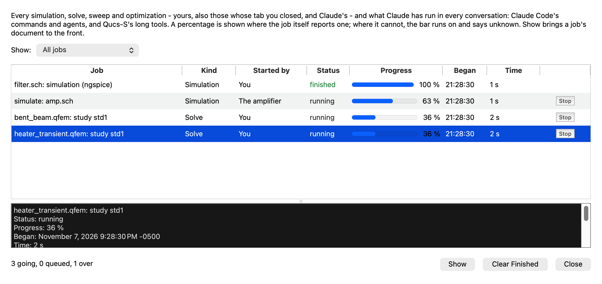

# Running simulations: a tab closed while it runs keeps running, and every run is in one list

*7 November 2026, on `claude/running-simulations-b617f6`, cut from `119aec3`. Apple M2 Ultra, macOS 27.2, Qt 6.12.0 from
Homebrew. CI pins Qt 6.10.3 and none of this has run on it, nor on Linux or Windows (see "What could not be verified").*

The request: *"Right now if I accidently close several running simulation tabs (.qfem, .qrf25, .qfem3d, .sch, ...) I have
no way to finding all the actively running tabs and restore and open them again. Is there a nice way to implementing this
feature in qucs? Maybe add a new toolbar that has buttons that open windows for showing all the running simulation tabs,
their progress, status, etc."*

Settled with the user before it was built: Close **asks each time**; the runs join the **Background Jobs window** (one list,
with who started each); **Quit asks** when something still runs.

## What you can do now

- **Close a tab that is running** (a schematic simulating with ngspice, Xyce, SPICE OPUS or Qucsator; a 2D model solving,
  meshing, optimizing or checking its mesh convergence; a 3D model solving or meshing; an RF 2.5D model solving). You
  are asked:
  - **Keep Running in Background**: the tab closes, and the document stays alive, hidden, with its run going on. Its
    unsaved changes stay with it (it is not asked about them, since nothing is lost).
  - **Stop and Close**: the run stops and the tab closes, as before.
  - **Cancel**: nothing happens.

  Close All, Close Others, Close Left/Right and a project switch ask once for all the running tabs they would close.
- **Bring it back**, the same document with its run and its results (not a fresh copy from its file), by any of:
  - opening its file again (File > Open, Recent, the project tree, a double click, `open_document`);
  - **File > Reopen Closed Tab** (Ctrl+Shift+T), or **File > Recently Closed Tabs**, which says of each kept one
    "running, 42 %" or "kept, with its results";
  - **Show** in the jobs window, or a double click on its row.
- **Find every run in one place.** A new **Running Jobs** toolbar has **Jobs** (it says "Jobs (2 running)") and **Reopen
  Closed Tab** with its list. **Simulation > Running Jobs...** and the Claude dock's ⋯ > Show Background Jobs open the same
  window. The status bar has a chip, "2 running", or "1 kept in the background" when only finished hidden documents are
  left. Its tool tip names them, and a click opens the window.
- **The window** lists your runs and Claude's together: name, kind, **Started by** ("You", or Claude's conversation),
  status, a bar with the percentage where the run reports one, when it began and how long it has run, and **Stop**. A
  **Show:** filter has All jobs, Simulations and solves, Started by you, and Started by Claude. Below the list, **Show**
  and **Clear Finished**. Clearing a finished hidden document's row lets it go; one with unsaved changes comes back as a tab
  instead, to be saved.
- **Quit** with runs going (in tabs or hidden) lists them and asks: **Stop Them and Quit** or **Cancel**. Hidden documents
  with unsaved changes come back as tabs first, so the usual save question covers them.
- **Claude** sees your runs in `list_background_jobs` (now with `started_by` and `document`, and a `started_by` filter),
  and `show_background_jobs` takes a `filter`. A tool given the path of a hidden document is told it was closed while
  running and that `open_document` brings it back.

*(Two real solves: one whose tab was closed, one in its tab. The amplifier's simulation (Claude's) and the filter's
finished run are made-up rows. On this Mac's own display. The dark one is
[beside it](2026-11-07-running-simulations/jobs-dark.png); the [main window](2026-11-07-running-simulations/main-window-dark.png)
shows the toolbar ("Jobs (3 running)") and the status chip, and the [question](2026-11-07-running-simulations/close-question.png) is what Close
asks.)*

**What falls short:**
- **A run is kept only while Qucs-S runs.** Nothing survives a quit or a crash. A run's row from an earlier session comes
  back from the kept list as lost, as Claude's jobs already did.
- **Hidden documents are not autosaved.** One kept with unsaved changes keeps the autosave copy it had when its tab closed
  (that copy is no longer removed on close), but later autosaves skip it until it is back in a tab.
- **Only work that was asked for counts.** A model's geometry made again after an edit, or a 2D process flow's step
  built to be shown, is no run: closing it asks nothing and stops it, as before. A 2D process flow's geometry built for a
  Compute or Build Mesh does count (`MultiphysicsDoc::buildAwaited()`, new); it is listed once it has run two seconds,
  or as soon as its solve starts.
- **A run that begins and ends between two readings may not be listed.** The documents are read every 400 ms, and at the
  next turn of the event loop after a model's state signal. A run of a few milliseconds that nobody closes can fall
  between them. Closing a tab reads them at once first: on the Cocoa display an RF 2.5D solve of the tests began and ended
  inside the question, and was never listed, until that was added.
- **Claude's tools closing a running tab** (`close_document`) do as before: nobody can be asked and the call asked to
  close it, so a model's run stops and a schematic's result is discarded. `test_simulation_console`'s
  `closingTheDocumentTakesTheRunDown` now closes that way, since a close by the user asks first.
- **The tuner's runs** are not listed (each step is a run of a moment), and a schematic being tuned closes as before.

## What closing a tab did before, and does now

Read in the code at `119aec3`, then checked by the tests below.

| Document | Before, its tab closed | Now, Keep Running |
|---|---|---|
| Schematic, ngspice / Xyce / SPICE OPUS | The simulator ran on to its end in the console (`SimulationRun` holds the schematic by `QPointer`), and then **its result was thrown away**: "The schematic was closed during the simulation; the result is discarded" (`SimulationRun::slotProcessOutput`), no dataset written, nothing reloaded. The brief guessed that such a run outlived its tab; it did, but to no use (`test_simulation_console`'s `closingTheDocumentTakesTheRunDown` pins it) | The schematic stays alive, so its dataset is written. When the run ends, its graphs reload and its script and CMD blocks run. It opens no data page and does not switch the palette, since it has no tab |
| Schematic, Qucsator | Its own window (`SimMessage`, owned by the application, the document by `QPointer`) ran on, and Qucsator wrote its dataset itself; with the document gone, nothing was reloaded | The same as above |
| 2D model (`.qfem`) | `~MultiphysicsDoc` cancelled its job and its geometry build and waited for them. (Waited on by a Claude tool, it was cancelled and freed once the wait ended: `closeWhenFree`) | Kept. Its job, build, optimization or convergence check goes on |
| 3D model (`.qfem3d`) | `~Multiphysics3DDoc` cancelled its job and waited for its thread | Kept |
| RF 2.5D model (`.qrf25`) | `~RF25Doc` let its layout read and its mesh go, and stopped a full-wave sweep at its next frequency | Kept. Its solve goes on (its shapes and mesh, remade at each edit in a moment, are not counted as a run) |
| Any of them, Stop and Close | | As before, with the run stopped first |

## How it works

- **`simulationruns.{h,cpp}`** (new): `qucs_s::runs::Tracker`, owned by the main window.
  - **What a document runs.** `activityOf()` reads each model from its own state: a 2D model's `isBusy()`,
    `buildAwaited()` and `jobFraction()`, and what it is at (`optimizing()`, `converging()`, `computing()`, `meshBeingMade()`); a 3D model's
    `solving()` and `meshing()`; an RF 2.5D model's `isSolving()`, `solveCount()` and `solvingSaid()`. The percentage is
    the model's own bar's, never worked out from time, and 0 counts as nothing said, as in `qucscontrol_jobs.cpp`.
  - **When.** The documents, open and hidden, are read every 400 ms, and at once when a model emits `stateChanged` or
    `solvedChanged`. A schematic's run lives in the console or in Qucsator's window, not in the document, so the two places
    in `qucs.cpp` that start one tell the tracker (`watchSpiceRun`, `watchQucsatorRun`). Its end comes from the run's own
    signal (`simulated`, `SimulationEnded`).
  - **The list.** Each run is a job in the jobs registry (`claudejobs.h`) with source `user`, its document's path, Stop
    (the model's own Cancel, `SimulationRun::stop`, Qucsator's Abort) and how it ended: stopped (a stop asked for, or the
    model's stop count moved), failed (the model's last error; a 3D solve with no solution; an RF 2.5D solve with no
    result; a simulation with an error or no results) or finished, at 100 %.
  - **Claude's runs, once.** A run that a Claude tool began is already that tool's job. Before listing a run, the tracker
    asks `QucsControl::jobWorkingOn()` for a call under way on that document: `simulate`, `fem_solve`, `fem_build`,
    `fem_converge`, `rf25_solve`, `tune`, or a `batch` or `run_script` that waits on its calls. That job gets the
    document, and no second row is made. A run begun by any other call of Claude's, such as a menu action it triggered, is
    listed as Claude's (its conversation's), since that call ends before the run does.
  - **Hidden documents.** `park()` reparents the document to a hidden widget of the main window. It stays in that window,
    so a view drawn with the GPU is never moved to another. `unpark()` hands it back for a tab. At most eight finished,
    unchanged hidden documents are kept, and the oldest go first. A running one, or one with changes, is never let go
    by that limit: only by Quit, or by its row cleared (one with changes then comes back as a tab).
  - **Tabs closed lately.** The last ten, by file, and for a hidden one the document itself.
- **`qucs_runs.cpp`** (new, `QucsApp`'s): the Close question, `keepRunningWithoutTab`, `bringBackDocument`, the window's
  Show, the toolbar and menu items, the quit question, and what Clear Finished lets go. The icons are drawn from the
  palette at each paint, so they follow the theme.
- **Shared files, additions only:** `qucs.cpp` (`closeFile`, `closeAllFiles`, `closeTabsRange`, `gotoPage`, the two quit
  paths, the two run starts, and the two after-run handlers skipping what opens a tab for a hidden document); `qucs.h`;
  `qucs_init.cpp` (two lines: `initRuns()` and the toolbar in `toolbars()`); `statusbar.{h,cpp}` (the chip);
  `multiphysicsdoc.h` (`buildAwaited()`, one line) and `multiphysics3ddoc.{h,cpp}` (`meshing()`, three);
  `claudejobs.{h,cpp}` (`Job::document`, `startedBy()`, `started_by` and `document` in the JSON and the kept file);
  `claudejobswindow.{h,cpp}` (Started by, the filter, Show, the new kinds' names); `qucscontrol.{h,cpp}` and
  `qucscontrol_jobs.cpp` (`jobWorkingOn`, a Claude job's document, the tools' new argument, filter and words); the two
  CMake lists.
- **Qt:** nothing newer than 6.8 is used: `QAction::associatedObjects()` (6.0) in a test, and
  `QStyleHints::setColorScheme` (6.8) in the opt-in pictures test, as the jobs window's write-up already used.

## Tests

`test_running_jobs` (new, 14 tests and an opt-in one). Every run is a real one: a 2D transient made to run for hours, the
3D `chip_heater` example, an RF 2.5D line on the example layout, and fake simulators (a shell script) for ngspice and
Qucsator that print and then sleep. Each tab is closed the moment its run has begun, so it is still running whatever the
machine's speed. Nothing asserts a time taken: waits are `QTRY` with long bounds.

| Test | What it holds |
|---|---|
| `theToolbarAndMenus` | the toolbar, its two buttons and list, File and Simulation items, Ctrl+Shift+T, one window |
| `aModelKeepsRunningWithItsTabClosed` | asked; kept; hidden, held, still solving, its percentage still moving; listed as the user's; the status chip and the Jobs button count it; reopened by its file: the same document, still solving; stopped by the row's Stop; held with what it got to |
| `theWindowShowsAndClears` | Show brings it back; the filter hides and shows it; Clear Finished lets a finished one go; one with changes comes back as a tab instead |
| `stopAndCloseOrCancel` | Cancel leaves it; Stop and Close stops it (said stopped, not lost) and frees it; its file reopens |
| `reopenClosedTabs` | a tab with nothing running closes with no question; the newest first, from the action and the menu; at most ten; a file gone |
| `closeAllKeepsWhatRuns` | one question for Close All; the running one kept, the other closed |
| `a3DModelSolvesWithItsTabClosed` | the 3D solve ends without its tab, finished at 100 %, and comes back with its solution |
| `anRf25ModelSolvesWithItsTabClosed` | the same for an RF 2.5D solve, back with its extraction from Reopen Closed Tab; a second solve stopped from the list |
| `aSchematicKeepsSimulatingWithItsTabClosed` | an ngspice run (fake): listed with ngspice in its name, kept, 42 % from its output, reopened (the same schematic), stopped from the window, its data page not opened |
| `aQucsatorRunKeepsGoingWithItsTabClosed` | the same for Qucsator's window (fake) |
| `claudesRunIsListedOnce` | Claude's `fem_solve` is one row, with its document; the tools' `started_by` and filter; closed by the user, still going (not lost); a tool told where the document went; Show; `show_background_jobs` with a filter |
| `aToolClosingARunningTabStopsIt` | `close_document` asks nobody and stops it, as before |
| `quitWithRunsGoing` | the window's close event asks and is cancelled, nothing changed; Stop Them and Quit brings back the one with changes, then lets every hidden one go, its run stopped |
| `heldDocumentsHaveALimit` | at most eight finished hidden documents, the oldest let go |
| `pictures` (opt in) | `QUCS_RUNS_PICTURES=<folder>`: the window light and dark, the main window (dark), the question |

**Existing tests changed, because the behaviour changed on purpose.** Four tests closed a running tab the user's way and
expected it gone at once. Each now meets the question:
- `test_multiphysics_doc` (`aFlowsGeometryIsBuiltInTheBackground`, its close while a tool waits on the build) and
  `test_multiphysics_optimize` (`closedWhileItRuns`) answer **Stop and Close**, and keep their assertions.
- `test_simulation_console` (`closingTheDocumentTakesTheRunDown`) closes as a tool of Claude's does (no one to ask), which
  is where the old behaviour remains.
- `test_toolbar_lock` counts eight toolbars, not seven.

The same 2D test first showed the question for a process flow's geometry rebuilt after an edit. That was wrong (nothing
asked for runs then), and led to `buildAwaited()` and the 3D model's `meshing()`.

**The results**, as QtTest counts them (with its `initTestCase` and `cleanupTestCase`). Every row but the whole suite's ran
on the final code:

| | Release | ASan + UBSan (Debug) |
|---|---|---|
| `test_running_jobs` | 16 pass, 1 skip (`pictures`, opt in) | 16 pass, 1 skip |
| the whole suite (`ctest`, 179), before the last three changes (the question reworded, the reading before it, `endRuns()`) | 177 pass. `test_library_export` was not built: it needs `qucsconv_rf`, which needs `dos2unix`, not installed here. `test_toolbar_lock` failed on its count of toolbars, fixed, then 6 pass | not run whole |
| `test_multiphysics_doc`, `test_multiphysics_optimize`, `test_simulation_console`, `test_toolbar_lock` after the changes above | 89, 18, 14 and 6 pass | pass (`test_multiphysics_doc` in 904 s) |
| `test_claude_jobs`, `test_mcp_server`, `test_claude_code`, `test_claude_fuzz` (short pass) | pass | pass |
| `test_qucs_control`, `test_mcp_wishlist`, `test_rf25_doc`, `test_multiphysics3d_doc` | pass | not run |
| the four lints in `scripts/ci/` | green (157 tools checked) | |

**What the sanitized build found.** The Debug build's own check, not a sanitizer report: as the main window was destroyed,
its children going (Claude's tools marking their jobs lost) changed the jobs, and the registry told
`QucsApp::updateRunsActions` of it, on a window half destroyed. `test_multiphysics_doc` and `test_multiphysics_optimize`
aborted in their `cleanupTestCase`, every test before passing. `~QucsApp` now calls `endRuns()`, which disconnects the
jobs' signals from the window and takes away the jobs window's Show, as it already did for `focusChanged`. After it, the
runs above, with no report from either sanitizer.

`test_running_jobs` also ran whole on this Mac's own Cocoa display, twice, after the fix above (the pictures come from
there too).

## What could not be verified

- **Qt 6.10.3, Linux and Windows.** Everything ran on Homebrew's Qt 6.12.0 on macOS.
- **By hand.** The window, the toolbar, the chip and the question were seen in pictures taken on this Mac's Cocoa display
  by the opt-in test, and the whole suite ran there. No person has clicked through the built app. The keyboard shortcut
  was checked as set, not pressed.
- **A real ngspice, Xyce or Qucsator run closed and reopened.** Fake simulators stand in for them, as in the jobs
  window's tests. The paths they exercise are the real ones (`slotSimulateWithSpice`, `SimMessage`), but a real
  simulator's own output and timing were not tried.
- **Long real runs.** The 3D and RF 2.5D solves in the tests take seconds in Release. Hours-long runs kept hidden were not
  tried, nor how much memory many hidden models hold (each keeps its mesh and solution, as an open tab does).
- **A 2D optimization or convergence check kept hidden** is the same job path as a solve (`isBusy()`) and was not run by
  itself here.
