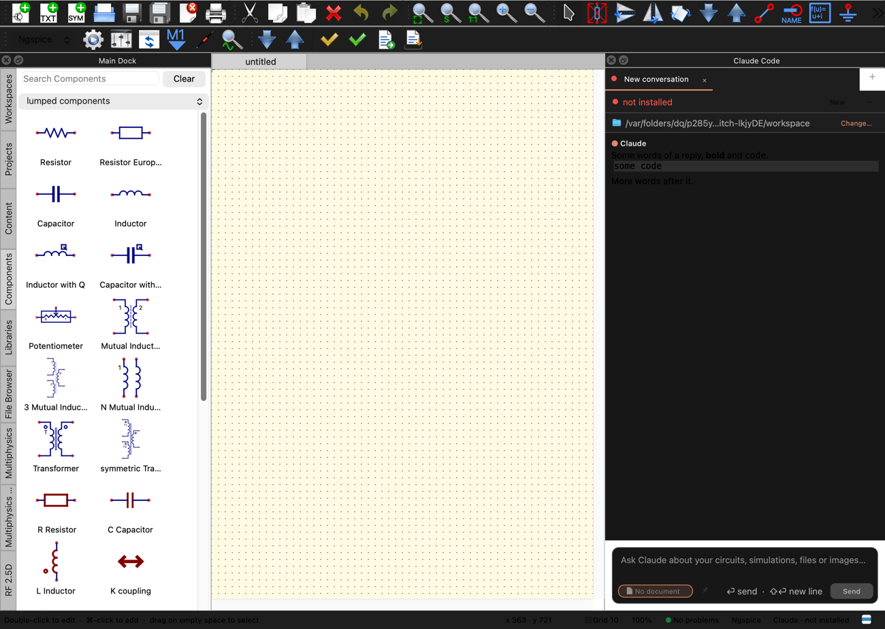
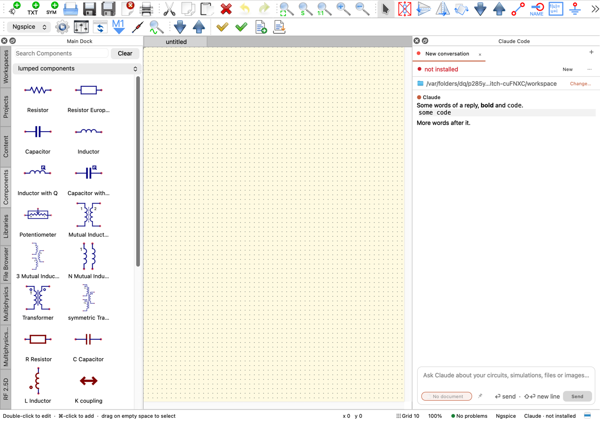
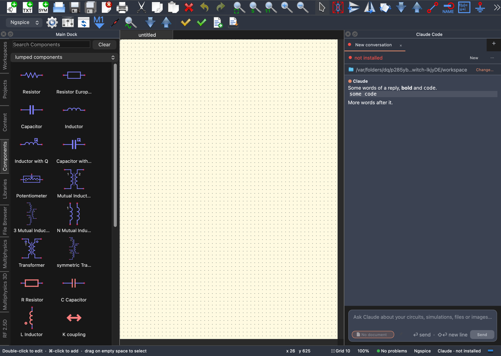
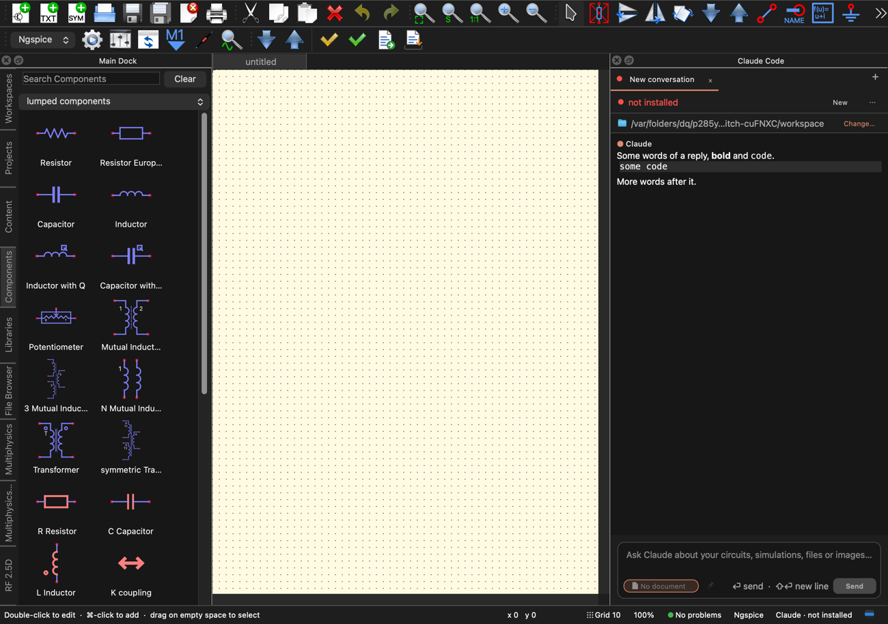

# The theme changed with the window open: black text on a dark Claude Code dock

Found while checking code block wrapping in the Claude dock in light and dark: the first pictures switched the theme with
the window already shown, and looked wrong.

*Apple M2 Ultra, macOS 27.2 in dark mode, Qt 6.12.0 from Homebrew. CI pins Qt 6.10.3 and none of this has run on it (see
"Not verified").*

**Finding.** The fault is real, and in the app's own route, not only the test's. With the main window open on a dark Mac,
View > Theme > Light turned the main window white, but the dock, the panel and the toolbars stayed dark. The transcript's
text went black on `#171717`. Going from a designed theme to a platform theme was just as wrong: Nord then Dark left the
dock in Nord's colours for good.

It is not only a Mac fault. It shows on the offscreen platform too, where a platform theme is a palette of ours, so Linux's
Dark and Light should have it as well (not run there). Starting in a theme was always right, since the window then takes
the palette as it is made.

| View > Theme > Light, on a dark Mac | Before | After |
|---|---|---|
| The whole window |  |  |

| Nord, then Dark | Before | After |
|---|---|---|
| The whole window |  |  |

(The "before" pictures are from an early version of the test, with its reply text the same.)

## Why

Qt does not take a new palette to every widget. What was counted on Cocoa, for one switch:

- `ApplicationPaletteChange` goes to the widgets of the classes with a palette of their own in the platform theme: labels,
  buttons, item views, text edits, tab bars and so on. That is why the text changed.
- It goes to the window, as a posted event. The window then passes its palette to its children, but only those without
  `WA_StyleSheet`.
- The main window has a style sheet (`setStyleSheet("QToolButton { padding: 0px; }")`, `qucs.cpp:582`), which gives every
  widget under it `WA_StyleSheet`. So a plain widget in the window (the dock, the panel, a toolbar) hears nothing.
- `ClaudeCodePanel::changeEvent` therefore never ran, and neither did `restyle`, so its style sheet kept the old background.

This does not depend on anything of Qucs-S. [`bare-qt.cpp`](2026-11-07-theme-switch-dock/bare-qt.cpp) shows it with a
window, a child and a label:

```
no style sheet                                     a style sheet on the window
light app #ffffff window #ffffff child #ffffff     light app #ffffff window #ffffff child #1e1e1e
```

Designed themes looked fine only because setting a style sheet on the application polishes everything again. Leaving one
for a platform theme has no such step, which is the Nord case above. The events and the propagation rule are what was
observed; Qt's source was not read.

## The fix

`apptheme.cpp`: `PalettePasser`, a filter on the application. When the application hears `ApplicationPaletteChange`, it
sends that event once to every widget, on the next turn of the event loop. Each widget resolves its palette again, and the
panels' own `changeEvent` handlers restyle them. A palette a widget set for itself stays its own.

It hooks the application's event rather than `apply()` so that a change with no `apply()` is covered too: the system's
appearance changing while the theme is System. `apply()` installs it on first use, which `main.cpp` does at startup.

Taking the main window's style sheet away would not do: the panel, the git bar and others have style sheets of their own,
and the same rule holds under them.

The other `changeEvent` handlers this now reaches (file browser, documents, git bar, tabs, jobs window) were read. They
defer their work or only repaint, and none deletes widgets, so the walk over `allWidgets()` is safe.

## Testing

`tests/test_theme_switch.cpp`, a `QucsApp` with the dock open and a reply in it:

- `theDockFollowsTheMenu`: 12 steps through the real View > Theme actions, between platform and designed themes.
- `theDockFollowsApply`: 5 steps through `apply()` alone, the route the fault was first seen on.
- `aPaletteOfItsOwnIsKept`.

Each step checks the palettes of the main window, dock, panel and toolbars against the application's. It also reads the
transcript's pixels: the background, a contrast of at least 4.5 for the text, and the code block in the new theme's shade.

CTest runs it offscreen. To run it on the platform itself, run the program with no `QT_QPA_PLATFORM`;
`QUCS_THEME_PICTURES=<folder>` keeps a picture of each step.

| | Cocoa | Offscreen |
|---|---|---|
| Without the fix | 12 of 20 fail | 10 of 20 fail |
| With the fix | 20 of 20 | 20 of 20 |
| With the fix, ASan and UBSan | 20 of 20, no report | 20 of 20, no report |
| Broken: every widget handed the application's palette outright | 1 fails | 2 fail |
| Broken: the pass works only once | 11 fail | 10 fail |

The counts are of the 18 steps and functions plus `initTestCase` and `cleanupTestCase`.

The picture of Light first looked wrong after the fix too: code block dark, the name "Claude" white on white. That picture
was taken before the panel's 40 ms render timer fired, and the same picture taken later is right. The test missed it at
the time, which is why it now looks for the code block's shade.

The Release suite: 170 of 172 pass. `GeometryTest` and `test_library_export` were not built, since this machine has no
`dos2unix` for a `qucsator_rf` build step, so they did not run. CI's lints that CTest includes pass (`check_json_nesting`,
`check_tool_arguments`).

## Not verified

- **The packaged app, looked at on screen.** All of this is widget grabs of a `QucsApp` in the test program on Cocoa, picking
  the real menu action. `screencapture` was refused in the session that saw this. The window's frame and title bar, which
  grabs do not show, were not seen. `main.cpp`'s own start differs only by the saved style and theme set before the window.
- **The system's appearance really changing.** Changing it means changing a system setting, so this was not done. Light to
  System goes through the same application event, and that is tested. By the code the same pass runs, but it was not seen.
- **Qt 6.10.3, Windows and real Linux.** No newer Qt API is used.
- **The other docks and documents, one by one.** They get the same event and the pictures of the main dock look right, but
  the test checks only the main window, the Claude dock and the toolbars.
