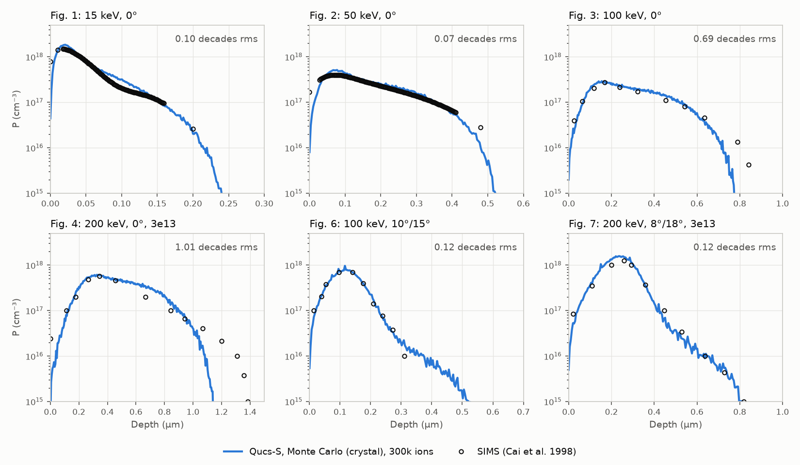

# A crystal Monte Carlo for the implant step: channelling worked out, not typed in

The user (2026-11-08): *"Do this in a new session: 'qucs-reviews/Multiphysics/ImplantProcessFlow/2026-11-08-claude-implant-crystal-bca.md'"*:
the review's proposal for merging its crystal binary-collision Monte Carlo (items 1-9), and its findings F1-F4.

*Apple M2 Ultra (24 cores), macOS 27.2, Qt 6.12.0 from Homebrew. Nothing here was built against Qt 6.10.3 or on Linux;
see "What is not verified".*

**Now.**
- **A fourth implant profile, "Monte Carlo (crystal)"** (`"profile": "crystal"`). A binary-collision Monte Carlo
  (MARLOWE's way) runs through the wafer's crystal and the amorphous films over it, at the beam's tilt, rotation and
  divergence. Its histogram is the profile. Nothing in it is fitted to SIMS.
- **Through the process flow:** the step's march takes the profile column by column, with the tilt already in it (not
  projected again). Across the beam it uses the run's own lateral straggle. Below the crystal (an SOI's oxide) the
  existing dose-matched march carries on.
- **From the panel and from Claude's tools:** the Profile box offers it, and with it come **Divergence** (1°), **Wafer's
  temperature** (300 K), **Ions** (50000) and **Random seed** (1). **Rotation** is now on every implant (F4). `fem_build`,
  `fem_plot … sims` and `fem_evaluate` work on it as on any step, and the tool description lists the new keys.
- **A background job, cached:** a process flow is already built on its own thread. The Monte Carlo reports its progress
  through the flow's ticker and stops when told. Its result is kept (32 runs, newest first) by everything it depends
  on: species, energy, tilt, rotation, divergence, the cover (each film's material and thickness), the crystal and its
  surface, temperature, ions and seed. A rebuild after an unrelated edit takes it from the cache, and the report says
  "from the cache".
- **Deterministic:** each ion has its own random stream (xoshiro256** from the seed and the ion's number, our own code,
  not the standard library's distributions), and the ends are summed in ion order. The same seed gives the same profile
  on any number of threads and on any platform's standard library. Only floating-point differences between platforms
  remain.
- **No Python at run time:** silicon's electron density ships as a resource
  (`multiphysics/data/si_density_cai.txt`, the review's LDA atom), read once into a 96³ grid.
- **F2:** a dual Pearson's report now gives its channelled part. **F3:** a **Moments along the normal** flag
  (`"normal": true`) keeps moments taken at a tilt from being projected again; the step's help says so. **F4:**
  rotation is a step property.

## Method

The engine is the review's `code/bca_crystal.cpp` (376 lines, written by Claude in the review), ported into
`multiphysics/fem_process_crystal.cpp`. Its physics is unchanged:

- **Nuclear scattering:** the ZBL universal potential, its θ, time integral τ and closest approach tabulated over
  log₁₀ ε (−6 to 5, every 0.02) and b (0 to 40 screening lengths, every 0.01). The ion moves to where the asymptotes
  cross.
- **Collision partner:** the nearest lattice atom ahead within 2.4 Å, not one of the last 12 struck. Each atom vibrates
  as a Gaussian (0.075 Å at 300 K, scaled by Debye's law with Θ = 543 K for other temperatures). Recoils are not
  followed.
- **Electronic stopping:** Cai et al.'s model (PRB 54, 17147): Brandt-Kitagawa effective charge with rs⁰ = 1.109 Å (their
  boron and arsenic value), Echenique-Nieminen-Ritchie friction, integrated every 0.1 Å through the crystal's own density
  grid. Firsov's loss is added in each collision.
- **Amorphous films over the crystal:** TRIM's random collisions: free path N^(−1/3), partners by their shares. The
  electron gas comes from the valence electrons (SiO₂ comes out at rs = 1.66 bohr, the review's value). A film of the
  crystal's own material uses the crystal's average.

What changed in the port:

- **One θ(ε, b) for the whole program.** The review's singularity-free quadrature (the straight line's π − 2 asin q taken
  out exactly) is now `universalScattering` in `fem_process_ions.cpp`. The transport theory's `scatteringAngle` calls it
  too, alongside the existing `zblScreening` and `screeningLength`. The old Gauss-Mehler θ lost precision at grazing
  angles: up to 8×10⁻⁵ rad absolute, 1.6×10⁻⁴ relative in the Coulomb limit, and 139 % relative at θ ≈ 10⁻⁶.
  `test_fem_process` (the transport theory's tests against a Monte Carlo and the tables) passes unchanged with the new
  one.
- **The table is universal.** The potential is universal in reduced units, so one table (26 MB, built once in about
  0.4 s on 24 threads) serves every pair. The engine built one per pair.
- **`Ion` and `Target` from the step.** Z₁ and M₁ come from the species and the pairs from the target's makeup; nothing
  is hard-coded to P and Si.
- **The crystal's axes from the substrate's orientation:** (100) as the review had it, plus (110) and (111). Each has
  its normal and a ⟨110⟩ in the surface (the wafer's flat) for the rotation to start from. Ions start uniformly over a
  lattice translation in the surface. A check that the frames agree: the ⟨100⟩ axis entered from (110) at 45° gives the
  same profile along the path as from (100) on axis (Rp 0.348 against 0.349 µm, tail 0.789 against 0.821 µm).
- **Each column's cover, as the regions are:** the solids over the first crystal along the beam's line, read from the
  regions' polygons rather than the grid's rows. A 1.6 nm native oxide is 1.6 nm even on a 2 nm grid. A mask's resist is
  part of the cover. Columns with the same cover share a run. The six commonest covers run; columns under any other
  cover (a sloped edge's) take the Pearson profile, with a warning.

### Option A or B: the histogram is the profile (B)

The proposal offered a dual Pearson fitted to the run (A) or the run's histogram as a tabulated profile (B). I took B and
did not ask, because the choice seemed clear:

- **B keeps what the Monte Carlo found.** The review's own dual-Pearson fits came out odd. At 200 keV the "main" peak
  (0.635 µm) lies deeper than the "channelled" one (0.371 µm), and at 15 keV the main Pearson's γ sits at the fit's bound
  (1.5). A least-squares fit in C++ would be a second model to maintain and check.
- **The march needs only the cumulative.** Dose matching works on the fraction still moving. `CrystalProfile::remaining`
  reads it off the histogram, with bins merged in the tail until each piece holds 20 ions (the review's
  `mc_profile.py` smoothing).
- **The cost is visible in the SIMS comparison.** On axis at 100 and 200 keV the model's tail ends short (the review
  found it 16 and 20 % too shallow at 1e16 cm⁻³). The review's dual Pearsons ran their tails on past the last ion and
  so scored better there (table below). B reports what the model predicts; A's extra depth there came from the fit,
  not from physics.

## Validation

### The port against the review's engine

The same seven cases, 300k ions each, compared with the review's own runs (`bca/runs/*_cf.txt`), both binned at 10 Å.
Depth in µm where the profile falls to each level, this port / the review:

| Case | 1e17 cm⁻³ | 1e16 | 1e15 |
|---|---|---|---|
| 15 keV, 0° | 0.153 / 0.150 | 0.216 / 0.211 | 0.248 / 0.248 |
| 50 keV, 0° | 0.352 / 0.353 | 0.474 / 0.478 | 0.524 / 0.521 |
| 100 keV, 0° | 0.502 / 0.513 | 0.713 / 0.709 | 0.772 / 0.779 |
| 100 keV, 0°, no divergence | 0.543 / 0.557 | 0.749 / 0.749 | 0.795 / 0.796 |
| 200 keV, 0°, 3e13 | 0.881 / 0.877 | 1.078 / 1.084 | 1.154 / 1.145 |
| 100 keV, 10°/15° | 0.220 / 0.224 | 0.344 / 0.349 | 0.526 / 0.527 |
| 200 keV, 8°/18°, 3e13 | 0.416 / 0.410 | 0.619 / 0.643 | 0.822 / 0.825 |

**Amorphous silicon** (the crystal taken as amorphous), P at 100 keV under 16 Å of oxide: Rp 0.1303 µm, ΔRp 0.0465 µm
with 300k ions. That matches the review's 0.131 / 0.0465 and Plummer's LSS table (0.129 / 0.0466).

### Against Cai et al.'s SIMS, through the app

Each case is a `.qfem`: a (100) substrate, 1.6 nm of native oxide, and the implant with `"profile": "crystal"`, 300k
ions, 1° divergence. Each was run through the built app over `--mcp-server` (`fem_build until imp`, then `fem_plot step
sims`), and its dataset scored with the review's measure: rms / largest error in decades over the SIMS points above
1e15 cm⁻³ deeper than 10 nm, with a profile that has ended counting as 1e14 there.

| Fig. | Case | Through the app, 300k ions | The review's dual Pearsons (300k) | At 40k ions (the test) | LSS only |
|---|---|---|---|---|---|
| 1 | 15 keV, 0° | **0.10** / 0.19 | 0.07 / 0.12 | 0.10 | 2.50 / 3.42 |
| 2 | 50 keV, 0° | **0.07** / 0.43 | 0.07 / 0.50 | 0.07 | 2.44 / 3.35 |
| 3 | 100 keV, 0° | 0.69 / 1.63 | 0.44 / 1.08 | 0.71 | 1.99 / 3.23 |
| 3 | the same, 0° divergence | 0.58 / 1.63 | | | |
| 4 | 200 keV, 0°, 3e13 | 1.01 / 2.33 | 0.87 / 2.00 | 1.01 | 2.10 / 3.30 |
| 6 | 100 keV, 10°/15° | **0.12** / 0.30 | 0.10 / 0.22 | 0.12 | 0.75 / 2.00 |
| 7 | 200 keV, 8°/18°, 3e13 | **0.12** / 0.21 | 0.13 / 0.24 | 0.20 | 1.31 / 2.54 |

*Black rings: Cai et al.'s SIMS, digitized. Blue: the process flow's profile with `"profile": "crystal"`, 300k ions, down
the column `fem_plot step sims` reads.*

- **15 and 50 keV on axis, and both tilted cases:** within 0.10-0.12 decades rms, nothing fitted. That is the review's
  result, now from the app itself.
- **100 and 200 keV on axis:** the peak and body match, but the tail ends short. With the histogram as the profile
  (option B, above), the last few SIMS points past 0.75 µm and 1.1 µm count as 1e14, so the rms is higher than the
  review's fits, whose tails ran on past the last ion. Fig. 3 at 0° divergence comes closer (0.58), as the review found.
- **Every case is far better than the tables' Pearson.**
- **Through Claude's tools, as a user would run it:** the window's own background build ran each Monte Carlo on opening
  the model, and `fem_build` then reported it "from the cache". The models are the review's
  `P_implant_*_pred.qfem` with the implant's `moments`/`channel` rows replaced by `"profile": "crystal"` and the tilt and
  rotation as parameters.

The SIMS points are the review's digitized curves (`tests/data/cai1998_phosphorus_sims.csv`). "LSS only" is the step's
Pearson from Plummer's tables, through the same flow.

## Timings

The 50000-ion default takes about a sixth of the 300k figures below. The first run in a program also builds the
scattering table and the density grid, about 0.4 s together. M2 Ultra, 24 threads, Release:

| Case | 300k ions |
|---|---|
| amorphous, 100 keV | 2.5 s |
| 15 keV, 0° | 6.0 s |
| 50 keV, 0° | 21 s |
| 100 keV, 0° | 32 s |
| 200 keV, 0° | 51 s |
| 100 keV, 10°/15° | 18 s |
| 200 keV, 8°/18° | 38 s |

That is about 550k ions a minute at 100 keV on axis. The review's standalone build managed 300k a minute.

## Physics limits (item 9)

`crystalTrust` decides, before a run:

- **Refused:** a crystal other than silicon (only silicon's lattice and density are in the program; a GaAs wafer is
  refused with that reason, and the Pearson profiles there work as before); Z < 3 or Z > 92 (the effective-charge model's
  range); below 1 keV (binary collisions); faster than twice the Fermi velocity of rs⁰ (above about 83 keV a nucleon: boron
  above 0.92 MeV, phosphorus above 2.6 MeV).
- **Warned:** past the Fermi velocity (the friction is linear in v); boron and arsenic (their published rs⁰, not
  checked against SIMS here); other ions; phosphorus outside 15-200 keV; any surface but (100). The (110) warning says
  more, below.
- **Trusted, no warning:** phosphorus into (100) silicon at 15-200 keV, the only case compared with measurements.

**(110) and (111) are geometry, not validated physics.** On (110), the model's own ⟨110⟩ axis channels less than its
⟨100⟩: on axis at 100 keV the profile reaches 1e-3 of its peak at 0.47 µm, against 0.80 µm on ⟨100⟩, and barely deeper
than 7°/22° off axis (0.41 µm). Silicon's ⟨110⟩ is usually described as its most open channel. The frames are right (the
check above), so the cause is in the model. A likely one is the scheme of one collision at a time: MARLOWE treats
near-simultaneous collisions with the rows around a channel together. The warning on (110) says the profile there is
"an estimate at best".

## Item 7, damage: not done

The amorphization cut stays as it was: the step's Pearson damage estimate decides where the crystal goes amorphous, and
any column it makes amorphous takes the Pearson profile (no channelling), with a warning. Following the deposited
nuclear energy inside the Monte Carlo and switching to amorphous where it passes the critical density was optional, and
I left it out. It would need dose-dependent runs (each dose its own cache entry) and a check against the 3e13 SIMS. That
is a task of its own.

## The findings

- **F1, `digitize_plot` does not name series from the legend: still there on main** (3042f463, after the digitizer's
  rework at 242ae4b7). On a copy of the paper, page 6, plot 1, the answer still has `Curve 1` to `Curve 7`. Curve 1 is
  the frame (5 points, a closed rectangle) and Curves 2, 4 and 6 are the legend's sample lines (2 points each). None is
  named. The digitizer was not changed here; the finding goes to its own session.
- **F2:** fixed. A dual Pearson's report ends with "channelled 43.4 %: Rp 0.404 µm, ΔRp 0.145 µm, γ −0.376, β 3.27".
- **F3:** `normal` (Moments along the normal) scales the given moments, and a channelled part's, by 1/cos θ along the
  beam, so they land at their own depth. Off by default, so existing models are unchanged. The step's help and the
  flag's tooltip explain it. The crystal profile needs no flag: its depth is the run's, along the normal.
- **F4:** `rotation` is a property of every implant. The crystal profile uses it; a Pearson has no crystal, as the
  tooltip says.

### An angle through a parameter was read in the wrong unit: fixed for the process flow

The first run through the app put the tilted cases at 0.175° and 0.14°, not 10° and 8°. The models give `"tilt": "tilt"`,
a parameter whose expression is `10[deg]`. The flow's `angle()` read a plain number as degrees and recognised a unit
only in the step's own text. "tilt" has none, so the parameter's 0.1745 rad was taken as 0.1745 degrees. This predates
the crystal profile: the review's own tilted models (`_lss`, and the SIMS-fit ones) went through it, so their "LSS only"
numbers for Figs. 6 and 7 were at a fraction of a degree. The Pearson's projection by cos 10° is small, and the test's
literal-tilt runs give nearly the same figures (0.75 and 1.31 against the review's 0.71 and 1.30). `angle()` now also
looks for a unit in the parameters the text names, and in theirs, so `tilt = t0`, `t0 = 30[deg]` is 30°. The test
gives tilt and rotation through parameters like that.

**The geometry's `angle()` (`fem_geometry.cpp`, a rotation's angle) has the same flaw. I left it alone, as it is outside
the implant; it is a follow-up.**

### Two things found on the way (not changed here)

- **Dose matching moves a narrow profile under a thin film.** The existing march enters a layer at the depth where that
  layer's own profile has the share already stopped above it behind it (Ryssel et al.). With a Gaussian of Rp 0.2 µm and
  ΔRp 0.02 µm given for silicon, a 1.6 nm native oxide that stops 3.3×10⁻⁴ of the ions puts the entry 3.4σ (0.132 µm)
  deep, and the peak lands at 0.068 µm instead of 0.2. The step's broad LSS Pearsons have left tails and hardly move,
  which is why nothing caught it. Range scaling (the film's thickness times Rp_Si/Rp_film) would not do this. The crystal
  profile is unaffected: its cover is in the run.
- **A tilted beam leaves a narrow window through its side.** A path that crosses the window's edge stops there, and its
  ions are counted "through the bottom". At 30° in a 0.2 µm window that is most of the dose below 0.1 µm. The lateral
  spread is mirrored at the edges, but the path is not. The tests here use a 3 µm window and read a column that paths
  from the left feed.

## Tests

`test_fem_crystal` (new, 12 functions, 54 s in Release):

- **The scattering in the Coulomb limit:** θ and r0 against tan(θ/2) = 1/(2εb) for ε 10³ to 10⁵, to 1.5/ε (the
  screening's constant term). The Monte Carlo's table on and between its points to 1 %.
- **Amorphous P at 100 keV:** Rp 0.131 ± 0.003 µm, ΔRp 0.047 ± 0.002 µm (item 8; 0.1307 / 0.0464 with 20k ions). Every
  ion accounted for.
- **Channelling:** on ⟨100⟩ the 1e-3 depth is 0.80 µm against 0.53 µm at 7°/22°, and Rp 0.29 against 0.13 µm.
  The axis frames agree. On (110) and (111) the own axis is deeper than off it, by Rp: on (110) the 1e-3 depth is barely
  deeper, within a few thousand ions' noise (the sanitized run had 0.436 against 0.418 µm).
- **A seed is its profile:** identical on 1 and 7 threads and after the cache is emptied; another seed gives another
  profile.
- **A flow keeps its dose:** held plus backscattered equals the dose to 1e-6. The residual 7×10⁻⁹ is the lateral
  spread's tails past 5σ, as in every implant. The silicon's share in the report is the run's.
- **The tilt is not projected twice:** at 30°/22° the flow's Rp and ΔRp match the run's along the normal to 3 % and 5 %
  (cos 30° would take 13 % off). The same angles given through parameters (`30[deg]` by way of another parameter)
  are the same run.
- **Against the SIMS:** all six figures through the flow at 40k ions (0.10, 0.07, 0.71, 1.01, 0.12, 0.20 decades rms),
  each better than the tables' Pearson by at least 0.3 decades (2.50, 2.44, 1.99, 2.10, 0.75, 1.31).
- **Its cache and its cancel:** a rebuild is "from the cache" with the same profile. A 5-million-ion run stopped through
  the flow's progress ends "cancelled" at once.
- **What it holds for:** each refusal and warning above, and a gallium arsenide wafer refused through a flow while its
  Pearson still works.
- **F2 and F3:** the dual's report; a Gaussian given along the normal at 30° peaks at its Rp (0.2 µm), and along the beam
  at Rp cos 30°.

`test_multiphysics_doc` gains `aCrystalImplantFromThePanel`. It picks "Monte Carlo (crystal)" in the implant's Profile
box, sees its fields appear (and moments, channel and normal go), types 3000 ions, builds through `fem_build`, and gets
the Monte Carlo's report, then "from the cache".

**Deliberate breaks, each caught:**
- **Firsov's loss removed:** the amorphous Rp test fails (0.165 µm), and so does fig. 6 against the SIMS.
- **The tilt projected a second time in the march:** the tilt test fails (the flow's Rp 0.160 against the run's 0.139).
- **Each ion's random stream taken from the order ions finish in, not its number:** the seed test fails.

**Sanitized (ASan and UBSan, Debug):** the suite runs fewer ions there (two SIMS figures at 10k ions). No sanitizer
reports. `test_fem_crystal` passes 12/12 (351 s) and `test_fem_process` 34/34 (440 s), both on the final code. The first
sanitized run of `test_fem_crystal` failed the (110) tail check (4.4 % deeper against a 5 % bar at 4000 ions), so that
check is now on Rp, as said above.

**The full Release suite** (`ctest -j8`, 182 tests): 181 passed. `test_mcp_server`'s `theProgramServesOverStdio` failed
once under that load: the stdio server's jobs file came back rewritten, where the test expects the window's file left
alone. That test belongs to the Background Jobs window, which this change does not touch, and it passes when run alone
(23 s). The four lints in `scripts/ci/` exit 0.

## What is not verified

- **Other ions and surfaces against measurements:** only phosphorus into (100) was compared with SIMS. Boron and arsenic
  (the paper's ref. 2 data) are the next blind test the review proposed. (110) and (111) need data too, and the model's
  ⟨110⟩ looks wrong (above).
- **The lateral straggle the run gives** has not been compared with anything measured; it replaces the tables' lateral
  straggle in Monte Carlo columns.
- **Several covers at once:** the six-cover limit and the Pearson fallback at sloped edges are tested only through the
  code paths, not against data. A thick resist cover uses the valence-electron gas's stopping, not the tables'.
- **Qt 6.10.3, Linux and Windows:** not built. The random numbers are our own and sum in a fixed order, so a profile
  should agree within statistics across platforms, but floating-point differences in libm will change individual
  trajectories. The tests use statistical bounds for that reason.
- **The GUI was driven by its test** (the Profile box, the fields, the build), not looked at on screen.

## Files

- `multiphysics/fem_process_crystal.cpp` (new): the Monte Carlo, its table, the density grid, the cache, `crystalTrust`.
- `multiphysics/fem_process_ions.cpp`: `universalScattering`, `zblScreening` and `screeningLength` shared;
  `scatteringAngle` through them.
- `multiphysics/fem_process_dopants.cpp`: the columns' covers and runs, the Monte Carlo's march, the report, `normal`.
- `multiphysics/fem_process.cpp`: the step's new keys; an angle's unit through its parameters.
  `multiphysics/fem_model.cpp`: the panel's fields and the help.
- `multiphysics/fem_process_p.h`: the declarations. `multiphysics/CMakeLists.txt`: the source and the resource.
- `multiphysics/data/si_density_cai.txt` (new, from the review): silicon's density table.
- `qucscontrol_fem.cpp`: the tool description.
- `tests/test_fem_crystal.cpp`, `tests/data/cai1998_phosphorus_sims.csv` (new); `tests/test_multiphysics_doc.cpp`.
