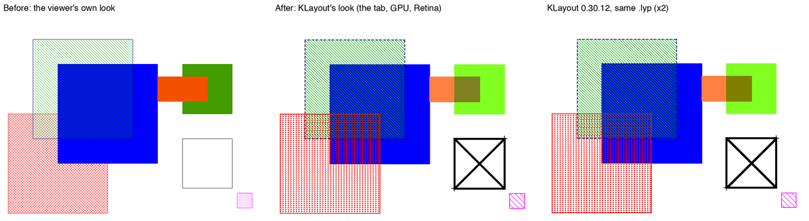
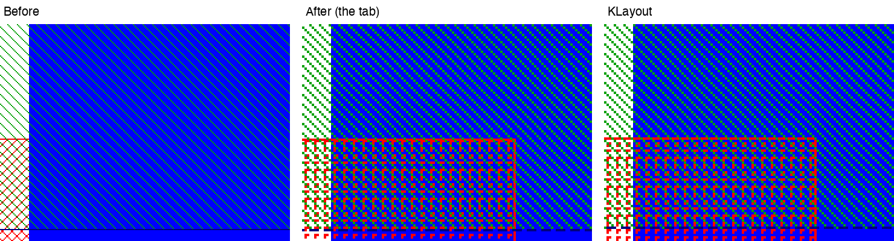
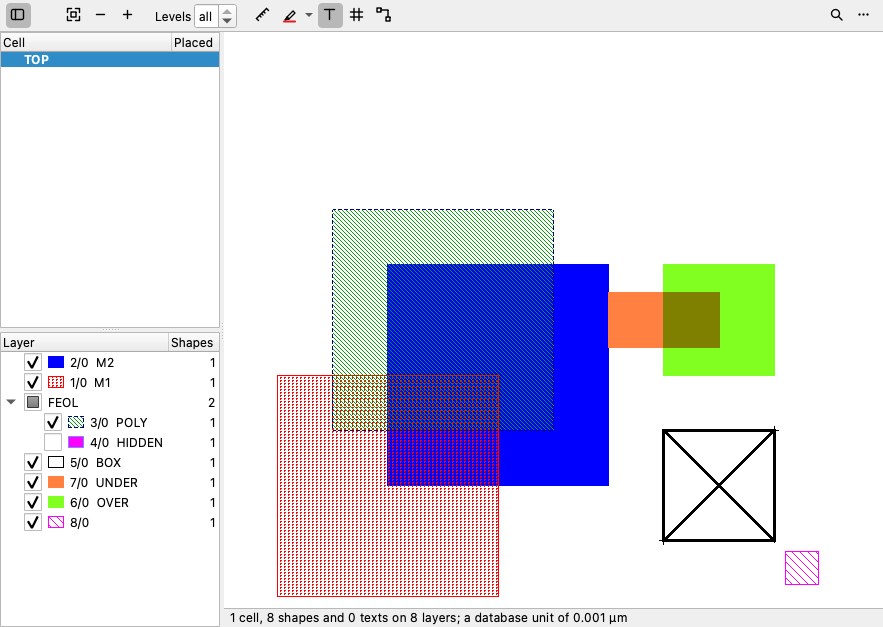
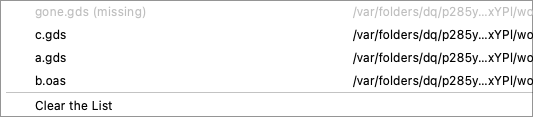

# The layout viewer draws a KLayout .lyp as KLayout does, and its ⋯ menu has Recent

The user (2026-11-08): *"Looks like gds layout viewer doesn't respect the coloring and fill pattern of
a .lyp file from klayout if we load it into the layout viewer. I want it to honor the settings in the
.lyp so that what it renders and shows to me closely matches what I see in klayout (or at least make
this an option that the user can choose). Also, add a new menu item called "Recent" in the three dot
"..." menu of the layotu viewer that keeps a history of the recently opened layouts so that a user can
quickly re-open them and they should be reopened in a new tab."*

> **Corrected on 12 November.** A check against KLayout's own pictures and layer list found 17 ways in
> which this did not draw a .lyp as KLayout does - among them 36 of the 47 patterns, the per-row pattern
> shift, edges a row low, default colours by place rather than layer number, groups' settings losing to
> their members', `*/*` and `*/0` entries, the first tab, line styles, wide and dashed frames, paths'
> spines and the GPU's dashes. The claims below that it measured these are wrong where
> [the bug hunt](../bug_hunts/2026-11-12-klayout-lyp-fidelity.md) says so; the viewer now matches
> KLayout's pictures of the test's layouts to the pixel.

- **K1.** A .lyp is read whole and drawn as KLayout draws it: its colours and their brightness,
  KLayout's 47 dither patterns and the file's own, at the screen's pixels and sharp on Retina, frame
  widths and line styles, transparency, xfill, marked, blinking and scrolling, the file's order and its
  groups, wildcard sources, and the layers it does not name. The tab, the GPU, `export_image` and
  `show_layout`'s screenshot all draw it this way.
- **K2.** It is a choice: **⋯ › Draw the .lyp as KLayout Does**, on at first, kept across restarts,
  the same in every layout tab, and offered in the layer list's right-click menu too. Off, a .lyp is
  drawn the way the viewer drew it until now.
- **R1.** **⋯ › Recent** lists the layouts opened lately, newest first. Choosing one opens it in a new
  tab.

*The test layout and .lyp (`aLypIsDrawnAsKLayoutDrawsIt`'s), in the same region. Left: as the tab drew
a .lyp until now. Middle: the tab now, drawn by the GPU on this Mac's Retina screen. Right: KLayout
0.30.12 (`klayout -zz`, the same .lyp, its picture doubled pixel for pixel).*

*A part of each, enlarged without smoothing: 1/0 in the file's own pattern over 2/0 (listed before
it), 3/0 hatched over 2/0, 3/0's dashed frame. The middle and right are the same pixels, except that
QPainter draws an edge one row lower than KLayout does (see "Differences that remain").*

## Before

`readLayerProperties` (in `layout.cpp`) took each entry's frame and fill colour, its visibility and its
name, keyed by an exact layer/datatype. Everything else in the file was dropped:
- **Patterns:** the dither pattern became the nearest of Qt's eight brushes. "I5" and "I9" were both
  diagonal lines, and the file's own patterns (`C0`, …) became a cross-hatch.
- **Ignored:** brightness, line styles, frame width, transparency, xfill, marked and animation.
- **Order:** the layers were drawn in the layout's order, not the file's.
- **Groups:** flattened into a plain list. A group's own colour or pattern did not reach its members.
- **Sources:** wildcard and range sources (`*/*`, `1-5/0`) named nothing.
- **Colours:** made to "stand out" from the background (the Background › Colours in Contrast setting),
  so a .lyp's pastels came out darker on white.

## K1: drawn as KLayout draws it

**Reading the file** (`layerstyles.cpp`, new):
- `readLayerPropertiesFile()` returns the file as written: each entry with exactly what it gives (an
  absent or empty element stays "not given") and groups with their members, nested too.
- It also reads the file's own patterns and line styles (`<custom-dither-pattern>`,
  `<custom-line-style>`), sorted by `<order>` so that `C0` is the first.
- A file with tabs (`<layer-properties-tabs>`) gives its first tab.
- A file that isn't one, is cut short or has no layers is refused, with the reason.
- I checked the format against a file KLayout wrote itself (`save_layer_props` with a custom pattern
  and line style): it uses the same tags, the same `C0` references and empty elements (`<width/>`,
  `<name/>`).

**Turning it into styles** (`planLayers()`):
- A member takes its group's settings where it gives none, and is hidden when its group is.
- Each layer is drawn as the **last** entry naming it says. KLayout draws every entry naming a layer, in
  order, so the last one is on top.
- Layers are drawn in the file's order, later entries over earlier ones.
- Layers the file names none of come after its layers, with KLayout's default for their place in the
  list.
- The layer list shows the file's groups as parent rows with their layers under them. A group's box
  shows and hides all its layers, and shows "partly" when some are hidden.
- Sources:
  - layer/datatype, each a number, a range (`2-4`) or `*`
  - a name alone or with numbers (`M1 (1/0)`, `METAL1 17/0`)
  - `@1` or `@*`; `@2` names nothing, since a tab shows one layout
  - transformations and hierarchy levels (`(r90)`, `#1..2`) are read past and ignored

**Drawing** (`layout.cpp`'s renderer and the GPU's `layoutviewgpu.cpp`, both):
- **Patterns:** a pattern pixel is a screen pixel whatever the zoom: 1 device pixel at a ratio of 1,
  2×2 on a Retina screen. The pattern is anchored at the view's **lower left**, with the file's last
  row on the bottom pixel row, as KLayout anchors it. The test compares I2, I4, I9 and a `C0` with
  KLayout's own pixels at the same places; they are the same.
- **Frames:** `width` pixels wide (two device pixels per pixel on Retina). Dashes follow the line style
  and are counted from the screen's left (an edge more across than up) or bottom, as KLayout counts
  them.
- **xfill:** a box gets both diagonals, as wide as its frame. KLayout crosses boxes only.
- **marked:** a cross reaching 4 pixels each way at every corner of a polygon, but only at a box's lower
  left and upper right corners, as KLayout marks a box.
- **transparent:** the layer's colour is mixed with what is under it: ANDed on a light canvas, ORed on a
  dark one.
  - CPU: exact, pixel by pixel on the view's picture or an export's. A transparent PNG export keeps its
    empty places empty.
  - GPU: the lesser or greater of each channel (blend ops Min and Max), since Qt's RHI has no bitwise
    blending. This is exact when one colour's bits contain the other's (primaries, `ff`/`80`/`00`
    channels). Otherwise it differs: `#ff8040` over `#80ff20` is `#808020` instead of AND's `#808000`.
- **Brightness:** fill and frame separately.
- **Colours:** used as the file gives them, never adjusted to stand out.
- **Animation:** blinking (1 s period) and scrolling (a pixel every 250 ms) while such a layer is
  shown. Exports take the frame of the moment.
- **valid=false:** shown in italics in the list and drawn anyway, as KLayout draws it.

**What I measured from KLayout** (`klayout -zz` scripts drawing small layouts with chosen .lyp files and
reading back pixels; nothing taken from its source or its files):

| | KLayout does | how I know |
|---|---|---|
| order | the later entry over the earlier | overlaps, both orders, and an entry repeated |
| brightness b | each channel ×m/256 towards black (b < 0) or white, m = round(256·2^(−\|b\|/128)) | 144 channel values, b from −255 to 255: all match, none off |
| transparent | AND on a light canvas, OR on a dark one (#336699 counts as dark) | `#ff8040` + `#80ff20` on white, black, #336699 |
| pattern anchor | lower left; the file's last row on the bottom row | a 3-row `C0` and I2/I4/I9 at known pixels |
| dashes | counted from the screen's left or bottom | the same box moved by a pixel |
| width w | w pixels, the extra one to the right and below when w is even | widths 1–3 |
| xfill, marked | boxes crossed at the frame's width; box corners 2, polygon corners all, ±4 px | a box and an L |
| no pattern given | I9 at an even place in the list, I5 at an odd one | 24 entries, and with no .lyp |
| no colour given | a cycle of 36 colours by place | 80 entries |
| `C<n>` | the file's own patterns by `<order>`, `C0` first | `C0`, `C1`, `C2` |

**The 47 built-in patterns** are written in `layerstyles.cpp` as a rule per pattern from its name
("lightly left-hatched": a diagonal every 8 pixels). I checked their period and density against
KLayout's pattern sheet; the test checks 21 of the densities and that no two are alike. The plain
hatches, grids, checkerboards and lines come out pixel-identical to KLayout's. The bubbles, pyramids,
plus, minus, zig-zag, sine and the two "unordered" patterns are my own drawings of the name, with
KLayout's period and similar density, so they look alike rather than identical.

**Licensing.** KLayout's source, its pattern bitmaps and its files
are not in the repository, and `check-third-party` is green. Two tables in `layerstyles.cpp` are
measured from KLayout's output rather than written from a name: the 36 default colours, and the
brightness formula above. They describe what KLayout shows; the default colours could be dropped for
the viewer's palette at the cost of different colours from the 11th layer on. The user decided (2026-11-08) to keep them as they are.

## K2: the choice

**⋯ › Draw the .lyp as KLayout Does** is a checkbox under *Load Layer Properties…* and *Colours of the
Palette*. It is greyed when the tab has no .lyp, and also offered in the layer list's right-click
menu.
- **On at first:** you asked for KLayout's look, and a .lyp is written to look a particular way.
  Drawing it otherwise needs a reason.
- **Kept across restarts** (`LayoutViewer/lypLook`) and **the same in every layout tab**, as the
  Background and Grid settings are.
- **Off: the viewer's own look,** which is how a .lyp was drawn until now: its colours, names and
  visibility on the viewer's patterns, adapted to the background, in the layout's order.
- **Switching keeps visibility:** layers hidden by hand stay hidden.
- **The background is unchanged:** it is still Background › Like the Application, Light or Dark,
  because a .lyp says nothing about it. *Colours in Contrast* has no effect in KLayout's look.

*The tab with the test .lyp: the list in the file's order, its group FEOL with one of its two layers
hidden (so its box shows "partly"), swatches drawn with each layer's pattern and dashes, 8/0 (named by
none) last.*

**Claude's tools:**
- `show_layout` has a `layer_look` argument (`klayout` or `viewer`). It switches every tab, as the menu
  does, and its answer says `"layer look"` when a .lyp is in use.
- `export_image` and the screenshot draw the tab's own styles, so they match what you see.
- `get_layout` and `find_shapes` on a layout that is not open read its .lyp in the chosen look.

## R1: Recent

**⋯ › Recent** is the first item in the menu.
- **Order and limit:** newest first, each layout once, at most 12.
- **Kept across restarts** in the settings (`LayoutViewer/recent`).
- **What counts as opened:** a layout is noted when its tab first reads it. That covers File › Open,
  the file browser, Claude's tools and Recent itself. Bringing an open tab to the front doesn't
  reorder the list.
- **Each row:** the file's name, with its folder on the right (`~` for your home folder).
- **Missing files:** listed greyed with "(missing)" so you can see what moved; they can't be chosen.
- **Clear the List** empties it.
- **Choosing one** opens it in a new tab. **A layout that is already open is brought to the front, with
  no second tab.** That is what File › Open does with a file already open (`QucsApp::gotoPage`), which
  Recent calls.
- **Not done:** Recent does not add to the application's File › Open Recent list.
  `updateRecentFilesList` is private to `QucsApp`, and I left `qucs.h` alone.

*Grabbed offscreen from the test, so the folders are the test's temporary ones. A real popup is sized
to fit its folder column; this grab of a menu that was never shown cuts it.*

## Tests

All in `test_layout_doc`:

| test | what it checks |
|---|---|
| `aLypIsReadWhole` | every field, nothing given stays nothing, nested groups, the file's own patterns and line style by order, a KLayout-written entry with empty elements, a tabbed file; six bad files refused with why; a missing file |
| `aLypsSourcesNameTheLayers` | numbers, ranges, wildcards, names, `@1`/`@2`/`@*`, transformations ignored, a member within its group's source |
| `klayoutsPatternsLineStylesAndBrightness` | 47 patterns, each distinct, 21 densities as KLayout's, hatch direction; line styles; brightness at 14 values as KLayout drew them |
| `aLypPlansTheLayers` | group settings inherited, the last entry wins, default colour and pattern by place, drawing order, the list's rows; the viewer's look unchanged |
| `aLypIsDrawnAsKLayoutDrawsIt` | pixels at known places: KLayout's own pixels for `C0` and I4, order (1/0's pattern over 2/0's solid), dashes along an edge, width 3, xfill, the marks (and their absence), a hidden layer, AND on white and OR on black (KLayout's `#808000` and `#ffff60`), a transparent export, the unnamed layer in KLayout's colour and pattern, Retina 2×2, blinking, scrolling |
| `aLypInTheTabIsDrawnInTheLookChosen` | the tab in KLayout's look at first, the list's order and group, a group's box, the swatch, `show_layout` and `export_image` alike and AND-mixed, the ⋯ switch, kept and followed by a new tab, visibility kept across a switch, `layer_look` and a bad value, no switch without a .lyp |
| `theGpuDrawsKLayoutsLookAsTheCpu` | GPU vs CPU in KLayout's look, within a pixel; Min blending. Skips where there is no GPU (offscreen, CI) |
| `theRecentMenuOpensLayoutsAgain` | order, once each, kept in the settings, reopened goes first, missing greyed, a new tab for a closed one, the front for an open one, the limit of 12, Clear |

The existing `aLypBesideItGivesTheLayersTheirLook` passes unchanged.

**Deliberate breaks.** Each was applied alone, rebuilt, the new tests run, and the change reverted:

| break | caught by |
|---|---|
| each layer by the first entry naming it, not the last | `aLypPlansTheLayers` |
| patterns anchored at the top left | `aLypIsDrawnAsKLayoutDrawsIt` (at (12, 71), KLayout's pixel) |
| transparent layers drawn over, not mixed | `aLypIsDrawnAsKLayoutDrawsIt`, `aLypInTheTabIsDrawnInTheLookChosen` |
| Recent keeping a layout twice | `theRecentMenuOpensLayoutsAgain` |
| the brightness factor truncated, not rounded | `klayoutsPatternsLineStylesAndBrightness` (−16: `#75573a`, not `#75583a`) |

**Runs** (this Mac, Homebrew Qt 6.12.0; ctest with a scratch HOME):
- **GPU:** `theGpuDrawsKLayoutsLookAsTheCpu` and `theGpuDrawsAsTheCpu` on the Cocoa display (Metal,
  ratio 2). KLayout's look: 86 of 159,224 drawn pixels outside the tolerance. The viewer's own look: 0,
  as before.
- **Release:** the full suite, 181 tests. 180 passed the first time. `test_qucs_control`'s
  `theToolsAreListed` failed: a sentence I had added about `layer_look` took `show_layout`'s
  description to 2,121 characters, past the 2,048 cap. I took the sentence out (the argument keeps its
  own description), and `test_qucs_control` then passed whole.
- **ASan/UBSan** (Debug), on the final sources: `test_layout_doc`, `test_layout_routing`,
  `test_layout_router`, `test_fem_layout`, `test_rf25_doc`, `test_rf25_layout` and
  `test_multiphysics_doc` all passed, with no sanitizer reports. (The GPU test skips offscreen there.)
- **Lints:** `check-shaders`, `check-third-party`, `check-tool-arguments` and `check-json-nesting` all
  green.

## Differences that remain, and what wasn't verified

- **Edges one row lower than KLayout's.** QPainter, and the GPU matched to it, draws a horizontal edge
  at y on the row below; KLayout uses the row above. Fills and patterns line up exactly; frames,
  crosses and marks are one pixel lower. I left this alone because it is the viewer's existing
  convention, which the selection, rulers and pen markers are drawn to.
- **GPU transparency** is Min/Max, not AND/OR (see K1). The CPU, used for exports and when there is no
  GPU, is exact.
- **The GPU was compared on Metal only.** Direct3D and OpenGL weren't run. The shaders compile for all
  of them (`check-shaders`).
- **Retina:** I chose a pattern pixel as one logical pixel (2×2 device pixels), so a pattern looks the
  same size on any screen. I haven't seen KLayout's own window on a Retina screen; the comparison
  pictures are `klayout -zz` renders, which have no pixel ratio.
- **Sources** follow KLayout's documented meaning rather than its quirks. `*/0` names every datatype-0
  layer here; KLayout 0.30.12 drew nothing for it in my test (`*/*` worked). `2-3/0` names 2/0 and 3/0
  here; KLayout drew only 2/0. Transformations, hierarchy levels and property selectors in a source are
  ignored, and `@2` names nothing.
- **Unnamed layers are always added** (KLayout's "add other layers"). KLayout's batch mode, given a
  .lyp, did not add them in one of my runs and did in another, so I followed what its window does by
  default.
- **Texts** are still drawn in the canvas's ink colour, not their layer's colour as KLayout draws them.
- **Animation on the CPU** redraws the whole picture every 250 ms while a blinking or scrolling layer is
  shown, which could be slow for a very large layout on a machine without a GPU. On the GPU it costs a
  frame.
- **Layers only in the .lyp** (named by it but absent from the layout) aren't listed. KLayout lists
  them, empty.
- **Not checked against a user's files:** no .lyp or GDS from you showing the problem was available.
  Everything was checked against small layouts and .lyp files written for the tests.
