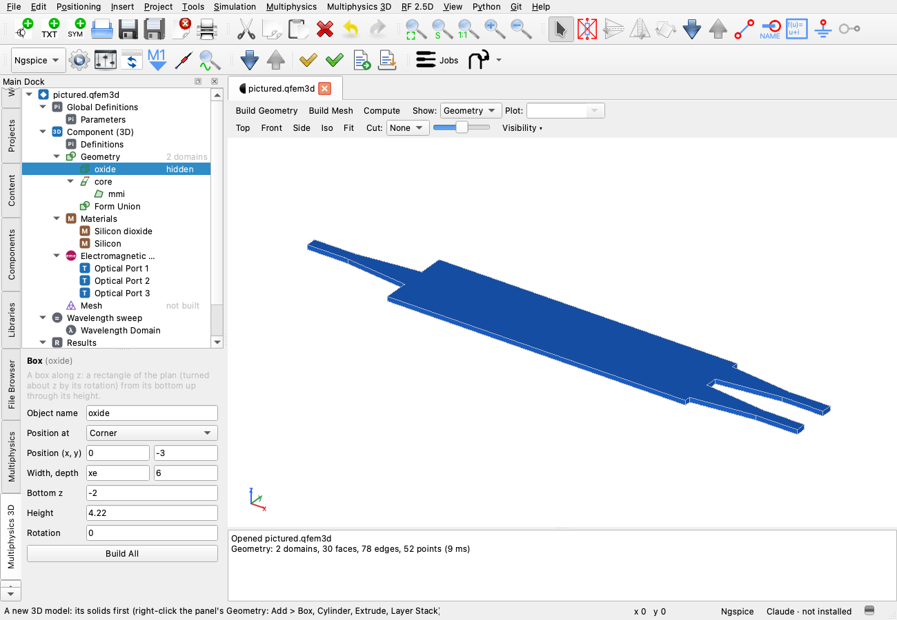
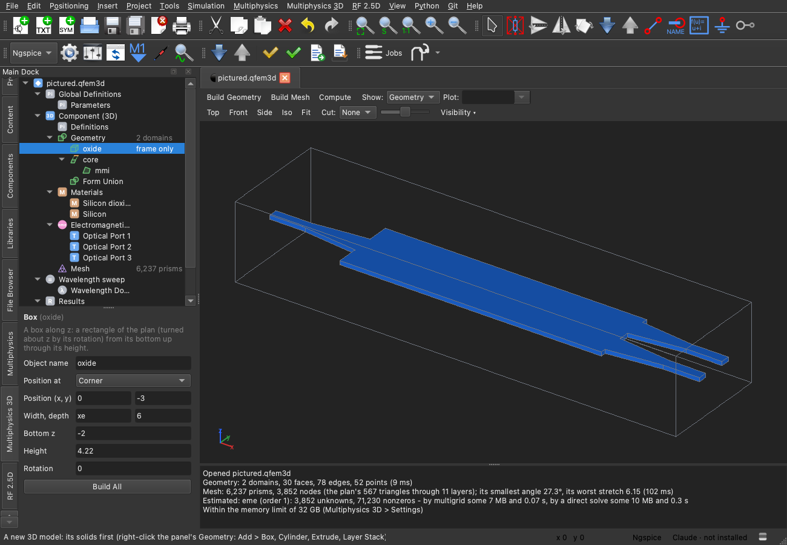
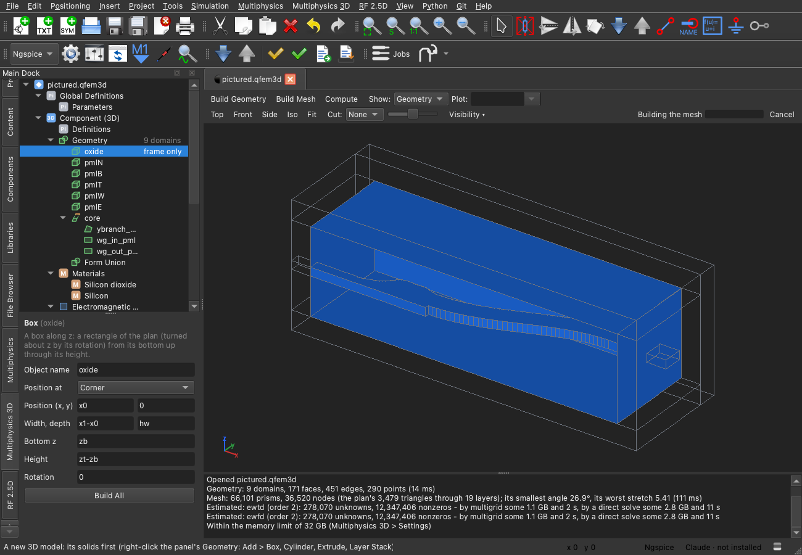
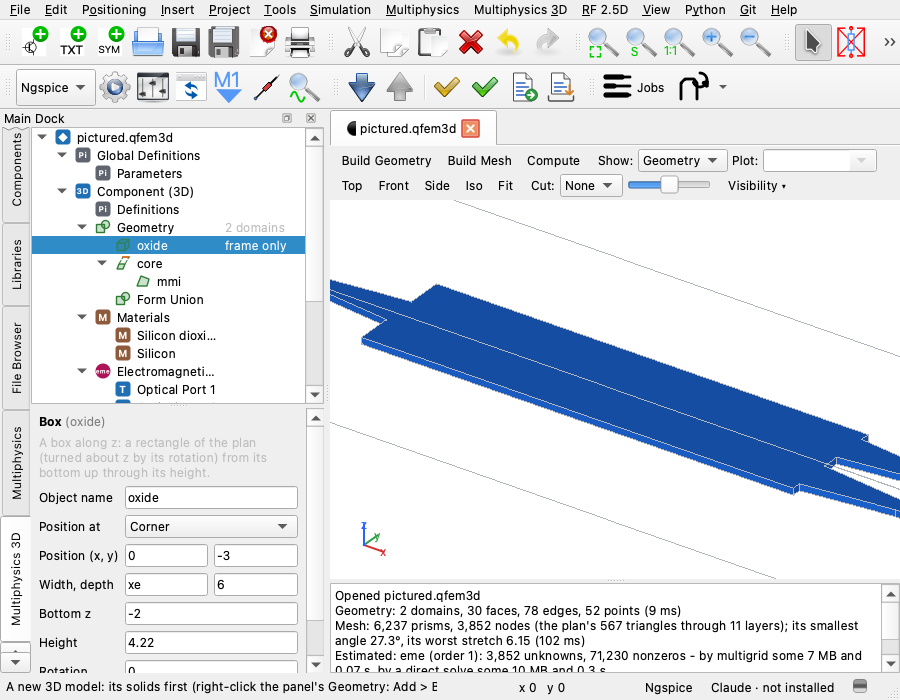
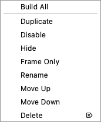
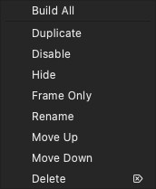
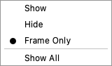
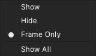
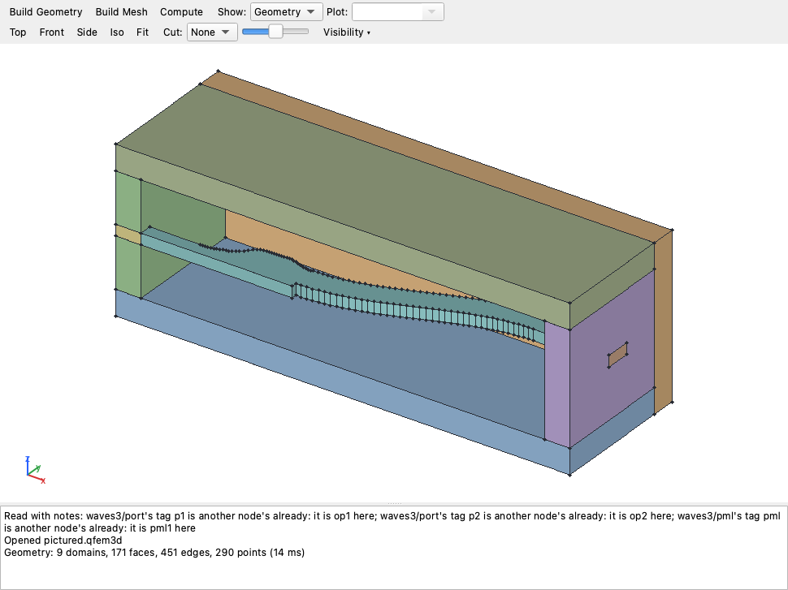

# Multiphysics 3D: the toolbar on two rows, and parts hidden or framed in the view

The user's request of 9 November, with two pictures: the 3D model tree's right-click menu on a material, and the 3D
view's one long toolbar row with Top, Front, Side, Iso, Fit, Cut, the progress bar and Cancel circled and an arrow
drawn to a second row. They asked for three things: those buttons and the progress bar moved to a second row; a "hide"
item in the 3D model tree, so parts of the geometry can be hidden in the 3D view (not disabled), or drawn as their 3D
frame alone; and hide, show and frame-only in the 3D view panel too, for the geometry chosen in the tree.

| Oxide hidden (light) | Oxide as its frame alone (dark) |
|---|---|
|  |  |

The model is the user's `mmi1x2.qfem3d` (an oxide box, the MMI's silicon core extruded in it).

## The toolbar on two rows

The first row keeps what is built, solved and shown: Build Geometry, Build Mesh, Compute, Show, Plot, and the Time and
Point boxes that come with a solution in time or a sweep. The second row, `multiphysics3dViewBar`, holds where the view
looks from (Top, Front, Side, Iso, Fit), the Cut and its slider, the new Visibility drop-down, and at its right end the
stage, the progress bar and Cancel while work goes on.

At least 553 pixels wide for the first row and 445 for the second (the one row needed both together). In a 900-pixel
window, which leaves the document 570, both fit:

The progress bar and the cut's slider have a least width now (60 pixels each), so a narrow row does not squeeze them
to a sliver.

## Shown, hidden, frame only

Each geometry feature (a box, an extrude, a sketch's shape, a layer stack; not Form Union) and each material has three
states:

- **Shown**, as before.
- **Hidden**: its faces, edges and points are not drawn.
- **Frame only**: its edges are drawn, its faces not.

A domain is drawn as the solid it belongs to: the smallest solid that holds it, the same one its material follows.
So hiding the oxide hides the cladding and leaves the core drawn, and hiding the core leaves a hole in the oxide. A
material's state applies to the domains it is on. Where a domain gets two states (its feature's and a material's),
the less visible one wins. A face is filled when a shown domain is on one side of it, in that domain's colour; it is
drawn as edges alone when only a framed domain is beside it. An edge or a point is drawn when a face on it is.

This applies in every view: the geometry, the mesh (a framed part's mesh lines without their fill), the solution and a
3D plot group. A cut's slice is kept, as it is an explicit cut. Faces left out cannot be picked. When every part is
hidden, the view says so and points to Show All.

**In the tree**, right-click a feature or a material: after Disable come the two states it is not in now (Hide and
Frame Only when shown; Show and Frame Only when hidden; Show and Hide when framed). A hidden node's name is dimmed but
not slanted (slanted means disabled), and its status column says "hidden"; a framed one's says "frame only".

| Light | Dark |
|---|---|
|  |  |

**In the view**, the Visibility ▾ drop-down on the second row applies Show, Hide or Frame Only to the node chosen in the
tree, with the current state checked, and has Show All under them. The three are greyed when the node chosen is not a
part (the mesh, a study); Show All stays available while anything is hidden. The tree's menu and the drop-down go
through the same `Multiphysics3DDoc::setVisibility`, so each always shows what the other did.

| Light | Dark |
|---|---|
|  |  |

The style's own menu indicator was drawn over the last letters of a text button, so it is hidden and the ▾ is part of
the text, in the theme's colour, as the File Browser's and the Claude header's buttons do it.

## Kept in the file

The state is saved in the `.qfem3d`, as `"visibility": "hidden"` or `"frame"` on the node (`Node::visibility`). It is
written only when a node is not shown, so a model with nothing hidden is written byte for byte as before, and old files
read unchanged. Any other value reads as shown. Saving it fits the format cleanly: a node already carries
`"enabled": false` the same way, and a view that keeps what the user hid is the kind of state a model file holds in
COMSOL too. Each change is a step of Undo ("Hide oxide", "Show All") and marks the document changed, like any other
edit to the file.

It changes nothing else:

- `partsOf()`, which decides whether the geometry, the mesh or the solution goes stale, compares the model with every
  node's visibility cleared. Hiding builds nothing again, meshes nothing again, and leaves a solution current.
- Duplicate gives the copy a state of its own: it is shown, even when the original is hidden.
- The eigenmode expansion copies the materials into each cut's 2D model, and that model's JSON is its cache key; the
  copy's visibility is cleared, so hiding a material does not miss the cache.

## Tests

`test_multiphysics3d_doc`:

- `theToolbarsTwoRows`: each button is on its row, the second row under the first and over the view, the rows' least
  widths, and the drop-down's items.
- `hiddenAndFramedParts`, on a straight wire in oxide built like an MMI's cross-section (a core box in an oxide box):
  - which nodes may be hidden;
  - the tree's menu items, where they go, and what each does;
  - the tree's marks;
  - the drop-down following the tree, and the tree following the drop-down;
  - the domains hidden and the faces and edges drawn in the geometry and the mesh;
  - the geometry and the mesh not built again;
  - written to and read from the file, and a file without it unchanged;
  - a material's state, and the less visible state winning;
  - Undo, Show All, and a duplicate of a hidden node;
  - a solved block framed: its solution kept current and its faces left out of the solution view.
- `pictures`: opt in with `QUCS_MP3_PICTURES=<folder>` and optionally `QUCS_MP3_PICTURES_MODEL=<a .qfem3d>`, which is
  copied first. It writes the window in the light and the dark theme: the pictures above.

## Left as it is

With a feature chosen in the tree, the view lights every domain the feature's solid covers, the old rule, not only the
domains it owns. Choose the oxide and the core in it is lit too, and with the oxide hidden the core is still drawn
lit. Choose the Y-branch's oxide and the PML boxes inside it are lit. Lighting the owned domains alone would match
what Hide hides, but it would change what choosing a feature has shown until now, so it was not changed here.

