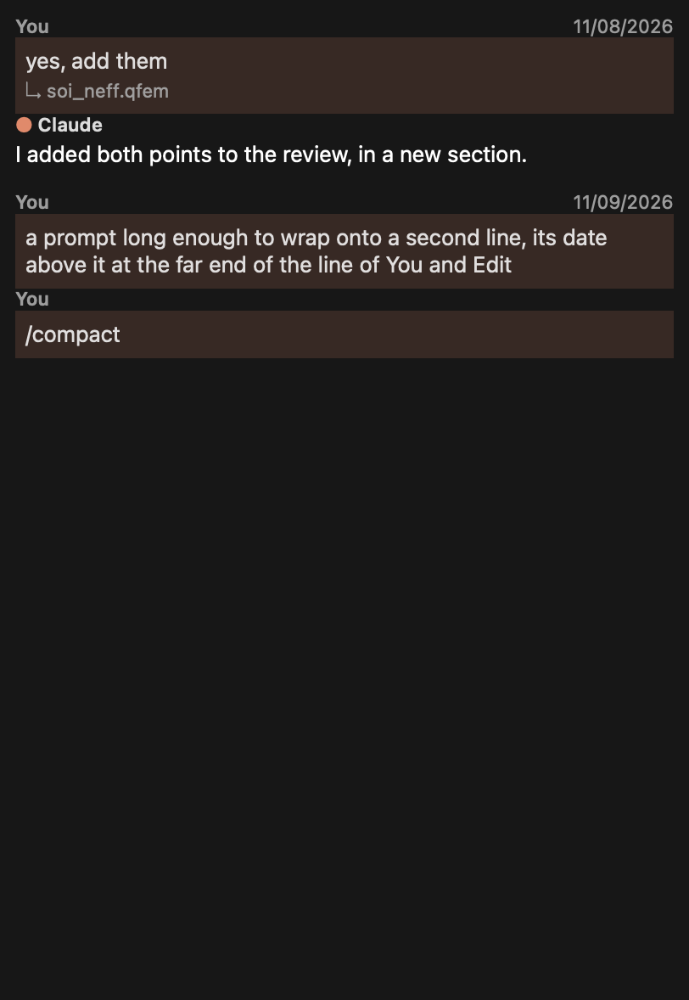
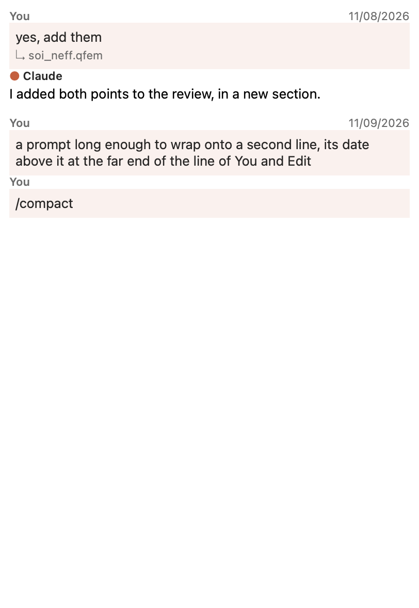
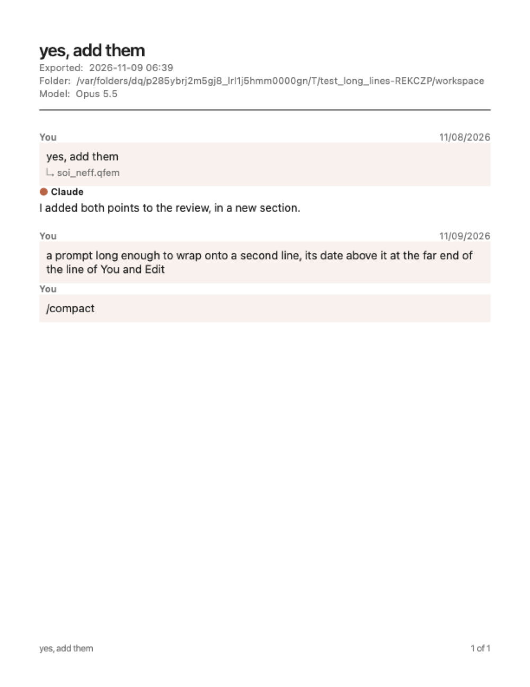

# Prompt dates in the Claude dock

The user's request of 9 November, with a picture of the dock's ⋯ menu open on Extras and a box drawn in a prompt's
top-right corner: "Can you add a new menu item called "Show Prompt Dates" under "Extras" menu in the three dot "..." menu
of the claude chat GUI that when selected the date of each prompt in the format of MM/DD/YYYY shows up in the
upper-right corner of each prompt?" Then, with a picture of the first version: "Move the date outside the prompt box and
put it where the "You" and "Edit" items are but on the far right end of it."

| Dark | Light |
|---|---|
|  |  |

## What it does

**⋯ > Extras > Show Prompt Dates** is a check item below the two "Ask Before" items, off at first. When it is on, each
prompt shows the date it was sent, as `MM/DD/YYYY` in this computer's time zone. It sits on the prompt's caption line,
the one with "You" and "Edit" above its bubble, at the far right, its right end level with the bubble's right edge and
its baseline level with "You". It is in the caption's smaller font and muted colour. Hovering over a date shows the date
and time in full, in the system's long format.

- **Every conversation at once.** It is kept in the settings (`ClaudeCode/showPromptDates`), as Show Usage's choices
  are, and every open conversation draws again when it changes. The menu's tick is read again each time it opens.
- **The prompt itself is laid out as before.** The date is outside the bubble, so nothing in it moves or wraps
  differently.
- **Where the line is too narrow** for the caption's words and the date with a gap between, the date is left out rather
  than drawn over them. The dock is never that narrow; the test makes its text that narrow to see it.
- **Right to left,** the date goes at the left end of the line.
- **On paper.** Export Conversation > PDF draws the dates the same way when they are shown.

## Where the date comes from

A prompt now keeps when it was sent (`Entry::when`, milliseconds since the epoch, UTC).

- **Sent from the dock:** the time it is sent. A prompt edited and sent again gets the time it is sent again.
- **Saved with the conversation** (`"when"` in its JSON) and read back when it is reopened.
- **Resumed from Claude Code's own history** (Resume a Conversation...): the `timestamp` Claude Code keeps on each
  message.
- **A conversation saved before this change** has no times kept for its prompts, so none is shown and nothing is kept
  clear. Its prompts sent from now on have one.

## Drawn over the transcript, not in it

The date is painted over the view after the document (`TranscriptView::paintEvent`), from where the layout put each
prompt's bubble and first line. It is not text in the document, so it is in nothing read from it: Copy, Reply, a drag,
the transcript's text, and the exports to Markdown and plain text. The PDF draws it from the same positions with the
same function.

Each prompt's bubble carries its time as a frame property only while dates are shown; the painting looks for that, and
for the caption's line just before the bubble. The setting is part of the transcript's look, so turning it on or off
draws the conversation again, and a prompt's time is part of what tells whether its part has changed.

Two faults were found on the way and fixed before anything was kept. A block's layout in Qt can be placed relative to
the frame it is in, so the date was at first drawn as if the bubble began at the document's top, some 24 px too high in
the test; it now goes by the block's rectangle in the document (`blockBoundingRect`). And the PDF drew it four times too
big: a font sized in points takes the device's 300 dpi, so the date is drawn in the screen's pixels, as the document was
laid out.

The first version put the date inside the bubble's top-right corner, with the prompt's first line given a margin to keep
clear of it. The user asked for it on the caption's line instead, and the margin went with that.

## Tested

`promptDatesShowInEachPromptsCorner` (`test_claude_code`):

| What | Holds it to |
|---|---|
| The menu | The item in Extras, checkable, off at first; ticked when on, read again as the menu opens |
| Sent | The prompt's time kept, between the moments before and after it was sent |
| Off | No date drawn |
| On | The date `MM/DD/YYYY` of that time; its right end at the bubble's right edge; above the bubble; its baseline level with "You"; clear of "You  Edit" by more than 12 px; the prompt's rows and first line's width as they were |
| Drawn | Ink in the date's place, none there without it; that place changes when the setting goes off, and is the same again when it comes back |
| Too narrow | The text laid out 150 px wide: no date; back to the view's width, the date again |
| The pointer over it | The tool tip: the date and time in the long format |
| Read from the view | Copy and Reply hold the prompt and not the date |
| Sized | Still level with the bubble's right edge |
| Reopened | The same date. A conversation of before: none |
| Claude Code's history | The date and the kept time from its `timestamp` |
| Off, then on from another conversation | Gone from both, back in both |
| PDF | Written with the dates on. Its look is held only by the picture above |

| Run | Result |
|---|---|
| `test_claude_code`, `test_claude_fuzz`, `test_long_lines`, `test_claude_jobs`, `test_claude_git`, Release, offscreen, Qt 6.12.0 | All pass |
| `test_claude_code`, `test_claude_fuzz`, `test_long_lines`, ASan and UBSan | All pass, no report |
| The new test on Cocoa, this Mac's display | Passes |
| `scripts/ci/check-*.py` | All four pass |
| `2026-11-09-prompt-dates/breaks.py` | All 17 caught, two of them after the test was tightened (below) |

The first run of the breaks had two survive, *other conversations not told* and *the menu's tick not kept*: the test
drew each conversation again itself and ticked the item by clicking it. It now waits for each conversation to draw
itself, and changes the setting from the other conversation before opening the first's menu. The narrow case also failed
on Cocoa at first, its 150 px wide enough there for both; it now takes the caption's and the date's own widths. Those test
changes were run again: the whole of `test_claude_code` in Release, the new test on Cocoa and under ASan, and the three
breaks concerned.

**The narrow case failed again on `main`** (d3d7f02b, about half the runs, and on CI's v27.1.0 macOS run), and the
test sometimes crashed, SIGSEGV at 0xe0. The cause was the test itself: it worked out the narrow width from a
`QTextLine` of the caption taken before `panel.resize(700, 700)`. Qt lays a document out lazily, so after the resize the
caption often had no lines yet, and that line read memory already freed. The width came out at some 631 px, so
`narrow` was 720 rather than 142 and the date still fitted. Sometimes the read crashed instead. The app was never at
fault: `promptDatePlaces` skips a caption with no lines. Every line the test reads is now laid out first
(`blockBoundingRect`), checked to have lines, and taken after the resize. The narrow width now leaves no room at all for
the 12 px gap, whatever the fonts. 30 runs of the test alone, 10 of `test_claude_code` through ctest, and 3 at
`-j 8` beside six other GUI suites all passed. With `promptDatePlaces`' check taken out, the test still fails every time.

**Broken on purpose:** the time not kept, not saved, not brought back, not read from Claude Code's history; the day before
the month; a day not the prompt's; drawn in the bubble on the prompt's first line; drawn at the left; short of the
bubble's edge; placed as if the caption's layout were the document's; drawn over the caption's words when narrow; never
drawn; the setting not a reason to draw again; other conversations not told; the menu's tick not kept; no time in the tool
tip; the date put in the document as text.

**Pictures:** `test_long_lines`' opt-in `pictures` now ends with the user's own exchange and a long prompt, dated, in
the main window's dock on this Mac's Cocoa display, light and dark (above), and its PDF.

## Not verified

- **The packaged app by eye.** The pictures are grabs from a test binary of the same window and panel.
- **Qt 6.10.3,** which CI and the releases use. Everything ran on 6.12.0. Nothing newer than Qt 6.1 is used
  (`QJsonValue::toInteger`, 6.0; `QList::removeIf`, 6.1).
- **Right to left.** Written for it, not tried.
- **Linux and Windows.**
- **A conversation built on `main` as it is now.** This branch is older than `main` (the app's sync was off), and `main`
  has changed `claudecodepanel.cpp` and `test_claude_code.cpp` in some 70 lines since. The merge was not tried here.

## Not done

- **The time itself** shows only in the tool tip. The user asked for the date.
- **A reply's date.** Only prompts were asked for.
