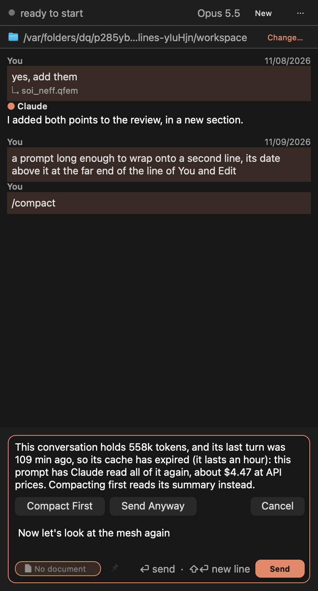
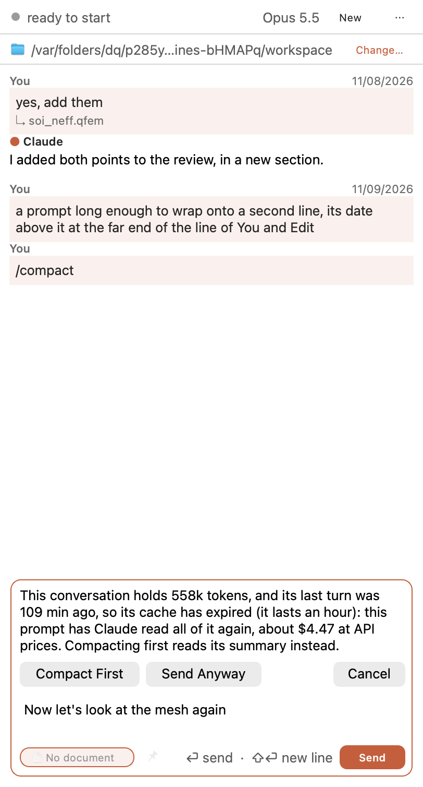

# Conversation Cache: long conversations without the cold re-read

The user, 10 November: "on a cold start (e.g., closing the app and re-opening it) of an existing long chat, claude needs
to read the entire conversation and it will consume a lot of tokens. Is there a way to make this more efficient?" Three
ways were proposed, and the user's answer was: "Add a new menu item called "Conversation Cache" to the three dot "..."
menu of claude chat GUI that has these three as its sub-menus and the user can choose which one to apply. Set the
default choice to option #2."

## What the logs showed

Every turn sends the whole conversation. Claude Code caches it, and in the dock's session logs (QucsWorkspace, 7 to 9
November) every cache write was a 1-hour one. A turn within the hour reads the conversation from the cache; a turn
after it writes all of it again. Closing Qucs-S has nothing to do with it: the dock starts Claude Code only when a
prompt is sent, and an idle hour with the app open costs the same.

| Since the session's previous request (requests of 20k+ context) | Requests | Written again |
|---|---|---|
| Under 5 minutes | 1,803 | 1% |
| 5 to 60 minutes | 58 | 4% |
| Over an hour | 24 | 95% |

One turn after 109 minutes wrote 558,342 tokens: at Opus 5.5's prices ($4 a million in, a 1-hour write twice that, a
read $0.20) some $4.47, against $0.11 warm. The dock's largest conversations held 375k to 630k tokens; over those three
days the 24 cold turns came to some $44 and the warm reads to some $104, so size costs more than coldness. Auto-Compact
was on, but with a 1M window Claude Code compacts only near it.

## ⋯ > Conversation Cache

A submenu of three, one chosen at a time, for every conversation at once, kept in the settings
(`ClaudeCode/conversationCache`):

| Choice | What it does |
|---|---|
| **Warn Before an Expensive Send** | A prompt to a long conversation (100k tokens or more of context) whose last turn ended over an hour ago is held. A note above the composer says how long it is, how long ago, and what reading it again would cost at API prices; **Compact First** sends `/compact` and then the prompt, **Send Anyway** sends it, **Cancel** keeps it to change |
| **Compact Idle Conversations** (the default) | A long conversation is compacted 50 minutes after its last turn, while its cache is warm, with a note in the transcript. Coming back later reads its summary. Brought back within the hour (Qucs-S opened again), it is compacted at once if the 50 minutes have passed and a minute of the cache is left |
| **Compact Earlier** | Claude Code compacts near 200k tokens rather than near the model's limit, through its own `autoCompactWindow` setting: every turn reads less. Needs Auto-Compact on |

### How it knows

- **A conversation's context** is what its latest request read: `input_tokens + cache_read_input_tokens +
  cache_creation_input_tokens` of the last assistant message of the main thread (not a subagent's). Claude Code's
  `compact_boundary` sets it to 0. It is kept with the conversation (`"cache": {"contextTokens", "lastTurnAt", "model"}`),
  so a restart knows it, and read from Claude Code's own file when a session is resumed from its history.
- **When its last turn ended** is set at each turn's end, kept and read back the same way.
- **The price** is said only for a model the dock knows (Opus, Sonnet, Haiku and Fable of the current lines), at twice
  its input price, as a 1-hour write is. A subscription's usage is not dollars, and the note says "at API prices".
- **Compact Earlier** tells Claude Code `autoCompactWindow: 200000` with Auto-Compact's flag, at its start and to a
  running program (`apply_flag_settings`). Otherwise nothing is told at the start, so a window set in the user's own
  Claude Code settings still holds; switched back while running, the program is told `"auto"`.

## The cost of compacting

Compacting reads the conversation once from the warm cache and writes a summary. For the 558k example: some $0.11 to
read, the summary's output, then the next return writes the summary (tens of thousands of tokens) instead of 558k:
roughly $0.60 against $4.47. Two things are given up: Claude then has a summary, not every detail; and a conversation
never returned to was compacted for nothing.

## Not done

- **Qucs-S closed within the 50 minutes.** Compact Idle Conversations works only while Qucs-S runs; nothing is compacted
  as it closes (that would hold the quit for the compaction, a minute or so). Brought back within the hour, it compacts
  then.
- **A keep-warm.** Claude Code has no way to refresh the cache without adding to the conversation.
- **Undocumented settings** in the installed Claude Code (`CLAUDE_AUTOCOMPACT_PCT_OVERRIDE`, and some on idle and cold
  compaction) were not used; `autoCompactWindow` is a setting it documents in its own `/context` text.

## Tested

| Test | What it holds |
|---|---|
| `theConversationCacheIsOneOfThree` | The submenu and its three; Compact Idle at first; one ticked at a time, read again as it opens; every open conversation and one opened later told; Compact Earlier's window on the session and as Claude Code is told it (none when not chosen, Auto-Compact's flag kept); the context read from the program, not a subagent's, 0 when compacted |
| `aColdLongConversationIsHeld` | 560k tokens two hours cold: held, the prompt kept, "560k", "2 h 0 min" and "$4.48" said, nothing sent; Cancel; Send Anyway sent and the composer emptied, its context and time known after; warm then, not held; Compact First: `/compact` first, then the prompt; not held when short, warm or another choice; a session of Claude Code's own: its context and time from its file, the price of its model ($0.80 for Sonnet 5.5); a new conversation holds nothing |
| `aLongIdleConversationIsCompactedWhileWarm` | 50 minutes less 400 ms after: compacted, the note, its context 0 after, sent once; brought back at 55 minutes: at once; not when short, cold already, without a session, or another choice; chosen again with one due: compacted; after a turn that read 305k: due in 49 to 50 minutes; another choice: not due; a new conversation: nothing |
| `theCommandLineCarriesTheOptions` | Unchanged: the window is not on the command line unless chosen |

The fake program answers `/compact` as Claude Code does (a `compact_boundary`, then the turn's result) and any other
prompt with a reply that read 305,010 tokens.

| Run | Result |
|---|---|
| `test_claude_code`, Release, offscreen, Homebrew Qt 6.12.0, final sources | 96 pass, 1 skipped |
| `test_claude_code`, ASan and UBSan, final sources | 96 pass, no report |
| The three tests and `promptDatesShowInEachPromptsCorner` on Cocoa, this Mac's display | Pass |
| `test_claude_fuzz` (default, and seed 61 for 60 s), `test_long_lines`, `test_claude_jobs`, `test_claude_git`, `test_gui_monkey`, `test_qucs_control`, Release; `test_claude_fuzz` and `test_long_lines` sanitized | All pass, no report |
| `scripts/ci/check-*.py` | All four pass |
| `2026-11-10-conversation-cache/breaks.py` | 27 of 27 caught, four after the tests were tightened |

**The first full run** had two failures and three breaks not caught. `idleCompactIn()` came out at 50 min 0.45 s: a timer
that long is coarse in Qt, 5 % either way, so it is now a precise one. `promptDatesShowInEachPromptsCorner`'s narrow case
read the layout before Qt, busy, had finished it in steps; it now waits for it (nothing of this feature). The breaks:
choices not exclusive (the test now looks before the menu opens again), no price said (the break itself did not build),
compacted when the cache has gone (the guard is twice; the test now sees that nothing is even due). The rows marked
final above ran after those changes; the rest before them.

**Broken on purpose:** another default; choices not exclusive; the tick not kept; other conversations not told; Compact
Earlier telling nothing; the window never, or always, on the command line; the context not read, or a subagent's taken;
compacted not said; the context not kept; the last turn's time not brought back; Claude Code's file's context not read;
never held; held while warm; held whatever the length; no price; a 5-minute write's price; Send Anyway held again;
compacted and the prompt not sent; the composer kept after the prompt went; never compacted; compacted whatever the
length; compacted when the cache has gone; at once rather than at 50 minutes; not armed by a turn; not armed when brought
back.

**Pictures:** the held prompt in the main window's dock on this Mac's Cocoa display, light and dark, from
`test_long_lines`' opt-in pictures:

## Not verified

- **The real Claude Code compacting on the dock's own `/compact`** in this branch: the fake answers it. Sending
  `/compact` from the composer was working before, and is what the user's own conversations show.
- **What the window does in a real long conversation.** The installed Claude Code (2.1.311) was asked, with no prompt
  and so no tokens: started with `--settings '{"autoCompactEnabled":true,"autoCompactWindow":200000}'` it said nothing
  against it, and `apply_flag_settings` with `autoCompactWindow: 200000` and then `"auto"` were each answered
  `success`. A conversation was not run up to 200k to see it compact there. (Had a version refused it, the dock starts it
  again with it, as for Auto-Compact.)
- **The packaged app by eye, Qt 6.10.3, Linux and Windows.** This branch is older than `main` (the app's sync was off);
  the merge was not tried.
