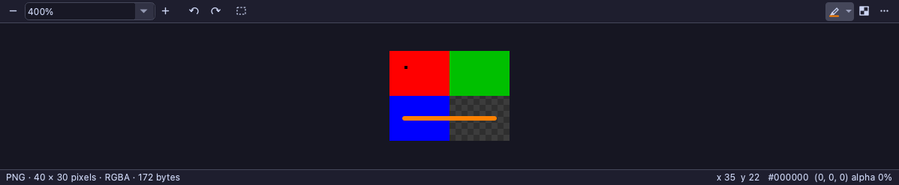

# The pen on a picture's tab

The request: "Let's add the pen marker to the image viewer panel similar to how we added it to layout viewer and pptx
viewer."

## What was built

- **The pen** is the first button of the picture tab's right-hand group, after the stretch and before the background's
  button, as a presentation's tab has it. It is the other viewers' pen, the same button and menu: pen, highlighter or
  eraser, a colour or any other, how broad, Undo the Last Change, and Clear the Drawings on This Picture or Clear All the
  Drawings. The pen in hand is every viewer's, as before.
- **Taken up**, a press of the left button on the picture draws on it, or erases, before anything else takes the mouse:
  with the pen up a drag draws rather than moving the view or selecting (in the selection mode, or with Shift), and a
  double click is two presses of the pen, not a zoom. A press beside the picture does nothing. A stroke goes on past the
  picture's edge, drawn as far as the edge. The middle button still moves the view, and the right button still opens the
  menu.
- **Escape** lets go of a stroke being drawn, then puts the pen down. **Ctrl+Z** with the pen up undoes the last change
  to the drawing, a stroke, an erasing, a clearing or a mark addressed. While the pen is up the view claims Escape before
  the window's shortcuts, as the window's Escape ends a schematic's mode. Ctrl+Z reaches the view as it is, because the
  window's Undo is off while a picture is in front. With the pen down, Escape clears the selection as before.
- **Strokes are held in the picture's pixels** from its top left, as in the file and not turned (the coordinates the
  selection and the pointer already use). So they zoom, move and turn with the picture, and are drawn as broad as the pen
  was at the zoom they were drawn at.
- **Frames:** a file of several pictures that is not played (a TIFF's pages, an icon's sizes) is drawn on picture by
  picture: each frame's strokes are its own, shown with it, and the menu's Clear the Drawings on This Picture clears the
  frame shown. An animation's strokes are on the whole of it, drawn over every frame. An SVG has one.
- **Kept** when the file is read again, whether it was written anew (a plot) or converted by Save As.
- **Copied and printed** with the picture: Copy (the picture, or the selection) and a print carry the strokes, as a
  slide's copy and print do. **Never written into a file:** Save As copies the file as it is, or converts the picture as
  it is in the file (`filePicture()`), without them.

## What reaches Claude

Nothing is known of what a picture shows, so a stroke on it is read by its shape alone: its gesture (a ring, a line, an
arrow, a corner, a mark, a dot), tool, colour and box, and its points, in the picture's pixels. An arrow's `tip` and
`tail` are given too, since the tip of an arrow drawn at one go is not its last point. Every answer says that what lies
under a stroke is not known, and that `screenshot` shows it.

- **Each prompt** from the Claude Code panel about a picture brings what was drawn since the last one
  (`QucsApp::drawingsOf`), a sentence a stroke: "the picture, stroke 2: a red pen arrow, its tip at (15, 20), its tail at
  (5, 25) (its box 4.625, 17.875 to 15.375, 25.375 pixels); its points (5, 25) (15, 20) (13, 18.25)". In a file of several
  pictures it says "frame 2, stroke 1". A last line gives the picture's size and says the pixels are the file's, not
  turned. While the pen is still up it adds that show_picture's `pen: false` puts it down. Strokes marked addressed are
  left out and named.
- **read_drawings** reads pictures as it reads layouts and slides: by its file or tab's title, or every open one drawn
  on. Its `measures` say "the picture's pixels from its top left, as in the file (40 × 30), not turned; what is under a
  stroke is not known: screenshot shows it". Each stroke in a file of several pictures has its `frame`.
- **show_picture** (new) is the picture tab's own tool, as show_schematic is a page's. No tool before it could take a
  picture's pen up or down or mark its strokes, and none of the existing ones could take them without misleading:
  read_drawings is read-only, and open_document is every kind's. It takes `path` (opened when it is not open), `pen`,
  `drawings: "clear"` (every frame's) and `addressed` ([n, ...] on the frame shown, or none). Every argument is checked
  first, and a stroke the frame shown does not have is refused with the numbers it has. It returns the format, the size
  in pixels, the frame of how many, the zoom, the quarter turns, the selection, whether the pen is up, and the strokes as
  read_drawings reads them, without their points. It changes nothing in a file, and is among the tools that only add.
- **send_input**'s new target `picture` draws on the picture in front, or the one `path` names, its points the picture's
  pixels (the view's with `pixels`), brought into view when they are not. Its answer reads each stroke drawn, says how
  many went, and says which of the picture's pixels its screenshot shows.
- **In every turn:** show_picture while a picture's pen is up or it is drawn on; read_drawings while it is drawn on.

### The descriptions' caps

Claude Code keeps 2,048 characters of a tool's description, and `test_qucs_control` holds every description to that. The
PDF's pen left its tools out over this. Pictures fit:

| Tool | Before | After |
|---|---|---|
| read_drawings | 2,037 | 2,043 |
| send_input | 2,045 | 2,031 |
| show_picture | none | 1,287 |

Room was made by saying the same in fewer words, nothing taken out:
- read_drawings: "show_pptx, show_layout and show_schematic give the same readings" became "the show_ tools give the
  same readings". The arrow's head lost "one side of a V or both or a triangle", and "what a dot is on, and what a
  corner's point is at" became "what a dot or a corner's point is on". 'path' was said in a bracket.
- send_input: the pen's three tools became "a show_ tool's 'pen'", and "\"Delete\"" was dropped from the list of example
  keys. 'button' lost its list of buttons, which its schema's enum gives. "context_menu chooses from one" became
  "context_menu chooses".

`scripts/ci/check-tool-arguments.py` finds every argument show_picture and send_input read in their schemas (162 tools, no
disagreement).

## Not done

- **What a picture shows is not read.** There is nothing to read it against: no words, no parts. A ring round a curve in
  a plot reads as a ring with its box. Reading the picture's pixels under a stroke (a colour, an edge) would be a step
  further.
- **show_picture drives nothing else:** no zoom, frame, turn or selection. The tab's toolbar, View > View All (its key 0)
  and send_input do those. send_input's refusal of points that do not fit at this zoom points at View All.
- **Claude's own overlay** is still only a layout tab's.
- **The thumbnails** (the File Browser's look at a picture) show it without the strokes.
- **Drawings are not saved:** like the other viewers', they live with the tab.

## Files

- `qucs/imagedoc.h`, `qucs/imagedoc.cpp`: `ImageView`'s pen (taken up, drawing, erasing, the strokes painted, Escape and
  Ctrl+Z, `centerOn`); `ImageDoc`'s pen button and menu, `partOf`, `readDrawing`, `drawingSentences`, the strokes in
  `picture()` and `print()`.
- `qucs/qucs.cpp`: `QucsApp::drawingsOf` tells a picture's strokes.
- `qucs/qucscontrol_picture.cpp` (new): show_picture. `qucs/qucscontrol.cpp`: its schema, summary, action, search hint,
  subject and dispatch; read_drawings' and send_input's descriptions; both tools in every turn. `qucs/qucscontrol_pptx.cpp`:
  read_drawings reads pictures. `qucs/qucscontrol_input.cpp`: send_input's target picture.
- `qucs/tests/test_image_doc.cpp`: three new tests.

## Tests

- **New, in `test_image_doc`:**
  - `thePenDrawsOnThePicture`:
    - The button sits first after the stretch, before the background's.
    - With the selection mode on, a drag with the pen up makes one stroke and no selection, at the pixels dragged
      through, 1.5 of them broad (the pen's 6 at 400%).
    - On screen where it was drawn, and not 2 pixels beside it. At 800% it is still where it was and twice as broad on
      screen. Past the picture's edge it is drawn as far as the edge, and not beside it. A press beside the picture draws
      nothing.
    - Turned a quarter, it is where the turned picture has it, and not where it was.
    - A double click is two dots, with the zoom left as it was.
    - Ctrl+Z pressed undoes. The middle button moves the view and draws nothing.
    - The eraser takes the line away, and Ctrl+Z gives it back.
    - Copied with it, a pixel for a pixel; printed with it. Not in `filePicture()`, a Save As copy is the file's bytes,
      and one converted to BMP is without it.
    - Escape puts the pen down. Kept through a reload. The menu's clearing, its Undo, and Clear All.
  - `whatThePenDrewIsReadByClaude`:
    - show_picture opens the file with the pen up, and says its size. Refused: a wrong `pen`, `drawings` or `addressed`,
      and a file that is not there.
    - send_input's target picture draws a ring through its points, read back as a ring with its box; an arrow drawn at one
      go is read with its tip and tail.
    - read_drawings by path and with none; its measures; refused for a file not open.
    - `drawingsOf`: the sentences, the measures and the pen still up, and nothing when the revision is known.
    - show_picture reads the strokes. A stroke it does not have is refused; one marked addressed is left out of the note
      and named, then unmarked.
    - Through send_input, Ctrl+Z undoes a change at a time: the marks taken away, then made, then the arrow. Escape puts
      the pen down, and a drag then draws nothing.
    - Cleared, the pen up and down, and both tools out of every turn again.
  - `severalPicturesAreDrawnOnOneByOne`: an icon of three sizes drawn on through send_input. The stroke is frame 1's,
    read and told with its frame. On frame 2 the menu's clearing is off, show_picture refuses stroke 1, and clearing that
    frame leaves frame 1's. An animated GIF's frames are all one part.
- **Broken on purpose:** [breaks.py](2026-11-11-image-pen/breaks.py) undoes each piece in turn, builds, and runs the test
  meant to catch it, in ctest's environment. The first run had 41 breaks and caught 40, each where its test was meant to:
  [results.txt](2026-11-11-image-pen/results.txt). The one it let through was the view claiming Ctrl+Z ahead of the
  window's shortcuts. That claim did nothing, since the window's Undo is off while a picture is in front: the presentation's
  pen found the same on 2 November. The claim was taken out, and its break with it, so 40 remain, all caught.
- **Through ctest,** Release: `test_image_doc`, `test_pptx_doc`, `test_pen_reading`, `test_qucs_control`,
  `test_mcp_server` and `test_claude_code` pass. The four lints in `scripts/ci/` are clean.
- **In the app:** the picture above is the tab as `thePenDrawsOnThePicture` grabs it (offscreen). Not drawn on by hand in
  the running app on the display.
